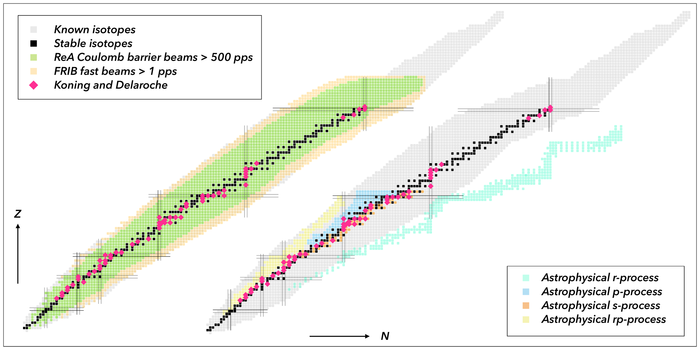
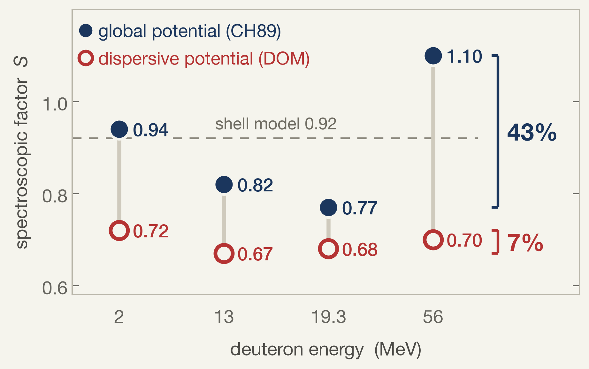
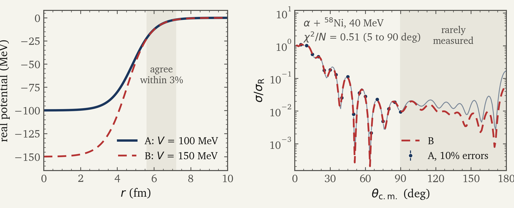
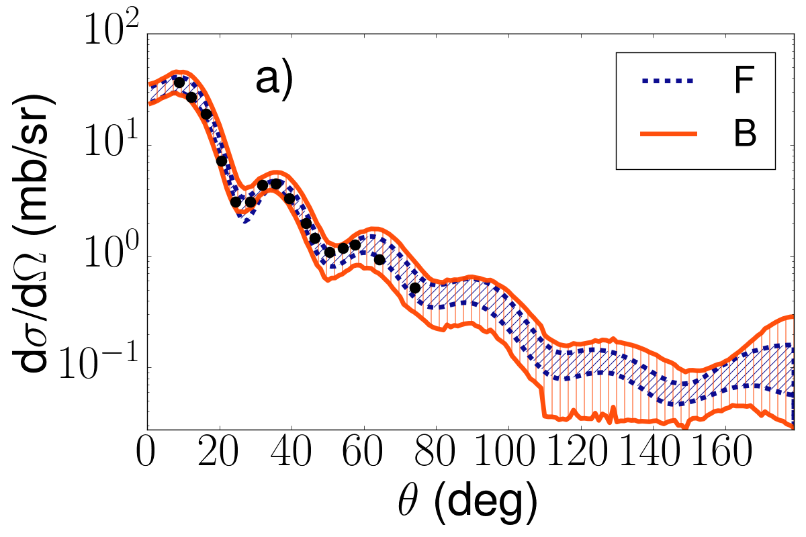
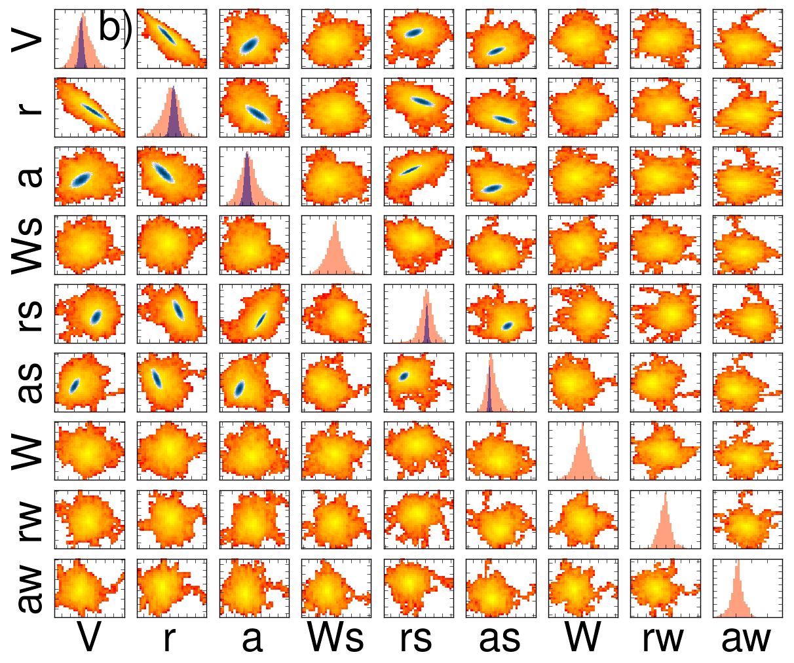
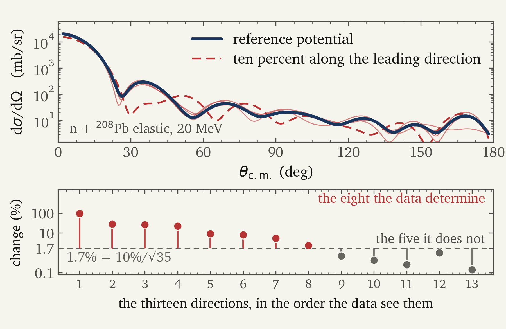
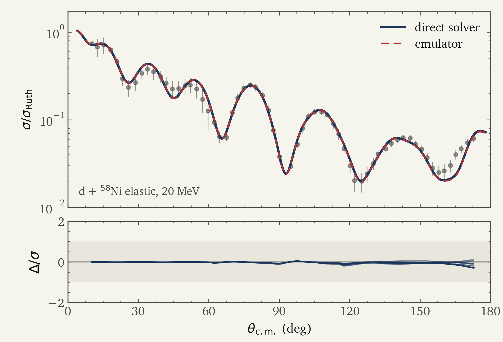
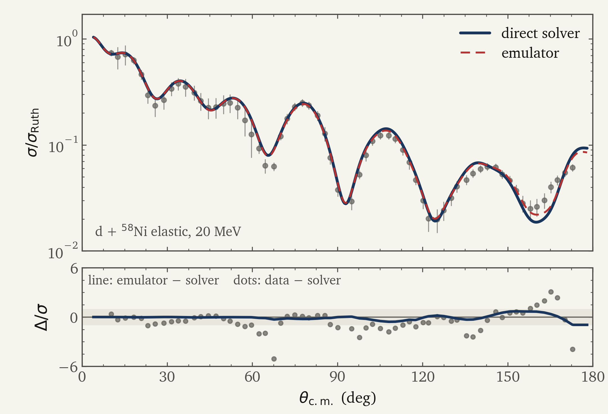
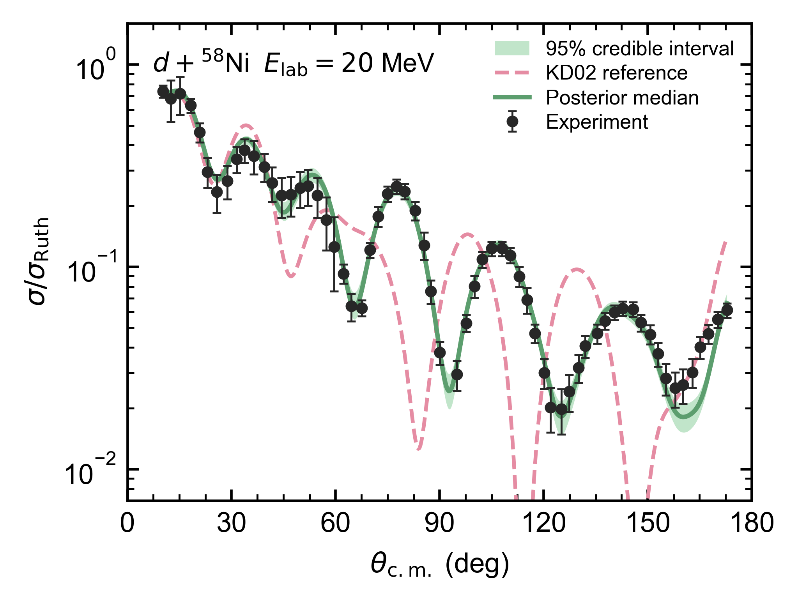
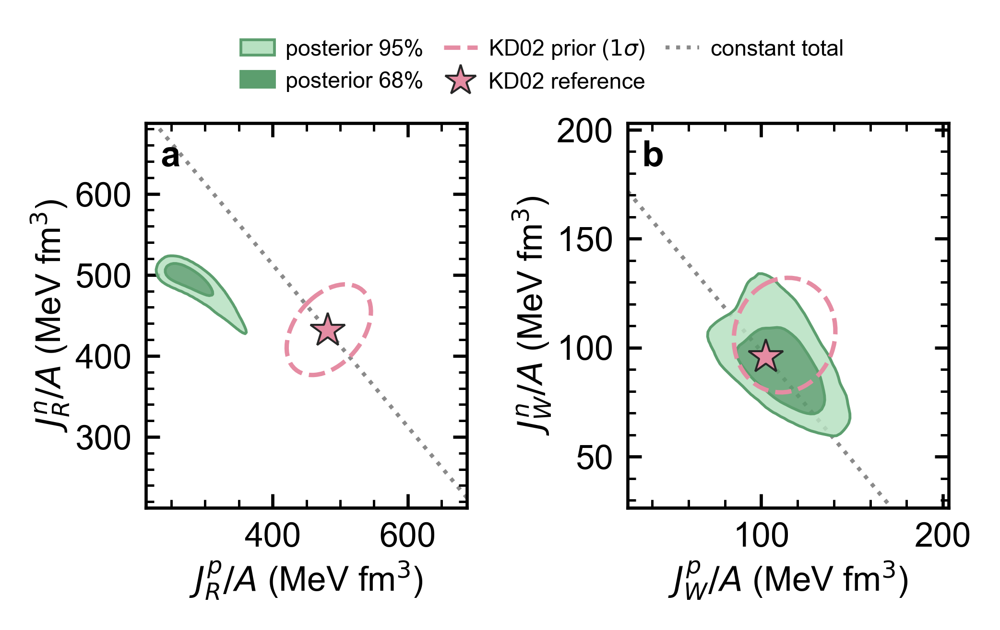

DREB 2026 SHENZHEN · NOVEMBER 2026

<h1 class="cover-title">Differentiable emulation</h1>

Full Bayesian calibration of coupled-channel reaction models

Jin Lei

Tongji University, Shanghai Southern Center for Nuclear-Science Theory, IMP, CAS, Huizhou

NSFC 12475132 · 12535009

<LiveOnly><CoverUQ /></LiveOnly>

<!--
Central message: what the talk is, in one line, before any machinery.

Talking points:
- This is a methods talk about how a coupled-channel reaction model gets calibrated,
  and it is deliberately framed as a physics problem rather than a statistics problem.
- Twenty minutes, one argument: the reaction model in the denominator of every
  extraction is not determined by the data, full Bayesian calibration is the honest
  way to say what the data do determine, and it is now affordable.

Timing target: 20 seconds.

Transition: start where the audience lives, with the extraction they all perform.
-->

---

I · Why a Bayesian analysis

# Rare isotopes are reached through reactions

Pink diamonds: nuclei used to fit the Koning-Delaroche potential. Left: reach of FRIB beams. Right: astrophysical r-, p-, s- and rp-process paths. Figure from Hebborn et al., J. Phys. G 50, 060501 (2023).

what this means

- Spectroscopic factors, ANCs, capture rates far from stability: read off reactions through a model.
- Its optical potentials there are mostly <b>extrapolations</b> from the stable valley.

“The field is ripe for merging … with experimental data within a <b>Bayesian analysis</b>.”

Hebborn et al., J. Phys. G 50, 060501 (2023), outlook.

An extrapolated potential is only as useful as <b>its error bar</b>.

<!--
Central message: the big picture. The rare-isotope programme measures reactions on nuclei far
from stability, and every number it extracts goes through a reaction model whose optical
potentials were fitted near stability.

Figure explanation (Hebborn et al. 2023, Fig. 1 of the optical-potential white paper):
- Both panels are the chart of nuclides. Black: stable isotopes. Pink diamonds: the nuclei
  whose data were used to fit Koning-Delaroche.
- Left: green and yellow are the reach of FRIB reaccelerated and fast beams.
- Right: the astrophysical process paths; the r process runs far on the neutron-rich side.
- The authors' own caption: the diamonds highlight "the dramatic extrapolations made".

Talking points:
- Spectroscopic factors, asymptotic normalizations, neutron-capture rates for the r process:
  far from stability all of them are reaction-model outputs.
- Elastic data are scarce away from stability, so global potentials are mostly extrapolated
  there (the white paper: fitted primarily to stable nuclei).
- So the question is not only "what is the best potential" but "how wrong can it be", and
  the community white paper names Bayesian analysis as the route (outlook section). The
  BAND collaboration was set up for exactly this across nuclear physics.

Timing target: 1 minute 15 seconds.

Transition: to see why the error bar matters, look at what an extraction actually does.
-->

---
clicks: 4
class: scene-slide
---

I · Why a Bayesian analysis

# Extracting S means normalizing a calculation

One measured angular distribution, two global nucleon potentials: ⁴⁸Ca(d,p)⁴⁹Ca at Ed = 10 MeV.

<LiveOnly><TransferScene :step="$clicks" :height="372" /></LiveOnly>

<!--
Central message: S is measured divided by calculated, and the calculated part carries the
optical potential. A real case, computed for this talk.

Setup (figures/run_dp48ca.py, figures/make_dp48ca.py):
- Data: Brown, Denning, Macgregor, NPA 153, 145 (1970), EXFOR F0910020 (relative angular
  distribution, c.m.), put on an absolute scale with the same paper's 36.6 mb/sr at 12.5 deg
  lab (F0910027; 10 percent systematic).
- Calculation: finite-range ADWA (Johnson-Soper, U_n + U_p at E_d/2), post form with remnant,
  2p3/2 neutron in a WS well (r0 1.25, a 0.65). The ONLY change between the two curves is the
  global nucleon potential, KD02 or CH89. Converged to 0.1 percent.
- S fitted over theta_cm <= 25 deg (the forward peak).

Left panel: every length is in fm from this calculation (figures/export_dp48ca_scene.py).
- Glass shell: half-value radius of the KD02 real potential, 4.33 fm.
- Blue cloud: |psi|^2 of the 2p3/2 bound state used in the calculation (m = j, drawn in the plane).
- Gold band: transfer region DEFINED by a radial cutoff scan (FRESCO cutc: remove the transfer
  coupling inside R). 90 percent of sigma survives a cut at 6.5 fm, 10 percent at 9.3 fm, so
  80 percent comes from 6.5 to 9.3 fm (CH89: 6.7 to 9.5). Inside 5.5 fm the net contribution is
  slightly negative (interference). Same diagnostic as the IAV-cut of Liu Junzhe et al.
- Red glow: W(r) of the adiabatic deuteron potential, one log scale for both potentials.
  Rings: W = 1 MeV at 6.8 fm (KD02) and 7.2 fm (CH89).
- Particles: a deuteron at impact parameter b survives with the eikonal T(b) = exp(-(2/hbar v)
  int W dz) of the potential shown (T(7 fm) = 0.69 KD02, 0.47 CH89; straight line, no Coulomb)
  and transfers with a probability following the cutc profile. Event rates are illustrative.

Say once, aloud, before anyone asks: the absolute S here (about 0.5) is lower than the ~0.8 to
1.1 of the next slide because the bound-state well is held fixed at r0 1.25, a 0.65; only the
ratio between the two potentials is the point.

Click 0: the measurement. Protons counted versus angle.
Click 1: the neutron is captured well outside the nucleus (gold band), into the blue orbital.
  Right: the two S = 1 calculations; CH89 is 14 percent lower at the peak (64.0 vs 74.5 mb/sr).
Click 2: KD02 absorption. Click 3: CH89 absorption, further out. Real parts nearly equal.
  Swapping only the deuteron-channel potential moves the peak 74.5 -> 65.7 (12 percent); only
  the proton channel, 74.5 -> 72.6 (2.5 percent). The difference is the deuteron absorption.
  The two cutc curves agree outside 9 fm: the difference is built between 6 and 8 fm.
Click 4: normalize each to the data: S = 0.49 (KD02) and 0.58 (CH89), 17 percent apart. The
  scaled curves are indistinguishable.

Caveats if asked:
- CH89 at 5 MeV (the nucleon energy in the deuteron channel) is outside its fitted range
  (10 to 65 MeV): it is an extrapolation, which is itself the point of slide 2.
- Absolute S here is about 0.5; it depends also on the bound-state well (r0, a), which is held
  fixed. The slide is about the ratio, not the absolute value.
- Deuteron spin-orbit dropped in the adiabatic potential, same for both.

Transition: one reaction at one energy; the next slide shows the published systematics across
four energies.

Timing target: 1 minute 30 seconds.
-->

---

I · Why a Bayesian analysis

# The extracted answer depends on the potential

48Ca(d,p)49Ca g.s., measured at four deuteron energies, each analyzed with two optical potentials.

<b>Precision</b>: how closely repeated extractions agree (their spread).

<b>Accuracy</b>: how close they are to the true value.

CH89 · low precision

43% spread

The same level moves with beam energy alone.

DOM · high precision

7% spread

Accurate? 25% below the shell model. Quenching or bias needs a reference.

S: Nguyen et al., PRC 84, 044611 (2011), Table II. Shell model: Tsang, Lee, Lynch, PRL 95, 222501 (2005).

A small spread is <b>precision</b>, not <b>accuracy</b>: the second needs a reference, and S has no unique one.

<!--
Central message: one published example shows the extraction moving under the optical
potential alone.

Figure explanation (the two series of the paper's Table II, redrawn at their four energies):
- The blue series is a global nucleon optical potential, read at half the deuteron energy,
  the standard adiabatic choice: 0.94, 0.82, 0.77, 1.1 at 2, 13, 19.3 and 56 MeV.
- The red series is the dispersive optical model (DOM), whose real and imaginary parts are
  linked by a subtracted dispersion relation (their Eq. 9): 0.72, 0.67, 0.68, 0.70.
- Both use the same overlap function, so the entire difference between the series is the
  potential. That is what the caption says and it is the point of the slide.
- Precision vs accuracy (the takeaway). Precision is the spread: CH89 43 percent, DOM 7
  percent. Accuracy is distance from a true value, and S is not an observable, so it needs a
  stated reference. Dashed line: large-basis shell model (Oxbash) 0.92 for 49Ca g.s., Tsang,
  Lee, Lynch, PRL 95, 222501 (2005), Table 1 (same paper extracts 0.68 +- 0.07 with a CH89
  adiabatic prescription). DOM sits about 25 percent below the shell model; Nguyen et al. say
  their DOM values are more in line with (e,e'p), i.e. with the usual quenching. So DOM is
  precise, and whether it is accurate depends on the reference.
- If asked about 2 MeV (below the Coulomb barrier, where little optical-potential dependence
  is expected, yet 0.94 vs 0.72): these are Nguyen et al.'s values, not reanalyzed here; the
  two series also differ in the energy dependence they put into the nucleon potentials. Say
  that plainly and do not improvise a mechanism.
- TRAP if asked: the mean of the four CH89 values is about 0.91, next to 0.92. That is a
  coincidence of four scattered points, not evidence that CH89 is accurate on average. Do not
  say it.
- The brackets on the right of the figure are each series' own spread across the four
  energies: 43 percent for CH89 (0.77 to 1.10), 7 percent for DOM (0.67 to 0.72). Neither is a
  distance between the two series at one energy.
- The closer (e,e'p) agreement in the paper comes after DOM overlap ingredients are also used,
  not for this DOM+WS series. Do not attribute it to the plotted red points.

Talking points:
- 48Ca is doubly magic and this is the textbook (d,p) case, so nobody in the room will
  think the target was chosen to make the point.
- The DOM series is much flatter in energy. Do not claim it is a better elastic fit or that
  dispersion alone causes the stability; the paper does not isolate that.
- Do not overclaim: this is one reaction, and the paper is about transfer. The point here
  is only that the denominator of the ratio is not pinned down.

Timing target: 1 minute 15 seconds.

Transition: so the potential is underdetermined, and the next slide says why, in physical
terms rather than statistical ones.
-->

---

I · Why a Bayesian analysis

# The potential is not determined by the data

FRESCO, illustrative Woods-Saxon potentials, not fitted to real data. B: depth fixed at 150 MeV, radius, diffuseness and absorption refitted to A (points: every 5°, 10% errors). Strong absorption: the data see the surface, and discrete families of potentials fit them. Igo, Phys. Rev. 115, 1665 (1959); Drisko, Satchler and Bassel, Phys. Lett. 5, 347 (1963).

Depths 50% apart, same angular distribution to 90°: the data fix <b>the surface</b>, not the potential.

<!--
Central message: the non-uniqueness is a property of the object, not a failure of anyone's
fitting procedure. Shown here as a real calculation, not a sketch.

Figure explanation (computed with FRESCO, figures/run_igo_ambiguity.py; both potentials are
illustrative, neither is fitted to measured data):
- Left: two real potentials. A: V = 100 MeV, r = 1.25 fm, a = 0.60 fm, volume W = 20 MeV.
  B: depth held at 150 MeV; r = 1.170 fm, a = 0.618 fm and W = 22.5 MeV refitted so that B
  reproduces A's angular distribution. They agree to 3 percent only between about 5.6 and
  7.2 fm, the strong-absorption surface; at r = 2 fm they differ by 49 percent, and the real
  volume integrals per nucleon are 942 against 1193 MeV fm^3.
- Right: alpha + 58Ni elastic at 40 MeV, ratio to Rutherford. Points are A every 5 degrees
  from 5 to 90 with 10 percent errors; the dashed line is B. chi2/N = 0.51 on those 18
  points. Beyond 90 degrees, where alpha data are rarely taken, the two separate
  (chi2/N = 11 over 5 to 175).
- This is the discrete ambiguity of strongly absorbed projectiles (Drisko, Satchler and
  Bassel 1963): V = 100 and 150 MeV are neighbouring families. An intermediate depth,
  130 MeV, does NOT fit (chi2/N = 7.5 with r, a, W free). Say this if asked: the families
  are discrete, the surface is what is fixed.
- Numerics: A and B are stable to 1e-3 and 2e-3 in the cross section under hcm 0.05 -> 0.03,
  rmatch 25 -> 30, jtmax 60 -> 70.
- Control: for n + 208Pb at 20 MeV with KD02 (weak absorption) the same exercise fails even
  for a 10 percent depth change (chi2/N about 2.5 with r and a free). Nucleon elastic
  scattering sees more of the interior; that matches the Fisher slide, 8 of 13 directions
  resolved. Do not claim the alpha picture holds for nucleons.

Talking points:
- Feshbach projection: the optical potential is what is left of a many-body problem after
  the other channels (the Q space) are projected out, so it is complex, energy dependent and
  nonlocal. Causality links the energy dependence of the real part to the imaginary part.
- Say the conclusion as physics: the data fix the surface, and an extraction that needs the
  potential elsewhere inherits the ambiguity.
- If someone points out that transfer is surface dominated, agree. The extraction still moves
  because energy dependence, nonlocality and the overlap enter beyond the elastic surface
  match. Do not claim the interior is what transfer probes.

Timing target: 1 minute 45 seconds.

Transition: so how has the field answered this? That is the next block.
-->

---

I · Why a Bayesian analysis

# Same data, same model: the Bayesian band covers better

48Ca(d,p) at 19.3 MeV, 95% bands from the same data and model. F: frequentist, χ² around the best fit. B: Bayesian posterior. Figure from King et al., PRL 122, 232502 (2019).

same data, same model, different statistics

44–92%

of elastic data inside the nominal 95% frequentist bands (nine data sets); Bayesian: 76–100%. King et al. 2019

8.3–34% → 30–158%

(d,p) band widths at the peak, before and after angle correlations enter χ². King et al., PRC 98, 044623 (2018)

$p(\theta \mid \text{data}) \propto p(\text{data} \mid \theta)\, p(\theta)$ → band on $\sigma_\text{calc}$ → band on $S$

The uncertainty of an extraction is itself a result, and it needs <b>calibrated statistics</b>.

<!--
Central message: this is the answer to "why Bayesian". A best fit plus a chi-square error bar
is the classical answer, and when it was tested head to head it undercovered badly.

Figure explanation (King et al. PRL 2019, Fig. 3a):
- Black points: 48Ca(d,p) data at 19.3 MeV. Blue dotted band F: frequentist 95% band, from
  the chi-square around the best fit. Orange band B: Bayesian 95% band from the posterior.
- Same elastic data, same model, same assigned 10% errors; the interval constructions differ,
  and some frequentist parameters had to be fixed. Transfer predictions are normalized at the
  peak.
- The Bayesian band is wider, especially past 80 degrees. The data stop near 75 degrees, so
  coverage is a statement about the elastic sets, not about this backward region.

Talking points:
- Coverage is the referee: across nine elastic data sets the nominal-95% frequentist band
  contained 44 to 92 percent of the data, the Bayesian one 76 to 100 percent (their Table I).
- King 2018 shows the same lesson inside the chi-square world: once angle-angle correlations
  are put into the fit, (d,p) band widths at the peak go from 8.3 to 34 percent to 30 to 158
  percent (their Table VI). The naive error bar was far too narrow.
- Coverage here is the fraction of the fitted data inside the band; even the Bayesian case
  has one set at 76 percent. Do not claim a posterior is calibrated in general.
- The formula: prior times likelihood gives the posterior; push it through the reaction
  model to get a band on the calculated cross section, hence on S.

Timing target: 1 minute 30 seconds.

Transition: this lesson is what moved the field to Bayesian optical potentials.
-->

---

II · How it is done now

# Bayesian optical potentials: the established programme

<b>2017</b>χ² bands for optical-model fits. <i class="citation">Lovell et al., PRC 95</i>

<b>2018</b>MCMC posteriors propagated to transfer: 25–100%. <i class="citation">Lovell and Nunes, PRC 97</i>

<b>2019</b>Bayesian against frequentist, head to head. <i class="citation">King et al., PRL 122</i>

<b>2019</b>Which measurement reduces the uncertainty. <i class="citation">Catacora-Rios et al., PRC 100</i>

<b>2023</b>Global KD and CH89 with uncertainties (KDUQ, CHUQ). <i class="citation">Pruitt et al., PRC 107</i>

<b>2025</b>Systematic propagation to transfer observables. <i class="citation">Hebborn and Nunes, Front. Phys. 13</i>

<b>2026</b>ELM: a global potential for rare isotopes, with (p,n). <i class="citation">Beyer and Nunes, arXiv:2603.28599</i>

Posterior of nine Woods-Saxon parameters, 48Ca(p,p) at 14 MeV. Orange: Bayesian. Blue: frequentist. Figure from King et al. (2019).

The posterior is the object this programme reports, and its <b>correlations</b> are part of the answer.

<!--
Central message: the Bayesian optical-potential programme exists, works, and is the state of
the art. Give its history in the right order.

Talking points:
- 2017: Lovell et al. was frequentist, chi-square bands, the starting point.
- 2018: Lovell and Nunes, Bayesian (MCMC) optical-potential posteriors, propagated
  to transfer; uncertainties of 25 to 100 percent depending on the reaction.
- 2019: King et al., the head-to-head of the previous slide; Catacora-Rios et al. asked which
  measurement would shrink the posterior most.
- 2023: Pruitt, Escher and Rahman put uncertainties on the two global workhorses, KDUQ and
  CHUQ.
- 2025 and 2026: systematic propagation to transfer (a 48Ca study), and ELM, a global
  potential aimed at rare isotopes with (p,n) charge exchange in the calibration.

Figure explanation (King et al. 2019, Fig. 2b): diagonal panels are marginal posteriors,
off-diagonal ones pairwise correlations. Orange is Bayesian, blue frequentist. Note the
strong Bayesian correlation between real depth V and radius r: that is the Igo ambiguity of
the earlier slide, now as a posterior shape. Other pairs are weakly correlated.

Timing target: 1 minute 30 seconds.

Transition: how do these analyses actually sample the posterior?
-->

---

II · How it is done now

# The recipe: a cheap model and a gradient-free walk

how the posterior is sampled

<svg viewBox="0 0 660 150" style="width: 100%; height: 8rem;">
  <defs><marker id="ar6" viewBox="0 0 10 10" refX="9" refY="5" markerWidth="7" markerHeight="7" orient="auto"><path d="M0 0 L10 5 L0 10 z" fill="#1B365D"/></marker></defs>
  <g font-size="19px" font-family="Newsreader, Georgia, serif" text-anchor="middle">
    <rect x="2" y="14" width="140" height="50" rx="6" fill="#E4ECF5" stroke="#1B365D"/><text x="72" y="46" fill="#1B365D">propose θ</text>
    <rect x="174" y="14" width="140" height="50" rx="6" fill="#E4ECF5" stroke="#1B365D"/><text x="244" y="46" fill="#1B365D">solve</text>
    <rect x="346" y="14" width="140" height="50" rx="6" fill="#E4ECF5" stroke="#1B365D"/><text x="416" y="46" fill="#1B365D">compare</text>
    <rect x="518" y="14" width="140" height="50" rx="6" fill="#E4ECF5" stroke="#1B365D"/><text x="588" y="46" fill="#1B365D">accept / reject</text>
  </g>
  <g stroke="#1B365D" stroke-width="2" fill="none" marker-end="url(#ar6)">
    <path d="M142 39 L172 39"/><path d="M314 39 L344 39"/><path d="M486 39 L516 39"/>
    <path d="M588 64 L588 104 L72 104 L72 67"/>
  </g>
  <text x="330" y="136" font-size="18px" fill="#b53333" text-anchor="middle" font-family="Newsreader, Georgia, serif">repeat until converged; no likelihood gradient</text>
</svg>

<b>Why it works</b>

Single-channel optical-model solves are cheap, so many random steps are affordable, even when one likelihood needs many targets and energies.

potential parameters (hyperparameters not counted)

| | | |
|---|---|---|
| <b>9</b> | one Woods-Saxon set | King 2019 |
| <b>21</b> | ELM, global | Beyer 2026 |
| <b>46</b> | KDUQ, global | Pruitt 2023 |

Different models and data sets. Parameter counts are not a performance comparison.

The proven route: a <b>cheap forward model</b>, sampled <b>without gradients</b>.

<!--
Central message: describe the sampling recipe, because the difficulties of Act III come from
exactly this recipe.

Talking points:
- Propose, solve, compare, accept or reject; every step is one reaction solve, and no step
  uses a derivative. KDUQ, for example, used the affine-invariant ensemble sampler (emcee)
  for 46 parameters.
- The parameter column: nine in a single-system Woods-Saxon fit, 21 in ELM, 46 in KDUQ.
- Why it works: the forward model is a single-channel optical-model solve, which is cheap.
  Hold on to that word; Act III takes it away.

Timing target: 1 minute.

Transition: the second ingredient the field developed is the emulator.
-->

---

II · How it is done now

# Emulators make each solve cheap

what a reduced basis gives you

<svg viewBox="0 0 560 190" style="width: 100%; height: 9.5rem;">
  <defs><marker id="ar7" viewBox="0 0 10 10" refX="9" refY="5" markerWidth="7" markerHeight="7" orient="auto"><path d="M0 0 L10 5 L0 10 z" fill="#1B365D"/></marker></defs>
  <rect x="10" y="12" width="150" height="150" fill="#E4ECF5" stroke="#1B365D" stroke-width="1.5"/>
  <text x="85" y="84" font-size="20px" fill="#1B365D" text-anchor="middle" font-family="Newsreader, Georgia, serif">full system</text>
  <text x="85" y="110" font-size="18px" fill="#66655f" text-anchor="middle" font-family="Newsreader, Georgia, serif">dimension N</text>
  <path d="M180 87 L350 87" stroke="#1B365D" stroke-width="2" marker-end="url(#ar7)"/>
  <text x="265" y="72" font-size="17px" fill="#66655f" text-anchor="middle" font-family="Newsreader, Georgia, serif">project onto n</text>
  <text x="265" y="114" font-size="17px" fill="#66655f" text-anchor="middle" font-family="Newsreader, Georgia, serif">stored solutions</text>
  <rect x="380" y="57" width="60" height="60" fill="#1B365D" opacity="0.85"/>
  <text x="410" y="145" font-size="18px" fill="#1B365D" text-anchor="middle" font-family="Newsreader, Georgia, serif">n ≪ N, per θ</text>
</svg>

- Established for scattering, optical models and coupled channels. Gaussian-process emulators have also enabled Bayesian breakup analysis.

Frame et al., PRL 121, 032501 (2018). Melendez et al., PLB 821, 136608 (2021). Duguet et al., Rev. Mod. Phys. 96, 031002 (2024). Odell et al., PRC 109, 044612 (2024). Catacora-Rios et al., PRC 113, 044623 (2026). Sürer et al., PRC 106, 024607 (2022).

<b>Where gradients are already used</b>

Chiral nucleon-nucleon interactions, sampled with Hamiltonian Monte Carlo. Svensson et al. 2022–2024. The couplings multiply fixed operators, so emulator derivatives follow analytically. Melendez et al. 2021. Photonuclear emulator with NUTS. Walton et al., PRC 114, 034621 (2026).

<b>Cited optical-potential fits: gradient-free</b>

A likelihood value tests a proposal. A likelihood gradient guides the next step.

Cheaper solves made calibration <b>possible</b>; the optical-potential samplers cited here use <b>no gradient</b>.

<!--
Central message: emulators solved the cost of one evaluation. Gradient samplers exist where
the structure allows it (chiral EFT; a differentiable photonuclear emulator with NUTS, Walton,
Khatiwada and Kawano, PRC 114, 034621 (2026)), but the optical-potential calibrations
cited here are gradient-free. Non-affine emulators exist (Odell et al. 2024, ROSE, single-channel optical
models; Catacora-Rios et al. 2026, coupled channels; both cited on the slide), but none has been used to obtain a joint HMC
posterior for a coupled-channel reaction observable. If asked "why not their emulator?": the
new piece here is the exact gradient of the emulated posterior, built from operators exported
by an existing solver without rewriting it, plus direct-solver checks at posterior points.

Talking points:
- Be fair: eigenvector continuation and reduced bases changed what is affordable; Sürer et
  al. already did a Bayesian breakup analysis with Gaussian-process emulators in 2022.
- The chiral case is the instructive contrast: low-energy constants multiply fixed
  operators (affine), so the emulator derivative is analytic and HMC is routine there.
- The optical-potential calibrations cited remain gradient-free; do not claim no one has ever
  used HMC on an optical potential. Distinguish the cost of an evaluation
  (emulators attack it) from the number of evaluations (set by how the sampler moves).
- Do not claim emulation is insufficient in general; claim it is insufficient alone.

Timing target: 1 minute 15 seconds.

Slide 13's takeaway names "non-affine emulators": Odell et al. 2024 (ROSE, single-channel) and
Catacora-Rios et al. 2026 (coupled channels), both cited here. Point back to them there.

Transition: now move from one channel to coupled channels, and the recipe stops working.
Three difficulties.
-->

---

III · What is hard

# Difficulty 1: one coupled-channel solve is expensive

The deuteron breaks up on the way in: ADWA folds this in adiabatically; CDCC treats the continuum explicitly, at a price.

01 / one solve

29 min

On 16 cores. Up to 151 channels per total-J block; dense complex systems of dimension ~2.7×104.

02 / one campaign

~105

Likelihood evaluations for one calibration.

03 / product

~106

Core-hours. Direct sampling is out of reach.

d + 58Ni at 20 MeV · continuum bins to 20 MeV, ℓ ≤ 4 · J ≤ 30

Coupled channels need an emulator, and it must be <b>trusted where the sampler goes</b>.

<!--
Central message: the "cheap forward model" of the established recipe does not exist for
coupled channels.

Talking points:
- One converged CDCC solve of this model space: about 29 minutes on 16 cores, roughly 7.7
  core-hours per likelihood evaluation.
- 1e5 is a floor, not an estimate: our own gradient-free ensemble run on the emulator used
  6.4e6 calls, and NUTS 6e5 gradients. The real gap is larger than the slide says.
- A gradient-free campaign is of order 1e5 evaluations; the product is of order 1e6
  core-hours. This is the paper's own cost accounting.
- So an emulator is mandatory. Plant the second half of the takeaway: an emulator that is
  wrong does not crash, it returns a smooth slightly wrong curve. That comes back in Act V.

Timing target: 1 minute.

Transition: even with a cheap emulator, the posterior itself is hard to explore.
-->

---

III · What is hard

# Difficulty 2: very unequal sensitivities

one elastic calculation

n + 208Pb, 20 MeV, KD02. Step the potential 10% along each of its 13 sensitivity (Fisher) directions; record how far the curve moves.

600×

Between the largest change (95%) and the smallest (0.15%).

<b>8 of 13 directions resolved</b>
To 10%, with 10% data errors. The other five, mostly the absorption, barely move the curve.

The measured directions <b>mix parameters</b>, so the posterior is a correlated ridge.

<!--
Central message: the information the data carry about the potential is anisotropic, which is
the physical reason a posterior over many parameters is a ridge.

Figure explanation (n + 208Pb elastic at 20 MeV, KD02 reference, 13 parameters, 35 angles;
computed for this talk):
- Top panel. Bold: the elastic angular distribution at KD02. Red dashed: the potential moved
  ten per cent (in log space) along the direction the data see best; the diffraction pattern
  goes out of phase. Thin curves: the same step along other directions.
  Directions 9 to 13 move the curve by less than 1.7 per cent: those are the ridge.
- Lower panel. Each dot is the RMS change of the curve from that ten per cent step. Leading
  direction 95 per cent, last one 0.15 per cent: a factor of about six hundred.
- The line at 1.7 per cent is derived, not chosen: a step eps changes the curve by
  eps sqrt(lambda/n) at RMS over n = 35 angles, so a direction resolved exactly at ten per
  cent sits at 10/sqrt(35) = 1.7 per cent. Eight above, five below.

Talking points:
- Define the matrix in one clause: Fisher information of the angular distribution with
  respect to the potential parameters, under the data errors; eigenvectors are directions in
  parameter space.
- Physics payoff, say it slowly: the data determine the real radius against the depth, the
  surface absorption geometry and the real diffuseness; they leave the volume absorption, the
  imaginary geometry and the imaginary spin-orbit nearly free.
- One spoken bridge: the same thing shows up in the real calibration as the p-n ridge on
  slide 20.
- Say "a different 13": these are 13 single-channel potential parameters, not DREAM's 13
  sampled coordinates.
- Uneven response means a correlated posterior; a sampler that ignores the correlation pays
  for it. One target, one energy: do not generalize the 8 of 13 beyond this case.

Timing target: 1 minute 15 seconds.

Transition: so state the obstruction precisely, in one slide.
-->

---
clicks: 3
class: scene-slide
---

III · What is hard

# Difficulty 2: the posterior is a curved ridge

Correlated parameters favor a narrow curved region: a valley in −log p, a ridge in p. Gradient-based proposals use its local geometry.

<HmcScene :step="$clicks" :height="322" />

<b>Gradient samplers follow this geometry</b>; their gain is expected to grow with dimension.

<!--
Central message: gradients help construct proposals in a correlated parameter space.
This is a schematic two-parameter density, not the 13-coordinate (18-parameter) posterior of the calculation.
The figure is live (public/hmc_ridge.html, source figures/hmc_ridge/): the block is carved to height
U = -log p, so HMC is literally a frictionless puck sliding on it. Each click runs one sampler;
the audience can drag to turn the block. Focus returns to the deck after a drag, so the arrow keys
keep advancing slides. "Gradient field" shows the -grad U arrows if asked.
Click 0: identify axes and equal-density contours (1, 2, 3 sigma). Several correlated combinations fit similarly.
Click 1: eight random-walk proposals. Red crosses are proposals into low-density regions, rejected. Short steps improve acceptance but explore slowly.
Click 2: one HMC trajectory. Momentum plus the slope carry the puck along the ridge; every leapfrog step costs one gradient (counter top right). It is not gradient ascent. An acceptance check follows.
Click 3: NUTS, full doubling tree. The ring marks the start; the trajectory grows by 1, 2, 4, ... steps, each time forward or backward in time at random, until it turns back at both ends. A new half that turns back inside itself is dropped (red dashed). One state of the kept trajectory is drawn with weight exp(-H) (multinomial NUTS, no separate accept/reject). Checked: 10^5 transitions reproduce the exact means and variances to 1-2 percent.
Do not infer an efficiency ratio from this schematic or from the counters, and do not say 18 parameters are impossible for an ensemble sampler.
Timing target: 1 minute.
-->

---
clicks: 3
class: scene-slide
---

III · What is hard

# Difficulty 3: geometry changes the operator

Depth scales the radial profile. Radius and diffuseness change its shape; the reduced operator must retain that dependence.

<LiveOnly><MatrixScene :step="$clicks" :height="300" /></LiveOnly>

Non-affine emulators exist; to my knowledge, no coupled-channel <b>HMC posterior</b> yet.

<!--
Central message: optical-model geometry cannot be represented by merely scaling one fixed radial function.
Click 0: define the Woods–Saxon formula and the reference V = 50 MeV, R = 5 fm, a = 0.6 fm.
Click 1: increase V to 65 MeV at fixed R and a. The radial function scales.
Click 2: restore V and move R to 6 fm. The surface moves rather than simply scaling.
Click 3: connect this dependence to matrix elements and likelihood gradients.
The curves are analytic illustrations, not a calibrated potential or a scattering calculation. Affine operator dependence does not imply an affine observable or a simple posterior. Gradient samplers can be used in both cases; the issue here is constructing a differentiable non-affine operator.
Timing target: 1 minute 15 seconds.
Transition: so the requirements are three: cheap, differentiable, and checked against the
solver. DREAM is built to meet exactly these.
-->

---

IV · Why DREAM

# DREAM: one answer to each difficulty

Differentiable Reduced-basis Emulator with Automatic gradients for Markov-chain inference

| difficulty | DREAM's answer |
|---|---|
| expensive solve | reduced basis built from the direct solver: ≈103 direct-solve equivalents offline, milliseconds per evaluation online |
| geometry reshapes the operator | export operators on geometry grids, compress them by SVD, rebuild them online |
| no derivatives | reduced model built from differentiable operations: exact emulator gradient for ≈1.2 extra forward costs |
| correlated ridge | No-U-Turn Sampler, the adaptive form of Hamiltonian Monte Carlo (expected to pay as the dimension grows; near parity at 13 coordinates) |
| silent emulator error | direct-solver checks at posterior points; enrich the basis when they fail |

Builds on Lei, PRC 113, 024614 (2026), the direct solver, and PRC 113, 044610 (2026), the reduced-basis emulator (220× per solve).

Do not differentiate the legacy solver. <b>Differentiate its compressed operator.</b>

<!--
Central message: DREAM is not a new sampler or a new emulator; it is the combination that
removes each obstacle of Act III, one row per difficulty.

Talking points:
- Read the table row by row, pointing back to the slide where each difficulty appeared.
- Row 1: the solver is used only offline; the full offline database costs about a thousand
  direct solves, versus about 1e5 for a gradient-free campaign on the solver.
- Row 2: the key idea. Geometry enters nonlinearly, so the solver exports the operator on a
  grid in radius and diffuseness; SVD keeps 8 to 15 matrix modes per form factor.
- If asked about accuracy versus cost (the paper's CAT figure, as in Odell 2024 and
  Catacora-Rios): every lower rank is an exact truncation of the production basis, so the
  curve is cheap to draw. Worst chi2_emu over the 13 posterior points falls from 151 at
  n_b = 20 to 0.30 at n_b = 180; both acceptance criteria are first met at n_b = 140
  (chi2_emu <= 0.43, worst angle 0.32 sigma). Production carries a margin of about 1.4 at 1.3
  times the cost of the smallest passing rank. Online cost grows only 3.2x (4.4x with
  gradient) while n_b triples: accuracy is cheap online, the snapshots are the expense.
- If asked how accurate the gradient is against the true model: NUTS uses the exact gradient
  of the emulated posterior (AD vs finite differences agree to 1e-6). Against direct-CDCC
  central differences the emulator derivative of the cross section agrees to 3.9 to 4.7
  percent, a solution-space plateau; it does not affect sampling, which only needs the
  gradient of the posterior it samples.
- Row 3: the reduced solve is written in differentiable operations, so reverse-mode
  automatic differentiation returns the exact gradient of the emulated posterior; measured
  cost 7.3 ms against 3.3 ms forward on one A800.
- Row 5 is part of the method, not a check added afterwards. Act V shows why.
- The two earlier papers: the exact solver every claim is checked against, and the reduced
  basis that made one solve 220 times cheaper. Neither returned a derivative.

Timing target: 1 minute 30 seconds.

Transition: here is the data flow, offline and online.
-->

---
clicks: 5
class: scene-slide
---

IV · Why DREAM

# The construction

From reference calculations to cross sections and likelihood gradients: the complete data flow.

<LiveOnly><ConstructionScene :step="$clicks" :height="368" /></LiveOnly>

Compress offline. Differentiate and sample online. Verify against the solver.

<!--
Central message: show explicitly what is computed offline and what happens at each sampler evaluation.
Click 0: read the two rows, offline construction and online evaluation.
Click 1: reference calculations cover parameter points and store solutions and operators.
Click 2: form the reduced basis and the parameter-dependent small operator.
Click 3: NUTS proposes theta; rebuild and solve the small system, then compute the angular distribution.
Click 4: compare prediction with measured data, add the prior, and differentiate the log posterior. The value and gradient return to NUTS.
Click 5: resolve selected posterior points with the reference solver. Compare cross sections and enrich the basis if necessary.
No ring, puck, or physical machine is intended. The diagram labels the actual mathematical objects and the validation loop.
Timing target: 1 minute 30 seconds.
-->
---

V · What DREAM gives

# What it costs, and what it buys

01 / offline

≈1,000
<h3>direct-solve equivalents</h3>
728 snapshots + operator grids, once. 29 min per solve on 16 cores.

02 / online

16,000
<h3>posterior samples</h3>
Four chains, &lt; 1 h on one GPU, 0 divergences, min ESS 1358, R̂ ≤ 1.01. 6×105 gradients; on the direct solver, finite differences would cost 12 extra solves each.

13 sampled coordinates (12 optical + error scale) carrying 18 potential parameters; p–n geometry pairs share a prior quantile

<b>At 13 coordinates the emulator is the win; the gradient is for multi-energy and global fits</b>
In the physical basin, an ensemble sampler on the same emulator matches the NUTS marginals to 1%. NUTS: 2.4× more independent samples per call, near parity per unit compute. The emulator is the speed-up.

Pay for the full model offline. Explore the posterior online.

<!--
Central message: separate the two budgets. The offline budget is large and finite; the online
budget is the one that used to be hopeless.

Talking points:
- Give the offline number plainly. About a thousand direct-solve equivalents (728 snapshots
  over five enrichment rounds, about 5e3 core-hours, plus operator grids) is a real investment
  and the honest price of the method.
- 6e5 gradient evaluations in the production run: on the direct solver each would be a solve
  plus 12 more for finite differences (the error scale beta enters the likelihood
  analytically, so only the 12 optical coordinates need solves). That is the cost argument,
  set against slide 10.
- Sixteen thousand samples in under an hour on one GPU, and say the qualifier: zero
  divergences, which means the sampler found no pathological region.
- Do not present the speed-up as a single headline ratio. The honest statement is the two
  budgets side by side.
- Rehearse one sentence for "why differentiate, then?": "At 13 coordinates the emulator is the
  speed-up; the gradient is built for multi-energy and global fits."
- The "what the gradient buys" box is the question the Bayesian-optical-potential people in the room will ask, so
  answer it before they do. An affine-invariant ensemble sampler (emcee), 64 walkers, 1e5
  steps, on the same thirteen-coordinate posterior and the same emulator: within the physical
  basin it reproduces the NUTS marginals to one percent. NUTS leads by about 2.4 in effective
  samples per model call; a gradient costs 2.2 forward evaluations, so per unit of compute
  they are close to parity. The gain expected at higher dimension (HMC steps grow like d^1/4
  against about d for random walk) is not measured here. Neither sampler crosses between
  separated posterior structures; that is what the direct-solver checks are for.

Timing target: 1 minute.

Transition: an emulator is a numerical instrument. Before reading a posterior off it, check
it against the thing it replaces. The next slide is what happened the one time we were less
careful.
-->

---

V · What DREAM gives

# Verify before reading the posterior

the check

0.30 / 1.0Worst emulator–solver χ² / threshold <b class="mt-2" style="display:block">10 fresh posterior points</b>None used to build the emulator; error-weighted over 64 angles. 13 more in the paper also pass.

<b>Check the posterior region</b>

A smooth emulator error shifts the posterior silently.

Read the posterior <b>only after the solver check</b>.

<!--
Central message: the verification step is part of the method, not a nicety, and the failure
mode it prevents is a silent one.

Talking points:
- State the check concretely: ten parameter points, solved both ways, agreement quoted in
  units of the experimental error so the audience can calibrate it against the fit quality.
  Say that this is a chi-square summed over the 64 angles, not a per-angle number, and give
  the worst case: 0.30, with no single angle off by more than 0.29 of an error. The gate is
  1.0, so this is a factor of three inside it.
- The lower panel has the same meaning on the next slide (emulator minus solver, in error
  units); there the axis is wider because the data residuals are drawn too.
- Explain why silence is the danger. A solver that is wrong usually diverges or returns
  nonsense. An emulator that is wrong returns a slightly wrong smooth curve, and the
  posterior quietly moves.
- "By your own slide 18, a 0.30 discrepancy aligned with the data could move chi2 by up to
  2 sqrt(chi2_data x 0.30), about 7 to 12 here. What does it actually do?" Computed at all 10
  points (figures/curves_gate_v728.npz, assigned errors, beta not applied): emulator minus
  solver chi2 against the data is -1.6 to +3.1, signs mixed (mean +0.6), so about a quarter
  of the bound and no systematic pull towards the data. With beta in the likelihood the effect
  on log p is smaller still. Before the rebuild (slide 18) it was -28, one-signed.
- If asked about model inadequacy: the error scale beta is sampled jointly and absorbs
  model inadequacy only to the extent that it mimics independent fractional noise; correlated
  model-space errors are not represented (slide 20 notes).
- This slide is the bridge. Say that the next slide is what happened before we adopted the
  rule, and that the results after it were produced with the rule in place.

Timing target: 1 minute 15 seconds.

Transition: the rule did not come first. Here is the run that made it a rule.
-->

---

V · What DREAM gives

# A smooth emulator error can fake a better fit

an earlier basis, not yet checked at its own posterior

89 → 117χ² against the data emulator → direct solver, at the same parameters

<b>A quiet bias in the likelihood</b>

An emulator–solver discrepancy of χ² = <b>6.4</b> improves the apparent fit by <b>28</b>.  The error points towards the data.

Build, sample, <b>check at the posterior</b>, enrich. After rebuilding: emulator–solver χ² = 0.08–0.30.

<!--
Central message: this is the methodological slide of the talk. A validation that is
geometrically comfortable is not a validation.

Talking points:
- Provenance if asked for the table: this pair is a development run, not in the paper. A direct
  CDCC solve at that run's posterior mean, recomputed 2026-10-16 from the saved S-matrix and
  that basis's grid. The paper's own verification is the 13-point table.
- "Why didn't your gate catch it?": that basis had been checked only at points away from its
  own posterior; the gate was not yet applied where the sampler went. That is the rule this
  slide earned.
- Tell it as a sequence, not as a confession. The check passed, the physics looked right, and
  the numbers were wrong.
- The lower panel now shows both residuals: line = emulator minus solver, dots = data minus
  solver. Past 145 degrees they move together: that is "the error points towards the data"
  made visible, and it is why a 6.4 disagreement buys 28 (2 x 17.3 = 34.6 alignment term).
- The single most useful sentence: weight the two curves by sin(theta), integrate over the
  measured angles, and they move by 0.84 per cent of each other; at the minima and the back
  angles they differ by up to 0.94 of an error bar. An integrated number hides a structured
  defect, and the likelihood does not. That gap is the whole lesson of the slide.
- Say where the difference is, because it is not uniform: inside a third of an error bar up
  to about 143 degrees, then positive to 0.71 between 145 and 168, then negative to 0.94 at
  173. Where the solver runs above the data the emulator sits below it, and the reverse.
- Give the Delta chi square as the diagnosis: at the posterior mean of that run the emulator
  fits the data better than the model does, 89 where the solver gives 117. A sampler
  optimising the emulator's likelihood will go there. Every number on this slide was
  recomputed on 2026-10-16 from the saved S-matrix of the direct solve and from that run's
  grid, so they can be quoted as read.
- The alignment is the part worth slowing on: 63 percent is 2 sum(r d / sigma^2) against the
  Cauchy-Schwarz bound 2 sqrt(chi2_solver x chi2_emu-solver) = 2 sqrt(117 x 6.4), 34.6 against 54.7
  (89 = 117 - 34.6 + 6.4). This is why a
  disagreement of 6.4 can buy 28: the error is not random noise, it points where the data
  point. That is the general mechanism, not an accident of this system.
- The fix is a self-consistent loop, and say it as a loop: build a basis, find the posterior,
  add points from that posterior, rebuild, re-check. The production basis took five
  enrichment rounds (728 snapshots).
- If asked about multimodality: from the full prior the reduced model also showed a remote
  high-V_v^p structure. Neither NUTS nor the ensemble sampler crosses between the two; 18 of
  64 ensemble walkers sat there while the pooled diagnostics looked fine, and four NUTS chains
  flagged it only through split R-hat 7.35. The direct solver puts it 15 to 33 log-posterior
  units below the physical basin at all 25 points checked, so the reported posterior is the
  basin the solver supports. Lesson: multi-start chains plus direct-solver adjudication.
- This is the slide to slow down on. It is the reason the two slides after it are trustworthy:
  say explicitly that the posterior shown next was produced after this fix, and that the
  0.08 to 0.30 in the takeaway is the paper's 13-point table after the rebuild; the 0.30
  on the previous slide is the worst of 10 further points not used to build the emulator.
  Both are after the rebuild.
- Do not claim credit for the failure being interesting. Claim the rule.

Timing target: 1 minute 15 seconds.

Transition: with the check now sitting where the sampler goes, here is the posterior.
-->

---

V · What DREAM gives

# The posterior in data space

fit to the 64 data points

51.8 → 1.16χ²/N with the assigned errors (β not applied): KD02 in CDCC, not refit → posterior mean. 60 of 64 error bars assigned (EXFOR quotes 4).

<b>Follows the diffraction pattern to 150°.</b>

Band: 95% credible, model curve only; widens beyond 150°. Error bars: 4 from EXFOR, 60 assigned. Dashed: KD02.

Coverage needs the noise-inclusive predictive: <b>the next check</b>, not yet a result.

<!--
Central message: the posterior is best shown in data space (a postdiction on the fitted data), because that is what it is
for.

Figure explanation:
- Black points: the elastic angular distribution, with its experimental uncertainties.
- Green line: the median of the posterior predictive. Green band: its 95 percent credible
  interval.
- Dashed pink: the global reference potential the calibration starts from.
- Read the band width, not the line. Narrow through the forward minima; beyond 150 degrees
  it widens and misses a few points, and that is where the spinless model is weakest.

Talking points:
- Say what a credible interval is in one clause, because the audience is a reaction audience
  and not all of them work in Bayesian terms.
- The interesting feature is the minima. A potential that is slightly wrong misses the
  minima badly, so a narrow band there is a real statement about how much the data
  constrain the prediction. Do not say the band is narrow because the model has eighteen
  parameters; the point is where it is narrow, not that it is.
- If someone asks whether sliders with more parameters would also give a narrow band, the
  honest answer is that a wider model would widen the band, not narrow it, and that the check
  against the solver on the previous slide is what the claim rests on.
- Be descriptive about the dashed curve, not dismissive: it is a global fit to a very large
  body of data, and it was never fitted to this system at this energy. Numbers if asked:
  KD02 chi2/N = 51.8 in this CDCC model, the posterior mean 1.16. That is not a test of KD02
  as a nucleon potential: it is the unrenormalized proton-plus-neutron fold, spinless, failing
  for this deuteron angular distribution, which is why one calibrates.
- First experimentalist question, "how did you assign 60 error bars?": absolute errors of
  0.005, 0.01, 0.02 or 0.05 in sigma/sigma_R, one common value forward, beyond that graded by
  the size of the ratio so the assignment follows the diffraction pattern: median 13 percent
  relative. "Did you inflate errors until chi2 = 1?": no. With all errors halved the sampled
  error scale beta rises to 0.122 +- 0.022 and restores nearly the same total uncertainty:
  the likelihood itself rejects an assignment tighter than the scatter of the data.
- If asked for coverage (slide 6 made coverage the referee): the band drawn is the 95 percent
  credible interval of the model curve, without the measurement noise, so the fraction of
  points inside it is not the right test. The proper check is a posterior predictive with
  the beta-inflated noise; it has not been computed for this talk. What exists: chi2/N = 1.16
  at the posterior mean with the assigned errors alone, and both headline integrals stable
  under halving or doubling those errors. Offer the predictive check as the obvious next
  diagnostic; do not quote a coverage number.
- Do not read the parameter values off this slide. They come next, and they come with a
  warning.

Timing target: 1 minute 15 seconds.

Transition: so which numbers did the data actually determine.
-->

---

V · What DREAM gives

# What the data determine

volume integrals per target nucleon

| | prior | posterior |
|---|---|---|
| real, summed | 915 ± 99 | <b style="white-space: nowrap;">772 ± 13</b> |
| imaginary, summed | 219 ± 40 | <b style="white-space: nowrap;">204 ± 14</b> |

MeV fm3 per nucleon; spinless CDCC, inert 58Ni. Real sum 15% below the KD02 nominal 913.

<b>The sum is what is pinned.</b>

p–n correlation −0.92 (real), −0.56 (imag.). Position along the dotted line moves with the error model; the sums do not. Woods–Saxon, 3% radius prior.

The summed integrals are better determined than the proton–neutron split.

<!--
Central message: the posterior compresses into two well-determined numbers per target
nucleon, and everything else is a correlated ridge.

Figure explanation:
- Panel (a): the real part, proton axis against neutron axis. Contours are the 68 and 95
  percent posterior regions, the dashed ellipse is the reference prior, the star is the
  reference value, and the dotted line is a constant total.
- The posterior has moved off the prior and sits compactly, but its long axis is close to
  the constant-total direction.
- Panel (b): the imaginary part. The posterior centre sits on the prior centre; the data
  narrow the sum threefold but do not shift it.

Talking points:
- Quote the two numbers with their uncertainties and say what the percent means: the summed
  real volume integral is determined to 1.7 percent by this single elastic data set, and the
  imaginary one to 6.9 percent. Say them separately; the real part is the sharp number.
- The comparison number is the reference: 772 against about 913. Say it as a shift, not as a
  correction, and remember the scope: one system, one energy. If someone asks whether the
  shift is the data or the prior pulling, the honest answer is that the prior sits at 915 (KD02 nominal 913) and
  the data pulled the posterior to 772, and the one-energy comparison to the reference is a
  statement about this data set, not a verdict on the reference.
- The anti-correlation is the physics content of panel (a): deuteron elastic sees mainly
  U_p + U_n, so the sum is fixed and the split is not. Do not call it the Igo ambiguity. The
  depth-radius (Igo) move is separate: depth sum 94.0 +- 3.3 against KD02 104.8 MeV, with a
  slightly smaller radius.
- Panel (b) is the contrast to hold: the imaginary centre did not move (204 against KD02 198),
  but its width shrank threefold (219 +- 40 -> 204 +- 14); 7 percent against 1.7 percent for
  the real sum.
- If asked why panel (a) sits far from the prior along the split direction when the split is
  not determined: with doubled errors the posterior slides back along the ridge toward the
  prior centre (V_v^p 34 -> 44, V_v^n 60 -> 46 MeV; J_R^p 282 -> 379, J_R^n 490 -> 398) while
  the sum stays. The location along the ridge depends on the error model and the reaction
  model; only the sum is a result.
- The hardest question (slide 5 said the data fix the surface, not the potential; how is a
  volume integral pinned to 1.7 percent?): within the Woods-Saxon family under a 3 percent
  radius prior, shared proton-neutron geometry and a five-sigma real-depth support, the
  discrete Igo families of slide 5 (depths 50 percent apart) lie outside the prior support.
  So 772 +- 13 is conditional on that geometry prior; say so. The posterior moved along the
  depth-radius ambiguity (depth sum 94.0 +- 3.3 against KD02 104.8 MeV, slightly smaller
  radius), which is the Igo direction of slide 5.
- One-sentence answer to the hardest question (slide 5 vs 1.7 percent): "Within Woods-Saxon
  under a 3 percent radius prior the discrete Igo families are outside the support, and inside
  it the data narrow the sum from 915 +- 99 to 772 +- 13."
- If asked whether 1.7 percent just reflects the 3 percent radius prior: the prior on the
  summed real integral is 915 +- 99, the posterior 772 +- 13. The width is set by the data
  through the likelihood and beta, not by the prior; the location along the p-n ridge is not
  a result.
- Error rescaling is not monotone in width, and someone will notice: doubled errors give
  777 +- 9, halved 771 +- 18. With the weaker likelihood the posterior slides along the p-n
  ridge toward the prior centre, the p-n anti-correlation tightens from -0.92 to -0.97, and
  the strongly anti-correlated sum narrows as a result. Narrower here is not more
  information. With halved errors beta rises to 0.122 and the width grows.
- Prior to posterior, both from 1e5 draws of the actual prior (DREAM_project
  final_volume_integrals_v728.npz): real 915 +- 99 -> 772 +- 13 (a factor 8 narrower, and
  moved); imaginary 219 +- 40 -> 204 +- 14 (a factor 3 narrower, centre consistent with KD02
  198). 913 is the KD02 nominal sum; 915 is the prior mean of the truncated draws.
- Why a KD02 prior with Pruitt-style widths (10 percent depths, 25 percent surface depths,
  3 percent radii, 5 percent diffuseness) rather than KDUQ draws: the widths follow the KDUQ
  analysis scale, but the shared proton-neutron quantile is a deliberate modelling choice;
  sampling the geometries independently gives 764 +- 12, so the sum is not an artifact of it.
- If asked whether the 15 percent is missing physics: possibly in part. The model has no
  spins, no spin-orbit and an inert 58Ni (2+ at 1.45 MeV not coupled); the posterior is
  conditioned on that model and the error scale beta absorbs inadequacy only as independent
  noise. Say so plainly.
- Robustness, if asked: halving or doubling all assigned errors leaves both statements
  standing; sampling all twelve geometry parameters independently (18 coordinates instead of
  12) gives 764 +- 12 and 205 +- 11, widths do not grow, and the extra freedom goes into the
  proton-neutron split (anti-correlation -0.92 -> -0.94).
- Do not state anything about the proton-neutron decomposition as a result. What the data
  support is the sum.

Timing target: 1 minute 15 seconds.

Transition: the check passed and the run is the one the paper reports. Read the numbers.
-->

---

V · What DREAM gives

# Limits and outlook

demonstrated
<h2>One system. One energy. Elastic scattering.</h2>
d + 58Ni, with direct-solver checks in the posterior region. Within this spinless, inert-target model, the summed real volume integral is 15% below KD02.

next questions

01
<b>Several energies</b>
Constrain the energy dependence jointly.

02
<b>Into (d,p)</b>
Propagate a deuteron posterior into (d,p): a swing like 48Ca’s (S = 0.49 vs 0.58) becomes an interval. Its driver, the absorption, is the less-constrained part.

03
<b>Breakup observables, global fits</b>
Higher fidelity; tens of parameters, where the gradient should pay.

Verified emulation made a 151-channel CDCC calibration practical; more energies and (d,p) are next.

<!--
Central message: separate what has been shown from what has not, and give the audience the
honest next step.

Talking points:
- Say the scope sentence exactly once, plainly, and do not hedge it further. The audience
  will respect a stated limit more than a soft claim.
- The energies item is cheap and true: the machinery is dimension-agnostic.
- U_p + U_n: in the zero-range adiabatic (Johnson-Soper) entrance channel the deuteron sees
  the sum of the nucleon potentials at half the deuteron energy, so the combination elastic
  pins is the one ADWA uses. Finite range and the CDCC continuum make this approximate; say
  it as the reason the next step is promising, not as a result.
- The (d,p) item closes the loop with slide 3: there the extracted S moved by 17 percent when
  the potential was swapped, mostly through the deuteron-channel absorption. Be straight that
  the absorption is the less-constrained part (7 percent against 1.7, centre not shifted), so
  the interval on S may stay wide until several energies or breakup data enter. Say it as
  the next step, not as a result.
- The third item is the real physics limit: breakup observables need far higher emulator
  fidelity than elastic, and global or multi-energy fits are where the gradient is expected to
  pay off (not yet measured).
- End on the closing line without dressing it up. It is the honest state of the field.

Timing target: 1 minute 15 seconds.

Transition: thank you.
-->

---

# Thank you

Compress the solver. Differentiate the operator, for where gradients pay. Verify where the sampler goes.

<b>Jin Lei</b> jinl@tongji.edu.cn

Tongji University · SCNT, IMP, CAS Supported by NSFC 12475132 and 12535009

<!--
Central message: stop, thank, and leave the contact and the support line on screen.

Talking points:
- Say the funding number, because the Chinese funding agencies expect it and it is the right
  thing to do.
- Say the software line only if someone asks how the emulator is built. It is here so the
  question has an answer on screen.
- Invite the two questions this talk is built to get: what happens at other energies, and
  what happens for breakup.

Timing target: 20 seconds.

Transition: end the talk. The backup slides are unnumbered.
-->

---
backup: true
---

<!--
Backup separator. The page counter stops here, so "Thank you" is the last numbered-looking
slide and nothing after it carries a number.
-->
