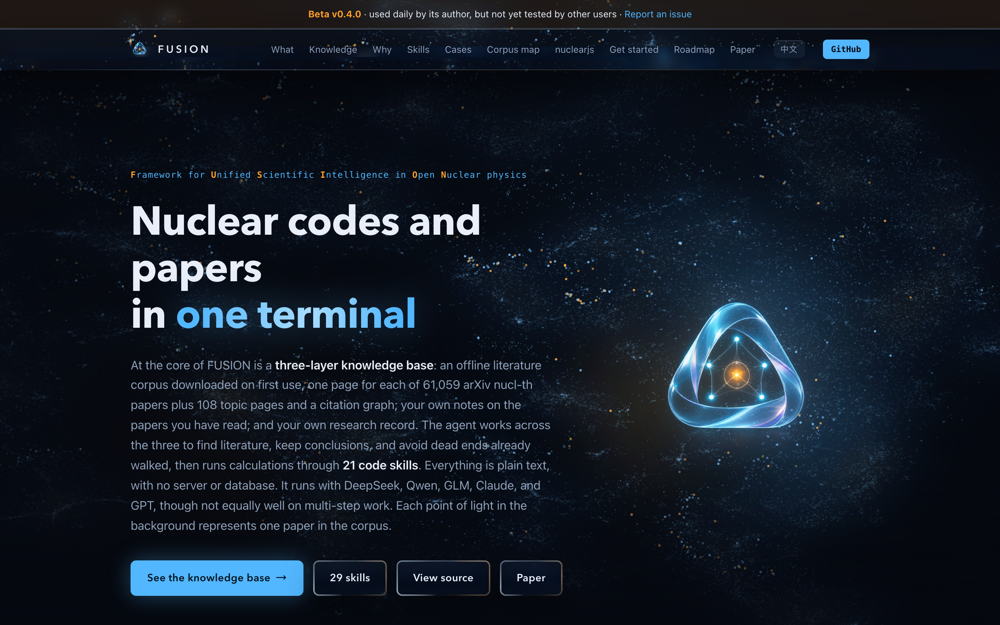
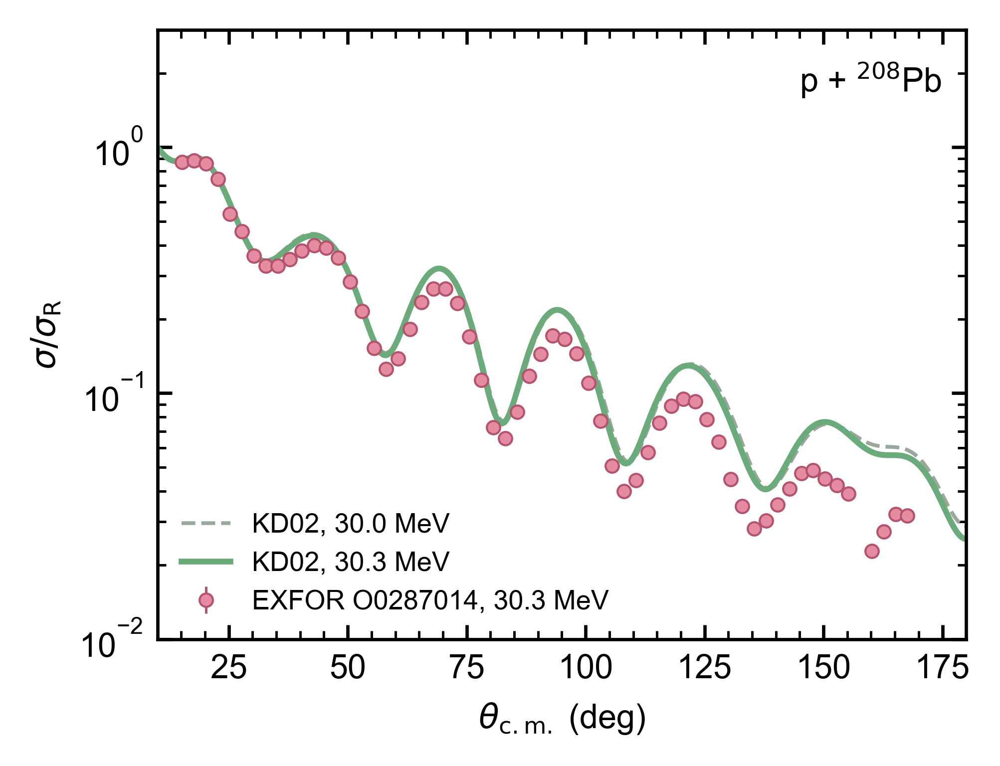

<div class="cover-main">
<h1>Using AI in Research:<span class="h1-sub">Lessons from FUSION</span></h1>
<div class="cover-tagline">Be the forward deployed engineer<br>of your own research</div>
<div class="byline">Jin Lei</div>
<div class="affiliation">School of Physics Science and Engineering, Tongji University</div>
</div>
<div class="cover-side">
<LiveOnly><HeroNucleus /></LiveOnly>
<div class="signoff"><div class="ui-label">TODAY</div><div class="slip-title">Today's plan</div><div class="row"><span>Three recent jobs I gave it</span><span>①</span></div><div class="row"><span>A live calculation, against data</span><span>②</span></div><div class="row"><span>Turning experience into skills</span><span>③</span></div><div class="row"><span>Giving it a knowledge base</span><span>④</span></div></div>
</div>

<!--
Central message: today is about how I use agents, not a tour of products.
Script: How many of you have used GPT or DeepSeek in a web browser? How many have let it edit files on your own computer or run your programs? Today I will use a few things I did recently, and then try one live: give it one sentence, let it compute a result with an optical potential, and compare with experimental data. At the end I will show how I write experience down as skills, and how I give it a knowledge base.
Timing target: 0:00–1:00.
Transition: First, something related to job hunting.
-->

---
class: dense
zoom: 0.9
---

# FDE: sent to the user, to make AI work there
<div class="subtitle">Forward deployed engineer: fit a general AI tool into someone's real work</div>

<div class="fde-top">
<div>
<div class="fde-steps">
<div><span>See</span><b>Sit next to the user</b><small>How they work every day, which data and programs</small></div>
<div><span>Connect</span><b>Let the AI reach them</b><small>Read their files, run their programs</small></div>
<div><span>Verify</span><b>Agree on what "right" means</b><small>Check against known results; never just take "done" for an answer</small></div>
</div>
<div class="fde-pay"><b>Pay:</b> US job postings list a base salary of about $200k–300k per year, plus equity.</div>
</div>
<FdeScene :height="345" />
</div>
<div class="bottom-line">Today: how to be the FDE of your own research.</div>
<div class="source">Pay: public OpenAI and Anthropic postings, 2025–2026 (e.g. Anthropic Applied AI FDE $200k–300k; OpenAI NYC FDE $200k–310k plus equity); the company sites are authoritative.</div>

<style>
.fde-top { display: grid; grid-template-columns: 1fr 1.35fr; gap: 14px; align-items: center; margin-top: -10px; }
.fde-steps > div { display: grid; grid-template-columns: 70px 1fr; column-gap: 8px; align-items: baseline; padding: 5px 12px; margin: 5px 0; border-radius: 8px; border: 1px solid #e0ddd2; background: #fcfbf7; }
.fde-steps span { grid-row: span 2; font-size: 17px; color: #1B365D; font-weight: 600; }
.fde-steps b { font-size: 17px; font-weight: 600; color: #141413; }
.fde-steps small { font-size: 13.5px; color: #3d3d3a; }
.fde-pay { margin-top: 10px; padding: 8px 12px; border-left: 4px solid #4a6b3a; background: #eef0e4; border-radius: 6px; font-size: 15.5px; color: #3d3d3a; line-height: 1.5; }
.fde-pay b { color: #4a6b3a; }
</style>

<!--
Central message: an FDE does three things: understand how the user works, connect AI to it, and fix how to verify. Today is about doing these three steps in your own research.
Script: First, something about jobs. AI moves fast, and everyone wonders what to do later. In Silicon Valley one hot job of the last two years is the forward deployed engineer, FDE. The name sounds mysterious; the work is concrete. The company sends you to a user, say a pharma company or a bank. You sit next to them and first learn how they work: where the data live, which programs they use, which step eats the most time. Then you connect AI to that, so it can read those files and run those programs. Finally you agree with the user on what counts as right, and check against known results, instead of trusting the AI when it says "done". Palantir created the role; now OpenAI and Anthropic hire for it, and US postings list a base salary of roughly two to three hundred thousand dollars, plus equity. The picture on the right shows exactly this: a plane takes off from Shanghai, the engineer parachutes onto a construction site, first learns how the site works, then connects AI to read the drawings and compute the structure, and finally verifies against known results. The live demo later is also an FDE job: the user is me, the job is an elastic-scattering calculation compared with experiment, the AI has to connect to FRESCO and EXFOR, and must first reproduce a known result. The difference: an FDE has to learn someone else's field; you already know your own research. Today is about being the FDE of your own research.
Sources: Anthropic Applied AI FDE (US, $200k–300k), Federal Civilian FDE ($280k–320k); OpenAI FDE NYC ($200k–310k plus equity), Gov ($198k–252k). All are public postings reposted on job sites, some closed; recheck on the company sites before the talk. "Pharma company, bank" are examples, not specific projects.
Timing target: 1:00–3:00.
Transition: First, how most of us code with AI today.
-->

---
clicks: 5
class: scene-slide
---

# Coding in a web chat means copying back and forth
<div class="subtitle">Copy code, run it, paste the error, repeat</div>

<DeskScene mode="web" :step="$clicks" :height="300" cols="1.75fr 1fr" v-slot="{ k }">
<div class="handoff-steps">
<div :class="{ on: k === 1, done: k > 1 }"><span>AI</span><b>Gives you code</b><small>in the chat window</small></div>
<div :class="{ on: k === 2, done: k > 2 }"><span>You</span><b>Copy, save, run</b><small>files on your computer</small></div>
<div :class="{ on: k === 3, done: k > 3 }"><span>You</span><b>Paste the error back</b><small>back to the chat window</small></div>
<div :class="{ on: k === 4, done: k > 4 }"><span>AI</span><b>Gives a fixed version</b><small>and around again</small></div>
</div>
</DeskScene>

<div v-click="5" class="bottom-line">It cannot see your files, run your programs, or see the output. All it knows is what you pasted.</div>

<style>
.handoff-steps > div { display: grid; grid-template-columns: 40px 1fr; column-gap: 8px; align-items: baseline; padding: 5px 12px; margin: 2px 0; border-radius: 8px; border: 1px solid transparent; color: #87867f; transition: all .3s; }
.handoff-steps span { grid-row: span 2; font-size: 15px; font-weight: 600; }
.handoff-steps b { font-size: 18px; font-weight: 600; }
.handoff-steps small { font-size: 13px; }
.handoff-steps .done { color: #3d3d3a; }
.handoff-steps .on { color: #141413; background: #fcfbf7; border-color: #1B365D; }
.handoff-steps .on span { color: #1B365D; }
</style>

<!--
Central message: in a web chat, the model cannot touch the files and programs on your computer.
Figure: left, the web chat; right, a terminal; on the desk a computer holding the project and a printer; the cloud top left is the AI model, which in web mode connects only to the chat window. Each click advances one step; the red slip is what you are carrying, and the counter top right shows how many times you carried something (three after four steps: code, error, fix). Click 5 shows what the chat window can see: only the lines you pasted. The desk can be rotated by dragging.
Script: Who has fixed a program like this? [Ask one student for an example.] Ten or more rounds is normal. With many files you also have to tell it which directory, which version, who calls whom. It knows only what you pasted. Whatever you left out, it guesses.
Timing target: 5:00–7:00.
Transition: So let it look and run by itself.
-->

---
clicks: 4
class: scene-slide
zoom: 0.86
---

# Agent: the model reads files, runs programs, sees results
<div class="subtitle">Agent = a model working with tools and feedback</div>

<div class="scene-definitions">Agent: an AI that uses tools to act, looks at the result, and decides the next step. Common ones: Claude Code, Codex, OpenCode.</div>

<DeskScene mode="agent" :step="$clicks" :height="300" cols="1.2fr 1fr">
<div class="agent-term">
<div class="agent-row you"><span class="who">You</span><code>Run plot_xs.py and plot the cross sections in runs/ in one figure. Fix it if it fails.</code></div>
<div class="agent-row"><span class="act">Read</span><code>plot_xs.py (32 lines), 6 .out files in runs/</code></div>
<div v-click="1" class="agent-row"><span class="act">Run</span><code>$ python plot_xs.py</code></div>
<div v-click="1" class="agent-row out"><span class="act"></span><code class="err">ValueError: could not convert string to float: 'E(MeV)'  (line 14)</code></div>
<div v-click="2" class="agent-row"><span class="act">Look</span><code>line 1 of each .out is a header, read as a number</code></div>
<div v-click="2" class="agent-row"><span class="act">Edit</span><code>line 14: np.loadtxt(f) → np.loadtxt(f, skiprows=1)</code></div>
<div v-click="3" class="agent-row"><span class="act">Rerun</span><code>$ python plot_xs.py  →  writes xs.png, 6 curves</code></div>
<div v-click="3" class="agent-row"><span class="act">Leave</span><code>the changed line + xs.png, for you to check</code></div>
</div>
</DeskScene>

<div v-click="4" class="bottom-line">The four hand-offs from the last slide, it now does itself. You write the first line, then open the figure and check.</div>

<style>
.agent-term { padding: 7px 12px; background: #faf9f5; border-radius: 10px; box-shadow: 0 0 0 1px #e0ddd2; font-size: 13px; }
.agent-row { display: grid; grid-template-columns: 48px 1fr; align-items: baseline; padding: 1px 0; }
.agent-row code { background: none; padding: 0; font-size: 12px; line-height: 1.3; color: #3d3d3a; }
.agent-row .act { font-size: 13px; color: #1B365D; font-weight: 600; }
.agent-row.you { padding-bottom: 10px; margin-bottom: 6px; border-bottom: 1px solid #e0ddd2; }
.agent-row.you .who { font-size: 13.5px; color: #87867f; font-weight: 600; }
.agent-row.you code { font-family: Inter, 'PingFang SC', sans-serif; color: #141413; }
.agent-row .err { color: #b53333; }
</style>

<!--
Central message: the steps where "you were the courier" are now done by the agent calling tools.
Figure: same desk. As you click, the cloud model reconnects to the terminal; the terminal reaches out with dashed lines to read the computer, run, and edit line 14 of plot_xs.py (that line lights up in the computer's side window); after the rerun, xs.png comes out of the printer; top right reads "you carried 0 times". Click 4 shows what the agent can see: the terminal plus the whole project on the computer. Note that the model itself still sits in the cloud, and the file contents it reads are sent to it; the "Before you approve" slide comes back to this.
Script: [Narrate click by click.] I write only the first line. It reads the script and the data directory by itself; [click] it runs the script and sees the error directly, no pasting from me; [click] it reads the error, finds the cause, and changes one line; [click] it reruns, the figure appears, and both the change and the result stay in my directory. [click] Compare with the last slide: copy, run, paste the error, copy again; all four steps are now its job. The models are the same GPT and Claude models, they just can now edit files and see what happens when they run. I am not comparing products today; use whichever of the three you can log into. This slide is a sketch; we will do it live later.
Timing target: 7:00–10:00.
Transition: So which jobs should go to it?
-->

---
class: dense
zoom: 0.86
---

# Which jobs suit an agent?
<div class="subtitle">Choose the workflow by what the task touches</div>

| What you need to do | Web chat | Agent |
|---|---|---|
| Understand a concept, discuss an idea, polish some English | Enough | Not needed |
| Compare two long files (proofs, two drafts) | Can upload; you put the edits back yourself | Compares in your directory, saves the result |
| Edit code, run, read the error, edit again | You are the courier | It iterates by itself |
| Collect a batch of outputs, make tables and plots | Too much to paste | Reads the whole directory |
| Search literature, check citations | Offline it answers from memory and invents | Queries databases, keeps raw records |

<div class="bottom-line">Ask whether the job needs to read or write files, run programs, or query outside databases.</div>

<style>
.slidev-layout table { table-layout: fixed; width: 100%; }
.slidev-layout th, .slidev-layout td { white-space: normal; line-height: 1.38; }
</style>

<!--
Central message: whether to use an agent depends on whether the task needs files, programs and databases.
Script: For the first row, keep chatting, that is enough. The rows below need files or programs on your computer, or an outside database; those are the jobs I give to it. The next three examples are all things I did recently.
Timing target: 10:00–12:00.
Transition: First, a journal proof.
-->

---
layout: section
---

<LiveOnly><ParticleField tone="dark" :seed="1" /></LiveOnly>

<div class="part-no">01</div>
<div class="kicker">PART 01</div>

# Three jobs I gave it recently

<div class="part-lead">A page proof, a bibliography, a preprint</div>
<div class="part-track"><span class="on"></span><span></span><span></span></div>

<!--
Timing target: 12:00–12:30.
Transition: The first one.
-->

---
class: dense
zoom: 0.86
---

# How my research directory is set up
<div class="subtitle">One local git repository, two remotes</div>

<div class="repo-top">
<div class="repo-points">
<div><span>①</span><b>Paper, code and data in one directory</b><small>git records every change</small></div>
<div><span>②</span><b>Pushed to two places</b><small>GitHub holds everything; Overleaf holds only the paper, for compiling online and editing with coauthors</small></div>
<div><span>③</span><b>So the agent opens the submitted source directly</b><small>the very .tex and .bib; whatever it changes shows up in git</small></div>
</div>
<FdeScene name="repo" :height="330" />
</div>
<div class="bottom-line">What it can read is what you have locally.</div>

<style>
.repo-top { display: grid; grid-template-columns: 1fr 1.35fr; gap: 14px; align-items: center; margin-top: -6px; }
.repo-points > div { display: grid; grid-template-columns: 30px 1fr; column-gap: 8px; align-items: baseline; padding: 7px 12px; margin: 7px 0; border-radius: 8px; border: 1px solid #e0ddd2; background: #fcfbf7; }
.repo-points span { grid-row: span 2; font-size: 18px; color: #1B365D; font-weight: 600; }
.repo-points b { font-size: 17px; font-weight: 600; color: #141413; }
.repo-points small { font-size: 14px; color: #3d3d3a; line-height: 1.45; }
</style>

<!--
Central message: the examples work because paper and code sit in one local git repository that the agent can read.
Script: Before the examples, a word on how my research directory is set up, otherwise what follows looks like magic. Each paper is one local directory: the .tex and .bib, the code, the plotting scripts, all inside, under git, so every change is recorded. The directory is pushed to two places: GitHub holds everything; Overleaf holds only the paper, so I can compile online and edit with coauthors. Overleaf speaks git too, so both are a git push. When the agent opens files on my computer, it opens exactly the source I submitted, and git tells me what it changed. If your paper lives only on the Overleaf website, it cannot read it.
Figure: on the desk, the local repository (the computer's side window lists paper/, code/, figures/, .git) and the agent's terminal; GitHub rack at back left, Overleaf at back right; two dashed lines are git push, with paper slips running along them.
Timing target: 10:30–12:30.
Transition: With that in place, the first job.
-->

---
class: dense
zoom: 0.82
---

# In the proof, <sup>16</sup>O became <sup>6</sup>O
<div class="subtitle">Case 1 · checking an APS page proof against my source</div>
<div class="case-tag">2026-10-13 · PRC 114, 044620 page proof · real record</div>

<div class="case">
<div class="kami-card steps-num"><h3>I did three things</h3><p>Opened Claude Code in the paper's directory.</p><p>Dragged in the proof PDF from APS.</p><p>Asked: "Any problems in the proof?"</p></div>
<div class="kami-card steps-dot"><h3>What it did by itself</h3><p>Found the submitted .tex and .bib in the directory and compared them line by line.</p><p>Zoomed suspicious spots to 300 dpi screenshots to confirm.</p><p>Wrote a document I could send straight to the editor. Only typesetting errors; APS house-style changes left alone.</p></div>
<div class="box-evidence"><h3>What it found</h3><p>The source has ¹⁶O and ⁹³Nb throughout; the proof was right at first mention, then lost the first digit of the mass number:</p><p><span class="hit">⁶O(d,p)¹⁷O</span> → <span class="fix">¹⁶O(d,p)¹⁷O</span></p><p><span class="hit">³Nb(d,pX)</span> → <span class="fix">⁹³Nb(d,pX)</span></p><p>11 corrections in total, including 2 "+n" set as subscripts; Eqs. (1)–(18) unchanged.</p></div>
</div>
<div class="why-chat"><b>In a web chat?</b> You can upload the file, but it cannot see the source directory; you put each result back and check against the original yourself.</div>


<!--
Central message: once the directory is set up, I drop in a PDF and ask one question; it finds the source, compares, and hands back a document I can use.
Script: On October 13 I received a PRC page proof. I did very little: opened Claude Code in the paper's directory, dragged in the proof PDF, and asked "any problems in the proof?". The rest it did: found my submitted .tex and .bib, compared them place by place, zoomed in on suspicious spots, and wrote a document. That is the payoff of the directory setup on the last slide: everything it needs is at hand. It found that the typesetting system printed 16O as 6O and 93Nb as 3Nb; correct at first mention, wrong after that. This kind of error slips past the human eye, because your brain silently fills in the 16. When it says "I checked", I still want evidence: which line, what does the screenshot look like. What goes back to the editor is my decision: fix errors only, no "improvements" on the side.
Timing target: 12:30–16:00.
Transition: Here is what it handed back.
-->

---
class: dense
---

# The deliverable: a reply to the editor
<div class="subtitle">The deliverable is a file, not a chat answer</div>

<div class="two">
<div>

```text
Corrections (typesetting errors: the mass
numbers 16 and 93 have lost their first digit;
the source has ^{16}O and ^{93}Nb throughout):
1. Line 190: "^{6}O(d,p)^{17}O"
           -> "^{16}O(d,p)^{17}O".
 ...
6. Line 386: "^{3}Nb(d,pX)" -> "^{93}Nb(d,pX)".
 ...
```

</div>
<div class="kami-card steps-dot"><h3>Three parts in the file</h3><p><b>Typesetting errors to fix:</b> 11 items, each with the proof line number.</p><p><b>Reply to the editor:</b> ready to paste.</p><p><b>Leave alone:</b> APS house-style changes, listed, with a recommendation not to touch them.</p></div>
</div>
<div class="note-line">Excerpt from proof_corrections_2026-10-13.txt. All 11 were fixed in the published version.</div>

<!--
Central message: it hands back a file that I can audit and use directly.
Script: This is the file it returned, verbatim. It did not just say "I checked, there are a few problems". Each item has a proof line number, and the reply can be sent as is. It also listed the places it recommends not changing, because I asked for errors only at proof stage. All 11 corrections are in the published version.
Timing target: 16:00–18:00.
Transition: Second job: the references.
-->

---
class: dense
zoom: 0.82
---

# 45 references, each checked against a database
<div class="subtitle">Case 2 · re-checking a bibliography before production</div>
<div class="case-tag">2026-09-28 · PRC 114, 044618, accepted, before typesetting · real record</div>

<div class="case">
<div class="kami-card steps-dot"><h3>What I told it (gist)</h3><p>The paper is accepted. Before production, re-check every cited reference, one by one.</p><p>No answers from memory, no cache from last time.</p></div>
<div class="box-evidence"><h3>How it did it</h3><p>43 have a DOI: fetched each CrossRef record online and compared title, <b>every author's surname and order</b>, volume, first page, year.</p><p>Isotope mass numbers in titles checked separately.</p><p>The 2 without DOI: the conference paper via INSPIRE, Feshbach's book via Open Library.</p><p>Result: 45/45 exist, and the details match.</p></div>
<div class="kami-card steps-dot"><h3>The evidence it left</h3><p>The query script and every raw record saved in the paper directory.</p><p>It also judged that the "(R)" in 011601(R) marks a Rapid Communication, not an error.</p></div>
</div>
<div class="why-chat"><b>In a web chat?</b> It answers from memory that "they all look right". That is how AI invents references.</div>

<!--
Central message: the same model gives different answers from memory and from a database.
Script: You have all heard of AI inventing references: authors, journal, DOI, everything there, except the paper does not exist. The reason is that in a web chat it can only answer from memory. With tools, I require it to fetch the raw record for every entry, compare field by field, and save the raw response. All 45 were right, and I can show 45 raw records to prove it. I wrote these lookup steps into a skill; I will open it later.
Timing target: 18:00–21:00.
Transition: Third job: a public preprint.
-->

---
class: dense
zoom: 0.8
---

# In the preprint, Kolmogorov became "K. A. N."
<div class="subtitle">Case 3 · a stale arXiv version nobody had looked at</div>
<div class="case-tag">2026-09-04 · H. Liu, J. Lei, Z. Ren, PRC 111, 024316 (2025) · real record</div>

<div class="case">
<div class="kami-card steps-dot"><h3>How it started</h3><p>My notes had no arXiv number for this paper.</p><p>It looked up the DOI on INSPIRE and found one: arXiv:2407.20737.</p><p>The public v2 was uploaded the day after acceptance, before the proofs, so it lacks the proof corrections.</p></div>
<div class="box-gap"><h3>Problems in the public version</h3><p>The text says "Figure 1"; it should be Fig. 2.</p><p>One label <code>fig:8</code> sits on two figures, so "see Fig. 9" links to Fig. 6.</p><p>Kolmogorov printed as <span class="hit">"K. A. N."</span></p><p>Arnol'd's paper lists the volume editors as authors.</p><p>The Fisher-Yates shuffle cites not the 1938 original but a 2016 entry in a machine-proof library.</p></div>
<div class="kami-card steps-dot"><h3>What it handed back</h3><p>Rebuilt v3 from the final source, compiled from scratch in an empty directory: 0 undefined references.</p><p>Also found that Table II of the published version prints A<sub>sym</sub> as A<sub>vol</sub>, confirmed at 300 dpi.</p></div>
</div>
<div class="why-chat"><b>In a web chat?</b> You must first know the preprint exists, then download both versions and compare them item by item. Nobody has time, so the public v2 stayed up for nineteen months.</div>

<!--
Central message: research is full of checks that "nobody has time for"; an agent can take them.
Script: This is a paper by my student Hao Liu. While tidying my publication records, it used the DOI to find an arXiv number I had not even recorded, and then noticed that the public version predates the proofs. Kolmogorov is printed as K. A. N. That version, without the proof corrections, stayed on arXiv for nineteen months. This kind of job is not hard; nobody has time for it.
Timing target: 21:00–24:00.
Transition: The three side by side.
-->

---
class: dense
zoom: 0.86
---

# What it helped with in these three cases
<div class="subtitle">Chores that take hours, slip past the eye, or never get done</div>

| | Before: I did it myself | This time: it did | What I look at in the end |
|---|---|---|---|
| Proof | Compare the PDF with the source line by line | Found 11 typesetting errors, wrote the reply to the editor | The screenshot of each, decide which to fix |
| References | Look up 45 entries online, one by one | Fetched 43 raw CrossRef records, compared field by field | The saved raw records |
| Preprint | Nobody had time; the old version stayed up nineteen months | Noticed v2 was stale, rebuilt v3 from the final source | Whether to post the new version |

<div class="bottom-line">Chores that take time, slip past the eye, and usually never get done. It does the work; I look at the evidence and decide.</div>

<style>
.slidev-layout table { table-layout: fixed; width: 100%; }
.slidev-layout th, .slidev-layout td { white-space: normal; line-height: 1.38; }
</style>

<!--
Central message: where an agent really helps in research is these slow, error-prone, neglected chores; the judgment stays with me.
Script: Look at the three together. The proof: before, I compared the PDF line by line, and 16 becoming 6 is exactly the kind of error eyes miss. The references: 45 entries looked up one by one, nobody wants to do it. The preprint is the clearest case: nobody even thought to check, and the old version sat on arXiv for nineteen months. None of this is deep work, but it is slow and error-prone, so usually nobody does it. Now it does the work, and I do only the last step: look at the evidence it left, and decide whether to change or post. Next, a physics calculation, live.
Timing target: 24:00–26:00.
Transition: Live demo.
-->

---
layout: section
---

<LiveOnly><ParticleField tone="dark" :seed="2" /></LiveOnly>

<div class="part-no">02</div>
<div class="kicker">PART 02</div>

# FUSION in research: a real case

<div class="part-lead">p + ²⁰⁸Pb elastic scattering with the KD02 optical potential, compared with EXFOR data</div>
<div class="part-track"><span class="done"></span><span class="on"></span><span></span></div>

<!--
Timing target: 26:00–26:30.
Transition: Now to the terminal.
-->

---
class: dense
zoom: 0.86
---

# What FUSION is
<div class="subtitle">vibeinscience.com · beta v0.4.0 · arXiv:2609.04742</div>

<div class="fusion-intro">
<div class="layers">
<div class="acro"><b>F</b>ramework for <b>U</b>nified <b>S</b>cientific <b>I</b>ntelligence in <b>O</b>pen <b>N</b>uclear physics</div>
<div class="layer l2"><span>What's inside</span><b>29 skills, 21 drive nuclear-physics codes</b><small>FRESCO, TALYS, SKY3D…, plus EXFOR data retrieval; offline knowledge base of 61,167 pages</small></div>
<div class="layer l1"><span>How to use</span><b>A plugin any agent can install</b><small>Installed and run on Claude Code, Codex, Gemini CLI, opencode and others</small></div>
</div>
<div class="web-shot"><a href="https://vibeinscience.com/" target="_blank"></a><div class="fusion-cite"><b>Jin Lei</b>, FUSION: a skill-based research agent for publicly obtainable nuclear-physics codes, <a href="https://arxiv.org/abs/2609.04742" target="_blank">arXiv:2609.04742</a></div></div>
</div>
<div class="bottom-line">Distilled from 19 nuclear-physics papers, iterated over and over: what I built as my own FDE, ready to hand over.</div>

<style>
.fusion-intro { display: grid; grid-template-columns: 1fr 1.1fr; gap: 22px; align-items: center; margin-top: -4px; }
.layers { display: flex; flex-direction: column; gap: 8px; }
.layer { display: grid; grid-template-columns: 100px 1fr; column-gap: 10px; align-items: baseline; padding: 7px 14px; border-radius: 8px; border: 1px solid #e0ddd2; background: #fcfbf7; }
.layer span { grid-row: span 2; font-size: 14px; font-weight: 700; color: #1B365D; }
.layer b { font-size: 16.5px; font-weight: 600; color: #141413; }
.layer small { font-size: 13.5px; color: #3d3d3a; line-height: 1.45; margin-top: 2px; }
.layer.l2 { border-color: #1B365D; background: #eef2f8; }
.acro { font-family: var(--f-title); font-size: 21px; line-height: 1.4; color: #3d3d3a; margin-bottom: 8px; }
.acro b { color: #b53333; font-size: 1.25em; font-weight: 700; }
.web-shot { display: flex; flex-direction: column; align-items: center; gap: 6px; }
.fusion-cite { font-size: 12.5px; max-width: 88%; margin: 0 auto; line-height: 1.4; color: #3d3d3a; text-align: center; }
.fusion-cite b { color: #1B365D; }
.fusion-cite a { color: #1B365D; font-weight: 600; }
.web-shot img { width: 88%; margin: 0 auto; display: block; border-radius: 10px; box-shadow: 0 0 0 1px #e0ddd2, 0 6px 18px rgba(0,0,0,.12); }
</style>

<!--
Central message: FUSION is a nuclear-physics plugin for the agent you already use: code skills plus an offline knowledge base, with private material staying on your machine.
Script: The demo uses FUSION, so first what it is. The name stands for Framework for Unified Scientific Intelligence in Open Nuclear physics. It is not a new AI and has no agent of its own; it is a plugin any agent can install. Underneath is the agent you already use: Claude Code, Codex, Antigravity, Gemini CLI, opencode all work, and the model can be DeepSeek or Qwen. FUSION installs into it with 29 skills, 21 of which each drive one nuclear-physics code, FRESCO, TALYS and so on; there are also skills for fetching EXFOR data, fitting with SFRESCO, and uncertainty quantification with BAND; plus an offline knowledge base of more than sixty thousand arXiv nuclear-theory papers. Where did it come from? From the 19 nuclear-physics papers I wrote with it this year, FUSION itself excluded. With each paper I found where it did not know something or went wrong, went back, and fixed the skills and the rules, over and over. Here I acted as an FDE: sitting next to my own research and distilling that experience into something others can install and use. The design is described in arXiv:2609.04742. The website is vibeinscience.com; it is a beta, I use it every day, and outside users are just starting.
Source: vibeinscience.com home page (English screenshot 2026-11-03): v0.4.0, plugin, 29 skills of which 21 code skills, kb-wiki 61,167 pages.
Timing target: 26:30–27:30.
Transition: Now let it run.
-->

---
class: live-stop
---

# Let's run it live
<div class="subtitle">I switch to the terminal now</div>

<div class="kami-card task-brief lesson-prompt live-prompt" data-label="This one sentence, sent as is to Claude Code">
<div class="copy-corner"><CopyButton label="Copy prompt" text="Use the KD02 optical potential to compute the elastic-scattering angular distribution (ratio to Rutherford) for p + 208Pb at 30 MeV, and plot it together with the experimental data from EXFOR in one figure, using Python, saved as results/p208pb_30MeV.png. Tell me which experimental data set you used and which checks you did." /></div>
Use the KD02 optical potential to compute the elastic-scattering angular distribution (ratio to Rutherford) for p + ²⁰⁸Pb at 30 MeV, and plot it together with the experimental data from EXFOR in one figure, using Python, saved as results/p208pb_30MeV.png. Tell me which experimental data set you used and which checks you did.
</div>

<div class="live-row">
<div>

```bash
mkdir p208pb && cd p208pb    # empty folder
claude                       # no input, no data, no scripts
```

<div class="live-note">Two rehearsals took 4 to 11 minutes. While it runs, we go back to the slides.</div>

</div>
<div class="task-qr">

<div class="ui-label">Scan to copy</div>
<a href="https://jinlei.fewbody.com/talks/fusion-ml2026-1030-en/prompts.html#task" target="_blank">prompts.html#task</a>
</div>
</div>


<style>
.live-stop .lesson-prompt { font-size: 18px; line-height: 1.5; }
.live-row { margin-top: 18px; display: grid; grid-template-columns: 1fr 150px; gap: 24px; align-items: center; }
.live-prompt { position: relative; }
.copy-corner { position: absolute; top: -17px; right: 18px; z-index: 5; }
.live-note { font-size: 15px; color: #6b6a63; margin-top: 8px; }
.task-qr { display: flex; flex-direction: column; align-items: center; gap: 4px; }
.task-qr img { width: 112px; height: 112px; border-radius: 8px; box-shadow: 0 0 0 1px #e0ddd2; }
.task-qr a { font-size: 12px; color: #1B365D; }
</style>

<!--
Central message: hand one physics question to an agent with the FUSION skills installed.
Action: [Switch to the terminal. Start claude in an empty folder, paste the prompt, press Enter.] Switch back once you see it call the fresco skill.
Script: Let's run it. This is a very ordinary sentence; any graduate student in nuclear reactions would ask it this way. The folder is empty: no input, no data. It has to write a FRESCO input, find experimental data in EXFOR, and make the plot. I send it now; it takes about ten minutes, and we look at what it is doing while we wait.
Backup: if it fails or is too slow live, open the rehearsal logs and figures in demo/fusion-live/runs/ of the Chinese talk directory.
Timing target: 26:30–29:00.
Transition: What is it doing on screen?
-->

---
zoom: 0.86
---

# What is it doing on screen?
<div class="subtitle">What to watch while it runs</div>

<div class="watch-steps">
<div><span>①</span><b>Reads the fresco skill</b><small>Computes the KD02 parameters with a script from the published formulas and fills them into a verified FRESCO input; nothing written from memory.</small></div>
<div><span>②</span><b>Reads the exfor-data skill</b><small>Searches EXFOR for p + ²⁰⁸Pb elastic data; checks energy, units, and whether the data were digitized from a figure.</small></div>
<div><span>③</span><b>Runs FRESCO, checks convergence</b><small>Changes step size, matching radius, number of partial waves; the result counts only if it does not move.</small></div>
<div><span>④</span><b>Plots, writes a report</b><small>States which data set it used, what it excluded, which checks it did.</small></div>
</div>
<div class="bottom-line">These four steps read files, query a database and run programs. A web AI cannot do them.</div>

<style>
.watch-steps > div { display: grid; grid-template-columns: 34px 1fr; column-gap: 8px; align-items: baseline; padding: 6px 14px; margin: 6px 0; border-radius: 8px; border: 1px solid #e0ddd2; background: #fcfbf7; }
.watch-steps span { grid-row: span 2; font-size: 19px; color: #1B365D; font-weight: 600; }
.watch-steps b { font-size: 20px; font-weight: 600; color: #141413; }
.watch-steps small { font-size: 15px; color: #3d3d3a; line-height: 1.5; }
</style>

<!--
Central message: the skill makes it edit a verified input and take data from the original database.
Script: [Glance at the terminal and point out which skill it called.] It builds the FRESCO input by editing the verified example in the skill, not from scratch; the KD02 parameters come from a script, not from memory. Then it queries EXFOR. A web AI can do none of these four steps.
Timing target: 29:00–32:00.
Transition: What does a web AI say to the same sentence?
-->

---
class: dense
zoom: 0.82
---

# Same sentence, what does a web AI answer?
<div class="subtitle">Same sentence, DeepSeek web with search on</div>

<div class="two">
<div class="kami-card"><h3>It said</h3><p>"I cannot generate this figure for you directly; there is no environment for running nuclear-reaction calculations, and I cannot access EXFOR directly."</p><p>Recommended Watson et al., NPA 92, 193 (1967), EXFOR O0490:<br>"explicitly gives the angular distribution of 30 MeV protons elastically scattered from ²⁰⁸Pb".</p><p>Then a five-point checklist.</p></div>
<div class="box-gap"><h3>I checked</h3><p>The paper is real, and so is the entry.</p><p>But the ²⁰⁸Pb cross-section angular distribution in O0490 is only at <b>26.3 MeV</b>, in arbitrary units, digitized from a figure in the paper.</p><p>The 30 MeV set is polarization data only.</p></div>
</div>
<div class="bottom-line">The advice contains an error, yet reads as entirely right. Only opening the raw EXFOR entry reveals it.</div>

<!--
Central message: a web AI gives advice, and you still have to verify it yourself.
Script: I pasted the same sentence into DeepSeek, with web search on. It said it could not compute and could not get the data. It recommended a data set; the paper and the entry are both real, better than the invented references earlier. But it said the data are at 30 MeV; I opened the raw entry: the lead cross sections are only at 26.3 MeV, in arbitrary units digitized from a figure. Compare that with a 30 MeV calculation and you are wrong. Half-right advice like this is the hardest to catch.
Timing target: 32:00–35:00.
Transition: Back to the terminal, see how far it got.
-->

---

# Back to the terminal: what it delivered
<div class="subtitle">Live demo · open what it delivered</div>

<div class="two">
<div></div>
<div class="kami-card steps-dot"><h3>Its report</h3><p>No data at 30.0 MeV; the measurement is at <b>30.3 MeV</b>; it computed both energies.</p><p>Used the tabulated data of van Oers 1974; the set digitized from a figure in the same entry is <b>used only as a cross-check</b>.</p><p>KD02: agrees at forward angles, 20–50% high beyond 60°.</p></div>
</div>
<div class="source">Figure: drawn by the agent itself in 3 min 43 s. Another rehearsal took 11 minutes, with somewhat different data choices and checks. Look at the terminal for today's result.</div>

<!--
Central message: it hands back a figure and explains why it picked this data set.
Script: [Open the figure in results/ and read a few lines of its report.] Three things to see. The data are at 30.3 MeV; it did not only compute 30, it plotted both energies. It distinguished tabulated data from data digitized off a figure, and used the latter only as a cross-check. In another rehearsal it also found a point in EXFOR that was off by a factor of ten, excluded it and said so, without "correcting" it on its own. Now the physics: the global optical potential agrees well at forward angles and is high at backward angles. Whether that is reasonable is for you to judge with physics. The two rehearsals did not do exactly the same things, and today's run will differ too.
Timing target: 35:00–42:00.
Transition: It says "checked"; checked what?
-->

---

# What can each check tell you?
<div class="subtitle">Implementation, input, and model adequacy</div>

| What you want to know | How it checked | What it cannot tell you |
|---|---|---|
| Did it really run? | Open the files, rerun with the command it gives | Whether the numbers are right |
| Are the numerics converged? | Change step, matching radius, partial waves; no change | Whether the input is wrong |
| Is the input right? | KD02 parameters from two independent sources | Whether this potential suits this nucleus |
| Does the model apply? | Two independent data sets, with errors | Whether a deviation comes from the potential or the data |

<div class="bottom-line">When an AI says "I have verified it", ask: which row of this table?</div>

<!--
Central message: different checks answer different questions; one cannot stand in for another.
Script: Most checks in its report belong to rows two and three: numerical convergence, parameter cross-checks. They are useful, but they cannot answer the last row: KD02 is high at backward angles, is that the potential or the data? That step needs your physical judgment. Next time you see "verification passed", first ask: which row?
Timing target: 42:00–51:00 (includes slack for the live wait).
Transition: To make it check like this every time, the rules have to be written down.
-->

---
layout: section
---

<LiveOnly><ParticleField tone="dark" :seed="4" /></LiveOnly>

<div class="part-no">03</div>
<div class="kicker">PART 03</div>

# Writing down what went wrong

<div class="part-lead">Its past mistakes and my corrections, written as skills that it reads before every job</div>
<div class="part-track"><span class="done"></span><span class="done"></span><span class="on"></span></div>

<!--
Timing target: 51:00–51:30.
Transition: First, a controlled comparison.
-->

---
class: dense
---

# Five references: can AI spot the errors?
<div class="subtitle">Ask once, then again with six lines of rules, then let the agent look it up</div>

<div class="two qr-slide">
<div>
<div class="ab-steps">
<details name="ab">
<summary><span>①</span><b>Just ask</b><small>Web AI, search off: "Check whether these references are correct."</small></summary>
<div class="ab-res">
<div><i>[1][3]</i>"Correct" ✅</div>
<div class="bad"><i>[2]</i>"Correct, a classic" ✅ <em>page 275 is wrong</em></div>
<div class="bad"><i>[4]</i>"Lei and Moro did publish in PRC 96, 064607; volume, page and year are themselves correct" <em>this one is invented</em></div>
<div><i>[5]</i>First "has a problem", then circles back to "correct"</div>
<p>Two errors, neither found.</p>
</div>
</details>
<details name="ab">
<summary><span>②</span><b>Rules first, then ask</b><small>New chat, same AI, 6 lines of rules in front. Run once with search off, once with search on.</small></summary>
<div class="ab-res">
<div class="sub">Search off</div>
<div class="bad"><i>[2][4]</i>"Per Crossref …, every field matches", judged correct <em>the records are invented</em></div>
<div class="sub">Search on</div>
<div class="good"><i>[2][4]</i>Both caught: first page should be 257; Lei and Moro's 2017 paper is PRC 95, 044605 <em>right</em></div>
<div class="bad"><i>[1]</i>Judged "wrong": someone else's reference list gives 32, 432 (1982) <em>false alarm, this one is correct</em></div>
<p>Offline, it fabricates evidence in the format the rules ask for; online, it takes a second-hand citation for the original record.</p>
</div>
</details>
<details name="ab">
<summary><span>③</span><b>Agent plus skill</b><small>Queries CrossRef, opens the raw records to compare.</small></summary>
<div class="ab-res">
<div><i>[1][3][5]</i>Raw DOI records match field by field: correct ([1] is indeed 32, 431, 1985)</div>
<div class="good"><i>[2]</i>10.1103/RevModPhys.30.257: first page <b>257</b>, the list says 275 <em>wrong</em></div>
<div class="good"><i>[4]</i>PRC 96, 064607 is an α-decay paper by M. Mirea; Lei and Moro's 2017 paper is PRC 95, 044605 <em>invented</em></div>
<p>Both found, and every verdict links to a raw record.</p>
</div>
</details>
</div>
<div class="note-line">Some of the 5 are wrong. Each round adds one thing: first 6 lines of rules, then a database tool.</div>
</div>
<div class="qr-box">

<div class="ui-label">Scan to copy the prompts</div>
<a href="https://jinlei.fewbody.com/talks/fusion-ml2026-1030-en/prompts.html" target="_blank">jinlei.fewbody.com/talks/fusion-ml2026-1030-en/prompts.html</a>
</div>
</div>

<style>
.ab-steps details { margin: 6px 0; border-radius: 8px; border: 1px solid #e0ddd2; background: #fcfbf7; }
.ab-steps details[open] { border-color: #1B365D; }
.ab-steps summary { list-style: none; cursor: pointer; display: grid; grid-template-columns: 30px 1fr; column-gap: 8px; align-items: baseline; padding: 8px 12px; }
.ab-steps summary::-webkit-details-marker { display: none; }
.ab-steps summary span { grid-row: span 2; font-size: 18px; color: #1B365D; font-weight: 600; }
.ab-steps summary b { font-size: 18px; font-weight: 600; color: #141413; }
.ab-steps summary small { font-size: 14px; color: #3d3d3a; line-height: 1.45; }
.ab-steps details[open] summary small { display: none; }
.ab-res { padding: 0 12px 8px 50px; font-size: 13px; line-height: 1.42; color: #3d3d3a; }
.ab-res > div { margin: 2px 0; }
.ab-res i { font-style: normal; font-weight: 600; color: #1B365D; margin-right: 6px; }
.ab-res em { font-style: normal; font-size: 12px; padding: 0 6px; border-radius: 4px; margin-left: 4px; white-space: nowrap; }
.ab-res .bad em { background: #f3e0dc; color: #9b3b2a; }
.ab-res .good em { background: #e2ebdb; color: #4a6b3a; }
.ab-res > div.sub { margin: 4px 0 0; font-size: 13px; font-weight: 600; color: #6b6a63; }
.ab-res p { margin: 5px 0 0; font-weight: 600; color: #141413; font-size: 14px; }
.qr-slide { align-items: center; grid-template-columns: 1.75fr 1fr !important; }
.qr-slide .note-line { margin-top: 8px; font-size: 17px; }
.qr-box { display: flex; flex-direction: column; align-items: center; gap: 6px; }
.qr-box img { width: 190px; height: 190px; border-radius: 10px; box-shadow: 0 0 0 1px #e0ddd2; }
.qr-box a { font-size: 10.5px; white-space: nowrap; color: #1B365D; word-break: break-all; text-align: center; }
</style>

<!--
Central message: rules without tools make the AI fabricate evidence in the rules' format. Only with a tool that queries the database does it find the errors. Each round adds exactly one thing.
Action: [Open the prompts page via the link below, copy round one, switch to a web AI (search off) and paste.] The audience can scan and follow along.
Script: Round one: I say nothing, just ask. [Rehearsal 2026-10-28, DeepSeek, search off: [2] with page 275 judged "correct, a classic"; for [4] it said "Lei and Moro did publish in PRC 96, 064607" and "volume, page and year are themselves correct"; [5] first "has a problem", then back to "correct".] Round two: new chat, same model, with 6 lines of rules pasted in front. [Rehearsal: it produced a very tidy table, each row saying "per Crossref DOI …", all five fields "match", and [4] judged "correct" too. But search was off; it looked up nothing; all those Crossref records were invented.] The table in this round looks rigorous, and the answer is still wrong. It produced what evidence looks like under the rules, without actually looking. [Then run round two again with search on: [2] and [4] are both caught (it found PRC 95, 044605, but did not open 96, 064607 to see whose paper that is); but it judged the correct [1] "wrong", based on "32, 432 (1982)" in someone else's reference list. It took a second-hand citation for the original record, and did not follow rule 4, confirming that what it opened is this very paper.] Round three: switch to the terminal and let the agent actually look things up with literature-search. Answer: entry 2 starts on page 257, not 275; entry 4 is invented: the DOI PRC 96, 064607 resolves, but to an α-decay paper by Mirea. Lei and Moro's 2017 PRC paper is 95, 044605. Merely checking that the DOI exists would never catch this.
Rehearsal transcripts: demo/literature/ab-test/runs/ in the Chinese talk directory (not committed).
Backup: if it fails live, open demo/literature/ab-test/ANSWERS.md and the raw records in crossref/.
Timing target: 51:30–59:00.
Transition: The 6 lines of round two are only part of a skill; they need a database tool too. Here is the full thing.
-->

---
zoom: 0.84
---

# Writing the lookup rules as a skill
<div class="subtitle">literature-search: the workflow behind Case 2</div>

<div class="handoff-loop">
<div><span>Leads</span><b>Check existing notes first</b><small>no lead, then search the literature</small></div>
<div><span>Tools</span><b>Fetch database records</b><small>INSPIRE / CrossRef / arXiv</small></div>
<div><span>Check</span><b>Is it the right paper?</b><small>title, authors, year</small></div>
<div><span>Write</span><b>Generate BibTeX</b><small>only fields from the record</small></div>
</div>
<div class="two">
<div class="kami-card"><h3>Every step has rules</h3><p>Notes give leads; still query the database.<br>Missing fields are marked UNVERIFIED, never filled from memory.</p></div>
<div class="kami-card"><h3>When nothing is found</h3><p>Say so: not found, several candidates, or network failure.<br>Unverified entries never go into a real reference list.</p></div>
</div>

<!--
Central message: write the mistakes and the right procedure into a protocol it reads every time; that is a skill.
Script: In Case 2 it followed the database steps because I had written the lookup procedure into a file beforehand, called a skill. Every time I say "look up this paper", it reads that file first and follows it. Saying "please check carefully" does nothing; you must spell out which database, which fields, and what to do when nothing is found.
Timing target: 51:30–54:00.
Transition: Let's open the file.
-->

---
class: dense
---

# What a SKILL.md looks like
<div class="subtitle">A teaching excerpt from literature-search</div>

<div class="two">
<div>

```yaml
name: literature-search
description: Search and verify scientific literature;
  use when looking up papers, DOIs or BibTeX.
```

```text
Check existing literature notes for candidate leads.
Call the database tool and read the raw record.
Check that title, authors and year match.
Take citation fields only from this query's result.
Mark missing fields UNVERIFIED; never guess a DOI.
Save the citation, record link and query date.
```

</div>
<div class="kami-card steps-dot"><h3>How the three parts work</h3><p><b>Name and description:</b> tell it when to use the skill.</p><p><b>Procedure:</b> which tools to call, what to check, when to stop.</p><p><b>Scripts:</b> the programs that actually reach the database,<br>e.g. scripts/verify_doi.py.</p><p>No new model to train;<br>just write the method down for it.</p></div>
</div>
<div class="note-line">Teaching excerpt; the full skill handles each case separately.</div>

<!--
Central message: a skill is an operating manual written for the AI, plus the scripts it calls.
Script: [Open demo/literature/SKILL-excerpt.md, then the full local SKILL.md.] The top two lines say when to use it, below are the steps, and the scripts handle the database connection. No model training needed; you write the method into a markdown file. Does your group have a "notes on running the code" handed down from senior students? That is exactly what you can turn into a skill.
Timing target: 54:00–56:00.
Transition: Let it look one up, live.
-->

---
class: dense
---

# Let the skill verify one paper
<div class="subtitle">Check one DOI and keep the raw record</div>

<div class="doi-row">
<div>
<div class="kami-card task-brief lesson-prompt doi-prompt" data-label="What I sent it">
<div class="copy-corner"><CopyButton label="Copy prompt" text="Use literature-search to verify DOI 10.1103/PhysRevC.97.011601. Save the raw database record, the BibTeX and a verification note. Leave anything you cannot find empty; do not fill it in yourself." /></div>
Use literature-search to verify DOI <code>10.1103/PhysRevC.97.011601</code>.<br>
Save the raw database record, the BibTeX and a verification note. Leave anything you cannot find empty; do not fill it in yourself.
</div>
<div class="kami-card steps-dot"><h3>It hands back three files</h3><p>crossref-record.json: the record as returned</p><p>references.bib: only fields present in the record</p><p>verification.md: when, where, what is missing</p></div>
</div>
<FdeScene name="lookup" :height="440" />
</div>

<div class="source">Queried 2026-10-20, CrossRef, no cache; record in demo/literature/results/. If offline, open this record.</div>

<style>
.doi-prompt { position: relative; }
.doi-row { display: grid; grid-template-columns: 1fr 1.05fr; gap: 16px; align-items: start; margin-top: -14px; }
.doi-prompt .copy-corner { position: absolute; top: -17px; right: 18px; z-index: 5; }
.doi-row .doi-prompt { font-size: 16px !important; line-height: 1.5 !important; margin: 18px 0 12px !important; }
.doi-row .kami-card.steps-dot { padding-top: 12px !important; padding-bottom: 12px !important; }
.doi-row .kami-card h3 { font-size: 20px !important; margin-bottom: 4px !important; }
.doi-row .kami-card.steps-dot p { font-size: 15px !important; line-height: 1.45 !important; margin: 4px 0 !important; }
</style>

<!--
Central message: whether a skill is any good shows in which tools it called and which files it left.
Figure: the scene on the right loops: the agent first reads SKILL.md, opens the CrossRef cabinet, pulls out a record card, brings it back to the desk where it becomes three files; "guess from memory" is crossed out.
Script: [Send as in demo/literature/PROMPT.md.] First see which skill it read, then which database it queried, and finally open the files it saved. [Comment on the live result. During preparation I hit one pitfall: the script reported the page as empty, because PRC article numbers live in CrossRef's article-number field and the script read only page. If it happens again live, say: with only a one-line "verified", you would get a citation without a page number, or it would guess one from the DOI; with the raw record saved, the problem is obvious at a glance.] One more point: finding that the paper exists does not mean it supports the claim you want to make; for that you still read the paper.
Timing target: 56:00–59:00.
Transition: Nuclear-physics codes can get the same kind of protocol; that is what FUSION does.
-->

---

# FUSION: skills for nuclear-physics codes
<div class="subtitle">Edit a verified input, reproduce a known benchmark</div>

<div class="kami-card"><h3>29 skills, 21 of them run public nuclear-physics codes.</h3><p>FRESCO, TALYS, SKY3D…: each skill carries a verified input and a known result.</p></div>
<div class="two">
<div class="kami-card steps-dot"><h3>How it works</h3><p><b>Edit</b> a verified input; never <b>write</b> one from memory.</p><p>First reproduce the known result to a stated precision.</p></div>
<div class="kami-card steps-dot"><h3>What you judge</h3><p>Reproducing a known result only shows the code is installed and runs correctly.</p><p>What to study, whether the model fits, how to read the result:<br>that is your judgment.</p></div>
</div>
<div class="source">github.com/jinleiphys/FUSION. No installation needed today.</div>

<!--
Central message: FUSION uses two rules against the two kinds of error seen earlier.
Script: I wrote the operating procedures of a number of nuclear-physics codes as skills, and that became FUSION. I require it to start from a verified input instead of writing a FRESCO input from memory, and to reproduce a known result first. That guards against "inventing" and against "declaring its own success". Reproducing the authors' result only shows the code is installed correctly; whether your physics is right is a separate question, the last row of the checks table.
Timing target: 59:00–62:00.
Transition: FUSION also ships a knowledge base. First, why one is needed.
-->

---
class: dense
zoom: 0.88
---

# Research starts with knowing where the field stands
<div class="subtitle">A field's history is written in its papers</div>

<div class="giant-row">
<div class="giant-cards">
<div class="kami-card"><h3>Know the field first</h3><p>Before starting: who did this, with which method, what they concluded, what is still debated.</p></div>
<div class="kami-card"><h3>All of it is in papers</h3><p>Over sixty thousand arXiv nuclear-theory papers since 1992, older ones in journals. Decades of a research direction are written down there.</p></div>
<div class="box-gap"><h3>The model's memory is unreliable</h3><p>It has not read them all, and mixes up what it remembers. Ask it about progress in the field, and make it look up the papers before answering.</p></div>
</div>
<div class="giant-fig"><FdeScene name="giants" :height="300" /><div class="giant-quote">"If I have seen further, it is by standing on the shoulders of giants." <span>Newton</span></div></div>
</div>
<div class="bottom-line">An FDE's first step is the same: organize the field's papers into a knowledge base it can search.</div>

<style>
.giant-row { display: grid; grid-template-columns: 1.1fr 1fr; gap: 18px; align-items: center; margin-top: -22px; }
.slidev-layout .giant-cards > div { margin: 0 0 8px !important; padding: 8px 16px !important; }
.slidev-layout .giant-cards h3 { font-size: 18px !important; margin: 0 0 2px !important; }
.slidev-layout .giant-cards h3::before { width: 22px !important; height: 22px !important; font-size: 13px !important; }
.slidev-layout .giant-cards p { font-size: 14px !important; line-height: 1.42 !important; padding: 0 !important; margin: 0 !important; border: 0 !important; }
.giant-quote { text-align: center; font-family: var(--f-title); font-style: italic; font-size: 13px; line-height: 1.3; color: #3d3d3a; margin-top: -14px; }
.giant-quote span { font-style: normal; color: #87867f; margin-left: 6px; }
</style>

<!--
Central message: research starts with knowing how the field developed, and that development is in the papers; for an agent to help, it must first be able to find them.
Figure: right, "standing on the shoulders of giants": decades of papers stacked layer by layer; you stand on top, and only from there can you see the distant star, the new question.
Script: The first thing in research is to know where the field stands: which questions have been done, with which methods, what the conclusions were, what is still argued about. New graduate students spend most of their first year or two on this. Where is all of that? In papers. Newton said he saw further by standing on the shoulders of giants; the shoulders are this stack of papers. Nuclear theory alone has more than sixty thousand arXiv papers since 1992, and older ones in journals. How a direction developed over decades is all written there. The model has not read all of them, and what it remembers it mixes up; the invented reference on the five-references slide came from exactly that. So to let it help with research, it first has to be able to search these papers. An FDE arriving in a new industry also starts by organizing the industry's documents. That is the job of a knowledge base. There are two ways to store and search it.
Timing target: 62:00–63:30.
Transition: First the most common one, RAG.
-->

---
class: dense
zoom: 0.86
---

# Approach 1: RAG
<div class="subtitle">Retrieval-augmented generation: look up chunks at question time</div>

<div class="rag-flow">
<div class="rf-step"><div class="rf-pic"><div class="rf-strips"><i></i><i></i><i></i><i></i></div></div><span>① Chunk</span><b>Cut papers into pieces</b><small>a few hundred words each</small></div>
<div class="rf-step"><div class="rf-pic"><code>[0.12, 0.87,<br>&nbsp;0.03, …]</code></div><span>② Embed</span><b>Each piece becomes numbers</b><small>similar meaning, similar numbers</small></div>
<div class="rf-step"><div class="rf-pic"><div class="rf-top"><i class="on"></i><i class="on"></i><i class="on"></i><i></i><i></i></div></div><span>③ Retrieve</span><b>Find the closest pieces</b><small>the question is embedded too</small></div>
<div class="rf-step"><div class="rf-pic"><div class="rf-bubble">A</div></div><span>④ Generate</span><b>Answer from the prompt</b><small>then the pieces are dropped</small></div>
</div>

<div class="rag-head">For research, four problems</div>
<div class="rag-probs">
<div><em>1</em><b>Nothing accumulates</b><p>Every question is pieced together again from scattered chunks</p></div>
<div><em>2</em><b>Context is lost</b><p>A chunk says "this potential", but which one?</p></div>
<div><em>3</em><b>Only similarity</b><p><code>(d,p) ≈ (p,d)</code><br><code class="iso"><sup>16</sup>O ≈ <sup>6</sup>O</code></p></div>
<div><em>4</em><b>Invisible</b><p>It does not flag two papers that disagree, and you cannot see which chunks it used</p></div>
</div>

<style>
.rag-flow { position: relative; display: grid; grid-template-columns: repeat(4, 1fr); gap: 18px; margin-top: -8px; }
.rag-flow::before { content: ''; position: absolute; left: 10%; right: 10%; top: 44px; border-top: 2px dashed #1B365D; opacity: .45; }
.rf-step { position: relative; text-align: center; }
.rf-step span { display: block; font-size: 14px; font-weight: 700; color: #1B365D; letter-spacing: .04em; margin-top: 8px; }
.rf-step b { display: block; font-size: 17px; font-weight: 700; color: #141413; margin-top: 2px; }
.rf-step small { display: block; font-size: 14px; color: #6b6a63; margin-top: 2px; }
.rf-pic { width: 128px; height: 88px; margin: 0 auto; border-radius: 12px; background: #fcfbf7; box-shadow: 0 0 0 1.5px #1B365D, 0 4px 0 #1B365D22; display: flex; align-items: center; justify-content: center; position: relative; z-index: 1; }
.rf-pic code { background: none; font-size: 13px; line-height: 1.35; color: #1B365D; text-align: left; }
.rf-strips { display: flex; flex-direction: column; gap: 6px; }
.rf-strips i { display: block; width: 74px; height: 9px; border-radius: 3px; background: #e8dcc4; border: 1px solid #a99166; }
.rf-strips i:nth-child(2) { width: 62px; } .rf-strips i:nth-child(4) { width: 50px; }
.rf-top { display: flex; flex-direction: column; gap: 4px; }
.rf-top i { display: block; width: 74px; height: 8px; border-radius: 3px; background: #e0ddd2; }
.rf-top i.on { background: #1B365D; }
.rf-bubble { width: 56px; height: 42px; border-radius: 14px; background: #1B365D; color: #fff; font-weight: 700; font-size: 20px; display: flex; align-items: center; justify-content: center; position: relative; }
.rf-bubble::after { content: ''; position: absolute; left: 10px; bottom: -8px; border: 6px solid transparent; border-top-color: #1B365D; border-left-color: #1B365D; }
.rag-head { margin-top: 22px; font-family: var(--f-title); font-size: 22px; font-weight: 700; color: #b53333; }
.rag-probs { display: grid; grid-template-columns: repeat(4, 1fr); gap: 14px; margin-top: 10px; }
.rag-probs > div { position: relative; padding: 14px 14px 12px; border-radius: 10px; background: #f7ebe7; border-top: 4px solid #b53333; }
.rag-probs em { position: absolute; top: 10px; right: 12px; font-style: normal; font-family: var(--f-title); font-size: 28px; font-weight: 700; color: #b5333333; }
.rag-probs b { display: block; font-size: 18px; color: #b53333; margin-bottom: 6px; }
.rag-probs p { font-size: 14px !important; line-height: 1.45 !important; color: #3d3d3a; margin: 0 !important; padding: 0 !important; border: 0 !important; }
.rag-probs code.iso { font-family: Inter, "PingFang SC", sans-serif; }
.rag-probs code { background: #fff; color: #141413; font-size: 15px; padding: 1px 6px; border-radius: 4px; line-height: 1.9; }
</style>

<!--
Central message: RAG grabs a few pieces of text each time; it can look things up, but never stores an understanding of the field.
Script: RAG works like this: cut the literature into small pieces, use a model to turn each piece into a vector of numbers, so that pieces with similar meaning get similar numbers. When you ask, the question becomes numbers too, the closest pieces are found and put into the prompt, and the model answers. Many "chat with your PDF" products work this way. For research there are four problems. Every question is pieced together again from scattered chunks; nothing organized earlier survives. Chunking loses context. Vectors only see whether meanings are similar, but in nuclear physics (d,p) and (p,d) are two reactions in opposite directions, and 16O and 6O are two nuclei; that is exactly the proof error from earlier. And you cannot see how it searched. If it finds two papers with opposite conclusions, it does not tell you; which chunks it used, you cannot see.
Timing target: 63:30–65:30.
Transition: So this year many people switched to another approach.
-->

---
class: dense
zoom: 0.86
---

# So I switched to a wiki
<div class="subtitle">Organize once when a paper comes in, not every time a question is asked</div>

| | RAG | wiki |
|---|---|---|
| When is it organized | Pieced together at every question | Once, when the paper comes in |
| Afterwards | Dropped after the answer | Written as pages that stay |
| Papers that disagree | Not noticed | Written on the page |
| How to search | Compare vectors, nearest chunks | Read the index, follow links |
| Can a person audit it | A string of numbers, unreadable | Plain text, open it, read it, edit it |

<div class="note-line">Karpathy described this approach in April in "LLM Wiki". I started my personal and close-reading wikis in May; the arXiv wiki was finished in July. Full-text search over the arXiv wiki uses keywords, not vectors, because what we look for is often an exact symbol or number.</div>
<div class="bottom-line">Organize papers once when they arrive; later questions need no reorganizing.</div>

<style>
.slidev-layout table { table-layout: fixed; width: 100%; font-size: 17px; }
.slidev-layout th:first-child, .slidev-layout td:first-child { width: 22%; }
.slidev-layout th, .slidev-layout td { white-space: normal; padding: 7px 12px; line-height: 1.4; }
</style>

<!--
Central message: papers are organized into wiki pages when they arrive, and both people and the model can read and edit them.
Script: The wiki approach: when a paper comes in, the model organizes it and writes it into the relevant pages: which method, which system, whose conclusion it contradicts. At the next question it reads the index, then follows links; no vector comparison. What I value most is the last row: it is all plain text; I can open it, see what it wrote, and fix mistakes directly. Karpathy wrote about this approach in April, calling it LLM Wiki, and many people use it now. I started my personal and close-reading wikis in May; the arXiv one was finished in July. Also, for full-text search in the arXiv wiki I deliberately use keywords, not vectors, because what we look for is often one exact symbol, one number.
Sources: Karpathy, "LLM Wiki" gist (April 2026); research-wiki and research-wiki-personal first commits both 2026-05-06; FUSION kb-wiki completed 2026-07-20; literature-corpus is SQLite FTS5/BM25, no embeddings.
Timing target: 65:30–67:30.
Transition: I now have three wikis, with completely different contents.
-->

---
class: dense
zoom: 0.82
---

# My three wikis
<div class="subtitle">Personal, close-reading, and arXiv-wide</div>

| | Personal wiki | Close-reading wiki | arXiv wiki |
|---|---|---|---|
| Contents | Everything about me: papers, refereeing, work log, servers | Papers I have read, plus topic pages on methods and systems | A summary of every arXiv nuclear-theory paper, 1992–2026 |
| Size | ~400 pages, 53 published papers | 835 papers, ~1200 topic pages | 61,059 papers, 800k citations |
| Written by | The agent from work records; I review | The agent after reading the full text; I review | DeepSeek, in bulk |
| Used to look up | What I have done and am doing; which machine runs what | What papers I trust say; where they disagree | Who has worked on this; who cites whom |
| Public? | No; refereeing records never enter git | No | Yes, part of FUSION |

<div class="bottom-line">Further right: wider coverage, thinner pages. Pick the right one before you search.</div>

<style>
.slidev-layout table { table-layout: fixed; width: 100%; font-size: 16px; }
.slidev-layout th:first-child, .slidev-layout td:first-child { width: 14%; }
.slidev-layout th, .slidev-layout td { white-space: normal; padding: 7px 12px; line-height: 1.38; }
</style>

<!--
Central message: the three wikis differ in coverage, author and trustworthiness; choose by the question.
Script: The first records my own situation: which papers I published, which servers the group has and how each is configured. Every new conversation, it first reads a one-page overview. The second records the eight hundred or so papers I have read, each linked to topic pages on methods, systems and observables, so I can ask "for this method, which papers I read disagree with which". The third is the largest: over thirty years of arXiv nuclear theory, more than sixty thousand papers, one summary page each, plus eight hundred thousand citation links. That one was written by DeepSeek in bulk and I have not reviewed it page by page, so I use it only for leads.
Numbers (counted 2026-10-29): personal 394 pages (excluding .private.md companions), papers/published 53; close-reading 835 sources (excluding 1 .private.md), concept pages entities 515 + methods 275 + systems 272 + observables 111 = 1173; kb-wiki 61,059 papers + 108 topic pages, citations.tsv 809,632 rows, typed relations 237,010.
Timing target: 67:30–69:00.
Transition: One real use of each.
-->

---
class: dense
zoom: 0.82
---

# How I actually use the three wikis
<div class="subtitle">One real use of each</div>

<div class="three">
<div class="kami-card steps-dot"><h3>Personal: my setup</h3><p>A new conversation starts by reading a one-page overview: my papers, the group's servers and GPUs.</p><p>I say "run it"; it knows where heavy jobs go.</p></div>
<div class="kami-card steps-dot"><h3>Close-reading: a debate</h3><p>Why is the ¹²C+¹²C fusion rate disputed?</p><p>Both sides from papers I read: Tumino, a rise; Mukhamedzhanov, an approximation pushed too far.</p><p>That page started my PRC.</p></div>
<div class="kami-card steps-dot"><h3>arXiv: a new direction</h3><p>Who works on emulators?</p><p>8 papers in 2020, 36 in 2025.</p><p>Mainly Furnstahl, Xilin Zhang, Drischler.</p></div>
</div>
<div class="bottom-line">The personal and close-reading wikis I have reviewed and use directly; the arXiv one gives leads only.</div>

<!--
Central message: the personal wiki tells it about me, the close-reading wiki sorts out debates in the literature, the arXiv wiki scouts who works on a new direction and how active it is.
Script: I use the personal wiki most, to let it know my situation. It lists my papers and DOIs, so when I cite my own work in a new paper it does not rely on memory. It also lists the group's servers, how many cores and GPUs each has. So when I just say "run it", it knows which machine a heavy calculation belongs on, and does not run it on my laptop. The close-reading wiki is most useful for sorting out a debate. Take the ¹²C+¹²C fusion rate: in 2018 a Nature paper using the Trojan-horse method found the low-energy S factor rising; the same year Mukhamedzhanov and collaborators argued that the plane-wave approximation had been used outside its range, and with corrections the rise disappears; a 2025 review still calls it open. When I ask about it, it does not answer from impression; it lays out the papers I read: who said what, which year, on what basis, and what exactly is disputed. That page later became the starting point of my THM paper this year (PRC 114, 034606). The arXiv wiki is best when entering a new direction: scout first, who works on it and how active it is. When I started on scattering emulators in 2024, I asked exactly that: how many emulator papers are there in nuclear physics, and by whom? It counted arXiv nuclear-theory papers mentioning emulators in title or abstract, by year: 8 in 2020, 11 in 2021, more each year since, 36 in 2025. The most active groups are Furnstahl, Xilin Zhang, Drischler, Giuliani. One question tells me: this direction is hot, these are the main players, these are the papers to read first. But this wiki was generated in bulk by DeepSeek, so it is leads only: the counts are keyword-based and include a few unrelated papers; journal information for individual papers may be incomplete. To cite something, go back to the skill and query the database.
Sources: personal wiki profile.md (publication list, compute table); close-reading wiki debates/12c-12c-thm-fusion-rate-controversy.md (Tumino, Nature 557, 687 (2018); Mukhamedzhanov-Tang-Pang arXiv:1806.05921; PRC 99, 064618 (2019); Tumino 2025 PPNP); kb-wiki/papers matched "emulat" in title+abstract (queried 2026-10-29; 169 papers in total; by year: 2020 8, 2021 11, 2022 18, 2023 20, 2024 23, 2025 36, 2026 to early October 20; top authors Furnstahl 11, Xilin Zhang 10, Drischler 8, Bass 8, Giuliani 8, Godbey 7, Lei 5).
Timing target: 69:00–70:00.
Transition: One more live try, using the wikis together.
-->

---
class: dense
---

# Read a new paper, find a collaboration
<div class="subtitle">One new arXiv paper, two wikis, one question</div>

<div class="kami-card task-brief lesson-prompt wiki-prompt" data-label="Sent live, as is">
<div class="copy-corner"><CopyButton label="Copy prompt" text="paper/ contains a paper I just downloaded from arXiv. First read it, then search the arXiv wiki for this group's earlier papers, summarize what they have been working on, guess what they might do next, and list the papers that support each guess. Then search my personal wiki, using only my published papers and public code, and find problems we could work on together. Give a source for every point (arXiv number or my paper)." /></div>
Read the new arXiv paper in paper/, then search the arXiv wiki for this group's earlier work and guess what they might do next. Then search my personal wiki, using only published papers and public code, for collaboration ideas. Back every guess with evidence and give a source for each point.
</div>

<div class="wiki-steps">
<div><span>①</span><b>Read the new paper</b><small>authors, method, conclusions</small></div>
<div><span>②</span><b>arXiv wiki</b><small>by author and citation, the group's earlier work</small></div>
<div><span>③</span><b>Guess next steps</b><small>each with supporting papers</small></div>
<div><span>④</span><b>Personal wiki</b><small>collaboration ideas from my papers and code</small></div>
</div>
<div class="note-line">The new paper is not yet in the arXiv wiki, so it reads the original. Next steps and collaborations are its guesses; I judge whether they hold up.</div>

<style>
.wiki-prompt { font-size: 16px; line-height: 1.5; position: relative; }
.wiki-prompt .copy-corner { position: absolute; top: -17px; right: 18px; z-index: 5; }
.wiki-steps { display: grid; grid-template-columns: repeat(4, 1fr); gap: 10px; margin-top: 14px; }
.wiki-steps > div { display: grid; grid-template-columns: 26px 1fr; column-gap: 6px; align-items: baseline; padding: 8px 12px; border-radius: 8px; border: 1px solid #e0ddd2; background: #fcfbf7; }
.wiki-steps span { grid-row: span 2; font-size: 18px; color: #1B365D; font-weight: 600; }
.wiki-steps b { font-size: 16.5px; font-weight: 600; color: #141413; }
.wiki-steps small { font-size: 13.5px; color: #3d3d3a; line-height: 1.45; }
</style>

<!--
Central message: two wikis together: the arXiv wiki to understand the other group's research, the personal wiki to see which of my work could support a collaboration.
Action: [Before the talk, pick a nucl-th paper from this week's arXiv and download it into paper/ of an empty directory. Switch to the terminal, start claude in that directory, paste the prompt.]
Script: One more live try. I just downloaded a paper from this week's arXiv; it is not yet in the arXiv wiki, so it has to read the original. Then it searches the wiki: what has this group done before, which questions have they pursued over the years? Then a guess: what might they do next? Every guess must list supporting papers. Then my personal wiki: which problems could we work on together? Here it may use only my published papers and public code; unpublished material in my personal wiki must not go on the screen. These guesses and suggestions are only its guesses; which one is worth an email is my call.
Backup: if too slow or it fails, open the rehearsal log from preparation.
Timing target: 70:00–75:00.
Transition: FUSION and the arXiv wiki are public; let's see who is looking.
-->

---

# Who knows about, and uses, FUSION
<div class="subtitle">GitHub, last 14 days · vibeinscience.com visitors, live</div>

<div class="fu-panel">
<div class="fu-side">
<div class="fu-group">VISITED THE PAGE</div>
<div class="fu-num"><b>52</b><span>visitors<small>last 14 days, opened the repo page</small></span></div>
<div class="fu-num"><b>20</b><span>stars<small>GitHub star</small></span></div>
<div class="fu-group use">PULLED THE CODE</div>
<div class="fu-num use"><b>104</b><span>unique cloners<small>agents clone directly when installing,<br>bypassing the page, hence more than visitors</small></span></div>
<div class="fu-num use"><b>2</b><span>forks<small>taken to modify</small></span></div>
</div>
<div class="vis-frame">

<iframe class="vis-live" src="https://vibeinscience.com/visitors.html" loading="lazy" title="FUSION visitor map"></iframe>
<div class="vis-tag">SITE VISITORS · LIVE</div>
</div>
</div>
<div class="vis-foot">Bright spots: places where someone opened the FUSION website. <a href="https://vibeinscience.com/visitors.html" target="_blank">Open in browser</a></div>

<style>
.fu-panel { display: grid; grid-template-columns: 290px 1fr; height: 340px; margin-top: -10px; border-radius: 14px; overflow: hidden; background: #070b14; box-shadow: 0 8px 24px rgba(7,11,20,.25); }
.fu-side { padding: 18px 10px 14px 24px; display: flex; flex-direction: column; justify-content: center; border-right: 1px solid #1c2638; }
.fu-group { font-size: 12px; font-weight: 700; letter-spacing: .18em; color: #8fa3bf; margin: 8px 0 2px; }
.fu-group.use { color: #f4c63d; margin-top: 12px; }
.fu-num { display: flex; align-items: baseline; gap: 10px; margin: 1px 0; }
.fu-num b { font-family: var(--f-title); font-size: 36px; line-height: 1.05; color: #e8eef7; min-width: 78px; text-align: right; }
.fu-num.use b { color: #f4c63d; }
.fu-num span { font-size: 15px; font-weight: 600; color: #d5dbe5; line-height: 1.25; }
.fu-num small { display: block; font-size: 11.5px; font-weight: 400; color: #7d8aa0; }
.vis-frame { position: relative; overflow: hidden; }
.vis-still { position: absolute; inset: 0; width: 100%; height: 100%; object-fit: cover; object-position: top; }
.vis-live { position: absolute; top: 0; left: 0; width: 1280px; height: 1000px; border: 0; transform: scale(0.5) translateY(-352px); transform-origin: 0 0; pointer-events: none; }
.vis-tag { position: absolute; top: 10px; right: 14px; font-size: 11.5px; letter-spacing: .12em; color: #8fa3bf; background: rgba(7,11,20,.7); padding: 3px 10px; border-radius: 999px; border: 1px solid #1c2638; }
.vis-foot { text-align: center; font-size: 13.5px; color: #6b6a63; margin-top: 8px; }
.vis-foot a { margin-left: 10px; }
</style>

<!--
Central message: FUSION is public; people come to look, and agents are installing it.
Script: The FUSION skills and the arXiv wiki are on GitHub. A few numbers, in two groups. First, people visiting the page: in the last two weeks 52 visitors opened the repository page, 20 stars in total. Second, people pulling the code: in the last two weeks 104 distinct sources cloned it, 167 clones in total, plus 2 forks. More clones than visitors, because when the plugin is installed the agent pulls straight from GitHub and never opens the page; this includes automated scripts and bots, so 104 is not 104 people. Below is the website's live visitor map; bright spots are where someone opened the site. To be clear: pulling the code does not mean using it, and GitHub does not tell me who; the map counts come from GoatCounter, which logs no IPs and counts the same person on different days twice, so I only say "where people looked", not how many. What I need most now is user feedback; if you hit a problem, please open an issue.
Source: GitHub API (queried 2026-10-29): stars 20, forks 2, traffic/views last 14 days 95 views by 52 unique visitors, traffic/clones last 14 days 167 clones by 104 unique cloners (counted by source, not people; includes plugin installs and automation), issues 0.
Action: the embedded page shows only the map and takes no clicks, so paging is unaffected; for the country list and daily curve, click "Open in browser". Offline, a 2026-10-28 screenshot is shown.
Timing target: 75:00–76:00.
Transition: One more case: two codes that disagree.
-->

---

# Two codes disagreed: a bug in a public code
<div class="subtitle">Case 4 · the verify step: disagreement is information</div>
<div class="case-tag">2026-09 · cross-check of reaction codes · real record, code name withheld for now</div>

<div class="three">
<div class="kami-card"><h3>What we did</h3><p>Same (p,n) reaction, same inputs, computed with a public scattering code and with FRESCO.</p></div>
<div class="kami-card"><h3>What we found</h3><p>They disagreed. Checking term by term: that code drops the spin-flip term.</p></div>
<div class="kami-card"><h3>Afterwards</h3><p>Contacted the authors; they confirmed it independently and fixed it.</p></div>
</div>
<div class="bottom-line">Two codes agreeing only means they compute the same thing; when they disagree, find out why.<br>Running, comparing and locating the difference, AI does fast; what to compare and whom to trust takes physics judgment.</div>

<!--
Central message: comparing two codes with an agent finds the difference fast; explaining it takes physics.
Script: The third step of an FDE is verification, and this came out of verification. Two codes agreeing only shows the implementations agree. This time they did not, and I did not tweak parameters to make them match. I checked term by term and found that someone else's public code drops a term. The authors confirmed it and have fixed it. I am not naming the code yet, because the authors' work is not published. Running two codes, comparing and locating the difference, the agent does very fast; what to compare and which to trust still takes physics judgment.
Timing target: 75:00–78:00.
Transition: Before you hand it the keys, one more boundary: permissions and data.
-->

---

# Before you approve, look at what it will do
<div class="subtitle">Permissions and privacy</div>

<div class="two">
<div class="kami-card steps-dot"><h3>It asks for permission</h3><p>Which files to read, which to write, which commands to run.</p><p>If you don't understand, ask it to explain first;<br>don't just keep clicking "Allow".</p></div>
<div class="kami-card steps-dot"><h3>File contents go to the model service</h3><p>The files stay on your machine; their contents are still sent out.</p><p>Unpublished data, manuscripts under review, collaborators' code:<br>check first whether they may be sent.</p></div>
</div>
<div class="bottom-line">The first time, practice on a copy of a directory.</div>

<!--
Central message: grant permissions per task; decide yourself which data may leave your machine.
Script: When it runs commands it asks for permission; if you don't understand, ask it what the command does. Also, file contents are sent to the model's servers. Manuscripts I referee never go to any external model; that is journal policy. The first time, practice on a copy.
Timing target: 78:00–80:00.
Transition: Finally, what did I deliver as my own FDE?
-->

---
class: dense
zoom: 0.86
---

# What I delivered as my own FDE
<div class="subtitle">Understand, connect, verify: what came out of 2026</div>

<div class="fde-deliv">
<div><span>SEE</span><b>Three wikis</b><p>835 papers read closely, 61,059 arXiv nuclear-theory summaries, plus all my own records. In a new conversation, it already knows the field and me.</p></div>
<div><span>CONNECT</span><b>The FUSION plugin</b><p>29 skills, 21 driving public nuclear-physics codes. Any agent can install it; code and arXiv wiki fully public.</p></div>
<div><span>VERIFY</span><b>A check at every step</b><p>Reproduce known results first, then compare with experiment and with other codes. Chase every disagreement; it found a bug in someone's public code.</p></div>
</div>
<div class="fde-out"><b>19</b><span>nuclear-physics papers done with it this year</span><b>1</b><span>FUSION paper, arXiv:2609.04742</span><b>1</b><span>slide deck, the one you are looking at</span></div>
<div class="bottom-line">The tools are general; connecting them to nuclear physics and deciding how to verify is the part only I can do.</div>

<style>
.fde-deliv { display: grid; grid-template-columns: repeat(3, 1fr); gap: 16px; margin-top: -6px; }
.fde-deliv > div { padding: 14px 16px 12px; border-radius: 10px; background: #fcfbf7; box-shadow: 0 0 0 1px #e0ddd2; border-top: 4px solid #1B365D; }
.fde-deliv span { display: inline-block; font-size: 12.5px; font-weight: 700; letter-spacing: .12em; color: #fff; background: #1B365D; padding: 2px 10px; border-radius: 999px; }
.fde-deliv b { display: block; font-family: var(--f-title); font-size: 24px; color: #141413; margin: 8px 0 4px; }
.slidev-layout .fde-deliv p { font-size: 14.5px !important; line-height: 1.5 !important; color: #3d3d3a; margin: 0 !important; }
.fde-out { display: grid; grid-template-columns: auto 1fr auto 1fr auto 1fr; align-items: baseline; column-gap: 10px; margin-top: 16px; padding: 12px 20px; border-radius: 10px; background: #eef2f8; }
.fde-out b { font-family: var(--f-title); font-size: 34px; color: #1B365D; line-height: 1; }
.fde-out span { font-size: 14.5px; color: #3d3d3a; }
</style>

<!--
Central message: I spent a year as the FDE of my own research; the deliverables are three wikis, a public plugin, a way of verifying, and the papers behind them.
Script: Back to the job from the beginning. An FDE does three things: see, connect, verify. This year as the FDE of my own research, I delivered exactly these three. See: three wikis, so that from the start it knows where the field stands and what I have done. Connect: FUSION, the procedures for nuclear-physics codes written as skills, packaged as a plugin anyone's agent can install. Verify: a comparison at every step; reproduce known results first, then compare with experiment and other codes, chase every disagreement to the end, and once it turned up a bug in someone else's public code. Behind all this are 19 nuclear-physics papers done with it this year, plus one paper about FUSION itself. One more deliverable: the slides you are looking at, also revised together with it. The tools are general, anyone can use them; but connecting them to nuclear physics and deciding how to verify is the part it cannot do for me, or for you.
Sources: 2026 publication list (19 nuclear-physics papers + FUSION arXiv:2609.04742); wiki numbers on the three-wikis slide; FUSION slide (v0.4.0, 29 skills, 21 codes); bug case slide.
Timing target: 80:00–82:00.
Transition: And you, after today?
-->

---

# AI has already changed how research is done
<div class="subtitle">What has changed, and what has not</div>

<div class="shift">
<div class="shift-col now">
<div class="shift-h">Has changed</div>
<p>Literature, code, runs, proofs: hours of work, now one sentence</p>
<p>Tools turn over every few months; today's habits are stale next year</p>
<p>The old way, one person reading, writing, computing and checking everything, is over</p>
</div>
<div class="shift-arrow">→</div>
<div class="shift-col keep">
<div class="shift-h">Has not</div>
<p>Which question to ask</p>
<p>Which result to trust</p>
<p>What to verify against</p>
<p>Physical judgment</p>
</div>
</div>
<div class="bottom-line">Don't fear being replaced; fear not knowing how to verify. If you can verify, stronger tools make you worth more.</div>

<style>
.shift { display: grid; grid-template-columns: 1.25fr 40px 1fr; gap: 14px; align-items: stretch; margin-top: -4px; }
.shift-col { border-radius: 12px; padding: 16px 22px 14px; }
.shift-col.now { background: #fcfbf7; box-shadow: 0 0 0 1px #e0ddd2; }
.shift-col.keep { background: #1B365D; color: #fff; }
.shift-h { font-family: var(--f-title); font-size: 24px; font-weight: 700; margin-bottom: 8px; }
.shift-col.now .shift-h { color: #87867f; }
.shift-col.keep .shift-h { color: #f4c63d; }
.slidev-layout .shift-col p { font-size: 16.5px !important; line-height: 1.45 !important; margin: 0 !important; padding: 8px 0 !important; border-bottom: 1px solid rgba(0,0,0,.07); }
.slidev-layout .shift-col.now p { color: #6b6a63; }
.slidev-layout .shift-col.keep p { font-family: var(--f-title); font-size: 22px !important; color: #fff; border-bottom-color: rgba(255,255,255,.14); }
.shift-col p:last-child { border-bottom: 0 !important; }
.shift-arrow { display: flex; align-items: center; justify-content: center; font-size: 34px; color: #1B365D; }
</style>

<!--
Central message: AI hits research hard and the old way is over; what stays valuable is what does not change: questions, judgment, verification.
Script: A final personal note. AI's impact on research is huge, and we happen to be here for it. The jobs from today, searching literature, writing code, running programs, checking proofs, used to take hours and now take one sentence; tools turn over every few months, and today's habits may be stale next year. The old way, where one person does everything from reading to computing to checking, is over. Many people say: get on this rising curve quickly, or the times will leave you behind. I would put it differently. The tools will keep getting stronger, so strong that what you learn today you won't need to learn next year; but a few things it cannot do for you: which question to ask, which result to trust, what to verify against, whether the physics is right. In every example today, the last step was exactly this. So don't fear being replaced; fear not knowing how to verify. If you can verify, stronger tools make you worth more.
Timing target: 82:00–84:00.
Transition: Materials.
-->

---

# Take-home material
<div class="subtitle">The prompts from today, one scan away</div>

<div class="two">
<div class="qr-box"><div class="ui-label">Scan for today's prompts</div><a href="https://jinlei.fewbody.com/talks/fusion-ml2026-1030-en/prompts.html" target="_blank">jinlei.fewbody.com/talks/fusion-ml2026-1030-en/prompts.html</a><small>FUSION skills: github.com/jinleiphys/FUSION</small></div>
<div class="kami-card steps-num"><h3>Try this first</h3><p>Pick a code you use often in your research,<br>and ask the same sentence twice:</p><p>once with nothing, once after giving it a verified input and a known result.</p><p>Compare what comes back.</p></div>
</div>

<style>
.qr-box { display: flex; flex-direction: column; align-items: center; justify-content: center; gap: 6px; }
.qr-box img { width: 200px; height: 200px; border-radius: 10px; box-shadow: 0 0 0 1px #e0ddd2; }
.qr-box a { font-size: 11px; color: #1B365D; white-space: nowrap; }
.qr-box small { font-size: 13px; color: #6b6a63; }
</style>

<!--
Central message: one comparison you can try right after the talk.
Script: All the prompts from today are on this page; scan and copy. Back home, do one comparison: pick a code you use often, ask the same sentence twice, once giving nothing, once giving a verified input and a known result, which is a minimal skill. Compare what comes back. Trying this once tells you more than any product review, and shows how much a skill is worth.
Timing target: 87:00–89:00.
Transition: Questions.
-->

---
layout: section
class: finale
---

<div class="fin-sky" aria-hidden="true"><FuturePortal /></div>

# The future is here

<div class="part-lead fin-quote">"The future is already here, it's just not very evenly distributed." <span>William Gibson</span></div>
<div class="fin-answer"><span class="lead">FDE may be just a passing wind;</span><br><span class="poem">a good wind lifts you to the clouds.</span></div>
<div class="fin-thanks">
<div><b>COLLABORATORS</b><span>Z. Ren · H. Liu · J. Liu · A. M. Moro · P. Descouvemont</span></div>
<div><b>FUNDING</b><span>NSFC 12475132, 12535009</span></div>
</div>
<div class="fin-qa">Thank you · Questions welcome</div>

<style>
.slidev-layout.section.finale { position: relative; isolation: isolate; background: #01020a !important; overflow: hidden; }
.slidev-layout.section.finale > .my-auto { position: static !important; }
.fin-sky { position: absolute; inset: 0; z-index: -1; pointer-events: none; }
.slidev-layout.section.finale .kicker { color: #7fe6ff; letter-spacing: .5em; font-size: 13px; text-shadow: 0 0 12px rgba(77,227,255,.8); }
.slidev-layout.section.finale h1 { font-size: 46px !important; letter-spacing: .08em; color: #ffffff; text-shadow: 0 0 16px rgba(127,230,255,.9), 0 0 44px rgba(111,123,255,.7); margin-top: 76px !important; }
.slidev-layout.section.finale h1::after { display: none !important; }
.slidev-layout.section.finale h1::after { background: linear-gradient(90deg, #4de3ff, #f4c63d) !important; box-shadow: 0 0 12px #4de3ff; }
.finale .fin-quote { margin-top: 92px !important; color: #cfe9ff !important; text-shadow: 0 0 10px rgba(2,4,14,1), 0 0 20px rgba(2,4,14,1); font-family: var(--f-title); font-style: italic; font-size: 17px !important; max-width: 760px; margin: 96px auto 0 !important; }
.finale .fin-quote span { display: inline; font-style: normal; font-size: 12px; letter-spacing: .14em; opacity: .65; margin-left: 10px; }
.fin-answer { margin: 18px auto 0; max-width: 780px; text-align: center; font-size: 18px; line-height: 1.6; color: #ffffff; font-weight: 600; padding: 10px 20px; }
.fin-thanks { margin: 8px auto 0; width: max-content; display: grid; grid-template-columns: auto auto; column-gap: 12px; row-gap: 4px; font-size: 12px; opacity: .7; text-align: left; color: #c9d4e3; }
.fin-thanks > div { display: contents; }
.fin-thanks b { text-align: right; font-size: 12.5px; letter-spacing: .16em; color: #f4c63d; font-weight: 700; }
.fin-answer .lead { font-size: 15px; font-weight: 500; letter-spacing: .1em; color: #a9c6e8; }
.fin-answer .poem { display: inline-block; margin-top: 6px; font-family: var(--f-title); font-style: italic; font-size: 26px; letter-spacing: .06em; color: #ffd36e; text-shadow: 0 0 14px rgba(244,198,61,.8), 0 0 32px rgba(255,140,60,.45); }
.fin-qa { text-shadow: 0 2px 12px rgba(6,12,30,.9); margin-top: 8px; text-align: center; font-family: var(--f-title); font-size: 22px; font-weight: 700; color: #ffffff; letter-spacing: .08em; }
</style>

<!--
Central message: the tools are already here; FDE may be a passing wind, and when the wind comes, use it to rise.
Script: To close, a line from William Gibson: the future is already here, it's just not very evenly distributed. The tools from today are already here; anyone can install and use them; the difference is only who first connects them to their own research and learns to verify. At the start I described the FDE job, with its high pay. Frankly, FDE may be just a wind of these few years; in a few years the name may change. But when the wind comes, you should know how to ride it. In Dream of the Red Chamber, Xue Baochai's poem on willow catkins has the line: "a good wind, borrowed, lifts me to the blue clouds." The wind is here; ride it upward. Thanks to my collaborators Zhongzhou Ren, Hao Liu, Junzhe Liu, and to Antonio Moro and Pierre Descouvemont; thanks to the National Natural Science Foundation of China for support. Thank you, questions are welcome.
[If there are no questions, ask: as the FDE of your own research, what would your first deliverable be, and how would you verify it?]
Sources: "好风凭借力，送我上青云" is from Dream of the Red Chamber, chapter 70, Xue Baochai's "Lin Jiang Xian: Willow Catkins". Gibson's line is usually quoted from 1990s interviews (e.g. NPR 1999), commonly given as "The future is already here, it's just not very evenly distributed." Grant numbers from recent paper acknowledgments (NSFC 12475132, 12535009).
Timing target: 84:00–90:00.
-->

---
routeAlias: bk-setup
---

# Backup: install and log in from the official pages
<div class="subtitle">Follow the guide for your operating system</div>

| Tool | Install and first setup | Once installed |
|---|---|---|
| Codex | <a href="https://learn.chatgpt.com/docs/codex/cli">Official CLI page</a>, configure per your account | run codex in a practice directory |
| Claude Code | <a href="https://code.claude.com/docs/en/quickstart">Official Quickstart</a>, pick the install method for your OS | run claude, complete the first login |
| OpenCode | <a href="https://opencode.ai/docs/">Official docs</a>, pick a version and configure a model service | run opencode, connect the service per the docs |

<div class="note-line">One tool is enough. Python 3 with numpy and matplotlib runs today's task.</div>

<!--
Script: Pick one for your system, install it, and log in. Detailed steps in SETUP.md.
Timing target: backup.
-->

---
routeAlias: bk-instructions
zoom: 0.86
---

# Backup: an example project instructions file
<div class="subtitle">Standing instructions the agent reads every time</div>

```markdown
# Working rules for this project
- data/ holds raw data; never modify it.
- Save new results to results/.
- After a run, report the command, the output location and the checks done.
- Take numbers from the raw output, never from a text summary.
- If the environment is missing or a definition is unclear, say so; never invent data.
```

<div class="note-line">Claude Code reads CLAUDE.md, Codex reads AGENTS.md; put it in the project root and confirm it was actually read.</div>

<!--
Script: A skill governs one kind of task; this file governs the whole project. Rule four comes from a real mistake: it copied numbers from a text summary instead of the raw table, and copied a wrong number.
Timing target: backup.
-->

---
routeAlias: bk-exfor
---

# Backup: experimental errors stored as 0
<div class="subtitle">A parsing defect that inflated a result</div>

<div class="two">
<div class="box-gap"><h3>What happened</h3><p>Reading data from EXFOR, the parser stored the errors of 8 (p,n) data sets as 0.</p><p>Zero errors were then clipped to a 0.5% floor: these 8 sets were only 15% of the data points but 88% of the Fisher-information trace.</p><p>For a while, the conclusion was overstated.</p></div>
<div class="kami-card steps-dot"><h3>How to prevent it</h3><p>After reading data, print the error range of each set first.</p><p>If you see 0, negative values or NaN, stop and ask.</p></div>
</div>

<!--
Script: Real record of 2026-09-18 (LUCID project). The error was in an intermediate file nobody checked, not in the model's reasoning.
Timing target: backup.
-->
