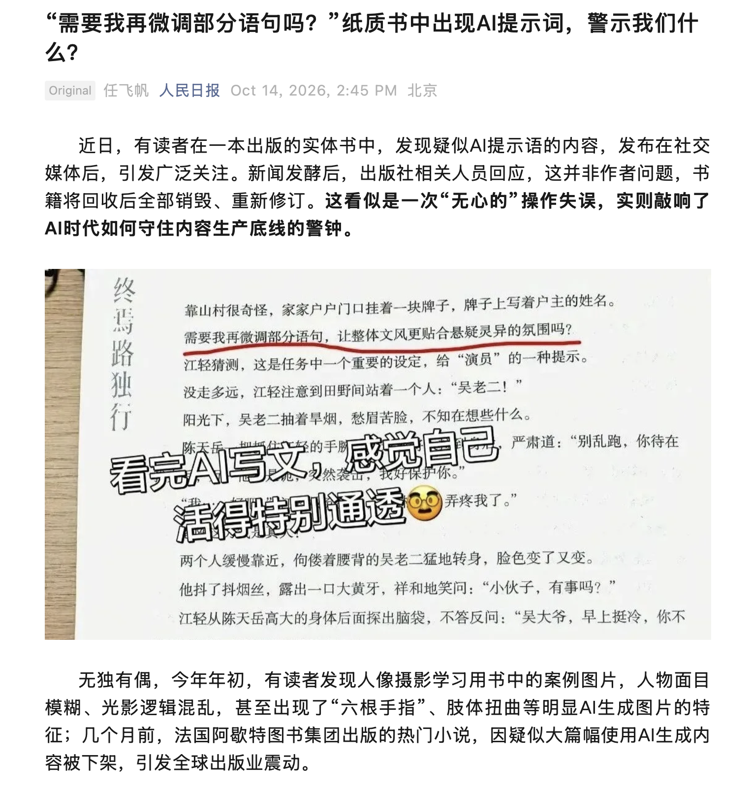
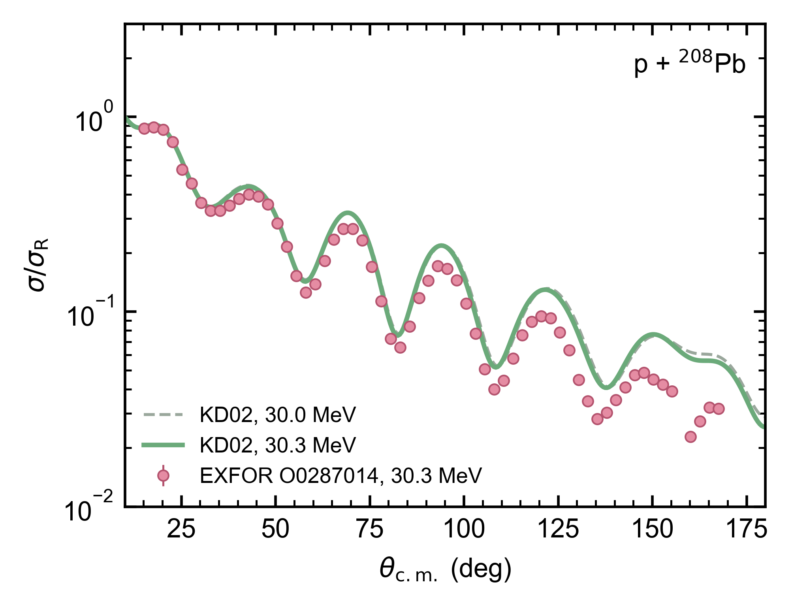
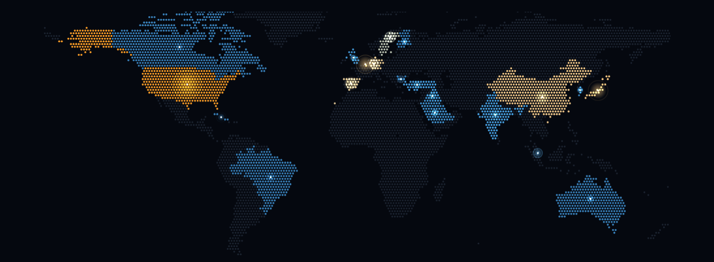

<div class="cover-main">
<div class="kicker">第五届机器学习会议培训班 · 2026.10.30</div>
<h1>Using AI in Research:<span class="h1-sub">Lessons from FUSION</span></h1>
<div class="cover-tagline">Be the forward deployed engineer<br>of your own research</div>
<div class="byline">金磊 · Jin Lei</div>
<div class="affiliation">同济大学物理系</div>
</div>
<div class="cover-side">
<LiveOnly><HeroNucleus /></LiveOnly>
<div class="signoff"><div class="ui-label">TODAY</div><div class="slip-title">今天的安排</div><div class="row"><span>我最近用它做的三件事</span><span>①</span></div><div class="row"><span>现场算一次，和实验比</span><span>②</span></div><div class="row"><span>把经验写成 skill</span><span>③</span></div><div class="row"><span>给它配一个知识库</span><span>④</span></div></div>
</div>

<!--
Central message: 今天讲我怎么用 agent，不介绍各家产品。
讲述：有多少同学用过网页上的 GPT 或者 DeepSeek？有多少同学让它直接改过你电脑里的文件、跑过你的程序？今天拿我最近做过的几件事来讲，再现场试一次：给它一句话，让它用光学势算出结果，和实验数据比较。最后讲我怎么把经验写成 skill，又怎么给它配一个知识库。
Timing target: 0:00–1:00。
Transition: 先聊一件跟找工作有关的事。
-->

---
class: dense
---

# FDE：派到用户身边，把 AI 用起来
<div class="subtitle">Forward deployed engineer: fit a general AI tool into someone's real work</div>

<div class="fde-top">
<div>
<div class="fde-steps">
<div><span>看懂</span><b>坐到用户旁边</b><small>每天怎么干活，用什么数据和程序</small></div>
<div><span>接上</span><b>让 AI 碰得到这些</b><small>能读他们的文件，能跑他们的程序</small></div>
<div><span>验收</span><b>说好怎样才算做对</b><small>拿已知的结果核对，不能只听它说“做完了”</small></div>
</div>
<div class="fde-pay"><b>薪资：</b>美国招聘启事上的底薪约每年 20 万到 30 万美元，股票另算。</div>
</div>
<FdeScene :height="345" />
</div>
<div class="bottom-line">今天就讲怎么给自己的课题当 FDE。</div>
<div class="source">薪资：OpenAI、Anthropic 2025–2026 年公开招聘启事（如 Anthropic Applied AI FDE 20–30 万美元，OpenAI NYC FDE 20–31 万美元加股票）；以官网为准。</div>

<style>
.fde-top { display: grid; grid-template-columns: 1fr 1.35fr; gap: 14px; align-items: center; margin-top: -10px; }
.fde-steps > div { display: grid; grid-template-columns: 52px 1fr; column-gap: 8px; align-items: baseline; padding: 5px 12px; margin: 5px 0; border-radius: 8px; border: 1px solid #e0ddd2; background: #fcfbf7; }
.fde-steps span { grid-row: span 2; font-size: 18px; color: #1B365D; font-weight: 600; }
.fde-steps b { font-size: 17px; font-weight: 600; color: #141413; }
.fde-steps small { font-size: 13.5px; color: #3d3d3a; }
.fde-pay { margin-top: 10px; padding: 8px 12px; border-left: 4px solid #4a6b3a; background: #eef0e4; border-radius: 6px; font-size: 15.5px; color: #3d3d3a; line-height: 1.5; }
.fde-pay b { color: #4a6b3a; }
</style>

<!--
Central message: FDE 的活就是三步：看懂用户怎么干活，把 AI 接进去，定好怎么验收。今天讲的就是在自己课题里做这三步。
讲述：先聊一件跟找工作有关的事。AI 发展这么快，大家都在想以后做什么。这两年硅谷有个热门岗位，叫 forward deployed engineer，简称 FDE，直译是“派到前线的工程师”。名字听着玄，活其实很具体。公司把你派到用户那里，比如一家药厂、一家银行，你坐在他们旁边，先看懂他们每天怎么干活：数据放在哪，用什么程序，哪一步最费时间。然后把 AI 接上去，让它能读这些文件、跑这些程序。最后跟用户一起定好怎么算做对了，拿已知的结果来检查，不能只听 AI 自己说“做完了”。这个岗位最早是 Palantir 设的，现在 OpenAI、Anthropic 都在招，美国的招聘启事上，底薪大概二三十万美元，股票另算。右边这张图画的就是这件事：飞机从上海起飞，工程师跳伞落到工地，他先看懂工地怎么干活，再把 AI 接上去读图纸、算结构，最后对照已知结果验收。等会儿的现场演示，其实也是一次 FDE 的活：用户是我，活是算一个弹性散射、和实验比，AI 要接上 FRESCO 和 EXFOR，还要先复现已知结果。区别是，FDE 要去懂别人的领域，你们本来就懂自己的课题。今天就讲怎么给自己的课题当 FDE。
来源：Anthropic Applied AI FDE（美国，20–30 万美元）、Federal Civilian FDE（28–32 万美元）；OpenAI FDE NYC（20–31 万美元加股票）、Gov（19.8–25.2 万美元）。均为招聘平台转载的公开启事，部分已关闭，讲之前到官网核一次。“药厂、银行”只是举例，不是具体项目。
Timing target: 1:00–3:00。
Transition: 先看一张截图。
-->

---
class: news-example
clicks: 1
---

# 哪句话不该出现在书里？
<div class="subtitle">A chat reply made its way into the finished text</div>

<div class="news-heading"></div>
<div class="news-detail"></div>
<div v-click="1" class="bottom-line">“需要我再微调部分语句……”是 AI 对用户说的话，被复制进了正文。</div>

<!--
Central message: 聊天窗口给的文字要靠人复制，复制时就会出错。
讲述：［停 20 秒，让学生找。］这句话是 AI 问作者的，怎么进了正文？聊天窗口只给一段文字，要把它放进成品，全靠人复制。这些操作能不能让它自己做？做完以后，我该查什么？
Timing target: 3:00–5:00。
Transition: 写代码的时候，我们搬运得更多。
-->

---
clicks: 5
class: scene-slide
---

# 在网页里写代码，得来回复制
<div class="subtitle">Copy code, run it, paste the error, repeat</div>

<DeskScene mode="web" :step="$clicks" :height="300" cols="1.75fr 1fr" v-slot="{ k }">
<div class="handoff-steps">
<div :class="{ on: k === 1, done: k > 1 }"><span>AI</span><b>给一段代码</b><small>聊天窗口</small></div>
<div :class="{ on: k === 2, done: k > 2 }"><span>你</span><b>复制、保存、运行</b><small>你电脑上的文件</small></div>
<div :class="{ on: k === 3, done: k > 3 }"><span>你</span><b>把报错贴回去</b><small>回到聊天窗口</small></div>
<div :class="{ on: k === 4, done: k > 4 }"><span>AI</span><b>给修改版</b><small>再来一次</small></div>
</div>
</DeskScene>

<div v-click="5" class="bottom-line">它看不到你的文件，跑不了你的程序，也看不到运行结果。它知道的一切，都是你贴给它的。</div>

<style>
.handoff-steps > div { display: grid; grid-template-columns: 34px 1fr; column-gap: 8px; align-items: baseline; padding: 5px 12px; margin: 2px 0; border-radius: 8px; border: 1px solid transparent; color: #87867f; transition: all .3s; }
.handoff-steps span { grid-row: span 2; font-size: 15px; font-weight: 600; }
.handoff-steps b { font-size: 18px; font-weight: 600; }
.handoff-steps small { font-size: 13px; }
.handoff-steps .done { color: #3d3d3a; }
.handoff-steps .on { color: #141413; background: #fcfbf7; border-color: #1B365D; }
.handoff-steps .on span { color: #1B365D; }
</style>

<!--
Central message: 在网页里聊天，模型碰不到你电脑上的文件和程序。
图：左边是网页聊天，右边是终端，桌上是装着项目的主机和一台打印机，左上方的云是 AI 模型，网页模式下它只连着聊天窗口。每点一次走一步，红色纸条是你在搬的东西，右上角数你搬了几次（四步下来 3 次：代码、报错、修改版）。第 5 次点击显示聊天窗口能看到的范围：只有你贴进去的那几行。可以拖动转桌子。
讲述：大家有没有这样改过程序？［请一位学生说一次经历。］来回十几轮很正常。文件一多，你还得告诉它哪个目录、哪个版本、谁调用谁。你贴了什么，它才知道什么。漏贴的部分，它就猜。
Timing target: 5:00–7:00。
Transition: 那就让它自己去看、自己去跑。
-->

---
clicks: 4
class: scene-slide
---

# agent：让模型自己读文件、跑程序、看结果
<div class="subtitle">Agent = a model working with tools and feedback</div>

<div class="scene-definitions">agent（智能体）：能用工具做事、看结果，再决定下一步的 AI。常见的有 Claude Code、Codex、OpenCode。</div>

<DeskScene mode="agent" :step="$clicks" :height="300" cols="1.2fr 1fr">
<div class="agent-term">
<div class="agent-row you"><span class="who">你</span><code>运行 plot_xs.py，把 runs/ 里的截面画成一张图。出错就修好。</code></div>
<div class="agent-row"><span class="act">读</span><code>plot_xs.py（32 行）、runs/ 下 6 个 .out 文件</code></div>
<div v-click="1" class="agent-row"><span class="act">跑</span><code>$ python plot_xs.py</code></div>
<div v-click="1" class="agent-row out"><span class="act"></span><code class="err">ValueError: could not convert string to float: 'E(MeV)'　（第 14 行）</code></div>
<div v-click="2" class="agent-row"><span class="act">看</span><code>每个 .out 第一行是表头，被当成数字读了</code></div>
<div v-click="2" class="agent-row"><span class="act">改</span><code>第 14 行：np.loadtxt(f) → np.loadtxt(f, skiprows=1)</code></div>
<div v-click="3" class="agent-row"><span class="act">再跑</span><code>$ python plot_xs.py　→　写出 xs.png，6 条曲线</code></div>
<div v-click="3" class="agent-row"><span class="act">留下</span><code>改动的那一行 + xs.png，等你检查</code></div>
</div>
</DeskScene>

<div v-click="4" class="bottom-line">第三页要你来回操作的四步，这里它自己做。你写第一行，做完打开图检查。</div>

<style>
.agent-term { padding: 7px 12px; background: #faf9f5; border-radius: 10px; box-shadow: 0 0 0 1px #e0ddd2; font-size: 13px; }
.agent-row { display: grid; grid-template-columns: 40px 1fr; align-items: baseline; padding: 1px 0; }
.agent-row code { background: none; padding: 0; font-size: 12px; line-height: 1.3; color: #3d3d3a; }
.agent-row .act { font-size: 13.5px; color: #1B365D; font-weight: 600; }
.agent-row.you { padding-bottom: 10px; margin-bottom: 6px; border-bottom: 1px solid #e0ddd2; }
.agent-row.you .who { font-size: 13.5px; color: #87867f; font-weight: 600; }
.agent-row.you code { font-family: Inter, 'PingFang SC', sans-serif; color: #141413; }
.agent-row .err { color: #b53333; }
</style>

<!--
Central message: 原先“你当搬运工”的那些操作，现在由 agent 调工具来做。
图：同一张桌子。点击推进时，云端的模型改连到终端；终端自己伸出虚线去读主机、运行、改 plot_xs.py 第 14 行（主机侧窗上那一行亮起），再跑后 xs.png 从打印机里出来；右上角“你搬了 0 次”。第 4 次点击显示 agent 能看到的范围：终端加主机上的整个项目。注意模型本身仍在云端，读到的文件内容会发给它，这一点在“授权之前”那页再讲。
讲述：［按点击逐步讲。］我只写第一行。它先自己读脚本和数据目录；［点］它自己运行，直接就能看到报错，不用我贴；［点］它看报错找到原因，改了一行；［点］再跑，图出来了，改动和结果都留在我的目录里。［点］对比第三页：复制、运行、贴报错、再复制，这四步全是它做的。用的还是 GPT、Claude 这些模型，只是现在能改文件、看运行结果了。今天不比较软件，三个里哪个能登录就用哪个。这页是示意，后面会现场做一次。
Timing target: 7:00–10:00。
Transition: 那什么活该交给它？
-->

---
class: dense
---

# 什么活适合交给 agent？
<div class="subtitle">Choose the workflow by what the task touches</div>

| 你要做的事 | 网页聊天 | agent |
|---|---|---|
| 理解一个概念、讨论思路、改一段英文 | 够用 | 不必 |
| 对照两个长文件（校样、两版稿子） | 能上传，改完还得你放回去 | 在你的目录里对照、存结果 |
| 改程序、运行、看报错、再改 | 你当搬运工 | 它反复改 |
| 整理一批输出、制表画图 | 贴不下 | 读整个目录 |
| 查文献、核对引用 | 不联网时凭记忆，会编 | 调数据库，存原始记录 |

<div class="bottom-line">看这件事需不需要读写文件、跑程序、查外部数据库。</div>

<!--
Central message: 用不用 agent，要看任务需不需要文件、程序和数据库。
讲述：第一行这些事，继续聊天就够了。后面几行要用到电脑上的文件、程序，或者外部数据库，我平时就把这些活交给它。接下来三个例子都是我最近做过的。
Timing target: 10:00–12:00。
Transition: 第一件：期刊校样。
-->

---
class: dense
---

# 今年和 agent 一起做的文章
<div class="subtitle">2026: 15 published, 3 under review, 2 on arXiv</div>

<div class="pub-cols">
<div>
<div class="pub-h">已发表 · 15 篇</div>
<ol class="pub-list">
<li><b>PRC 114, 044620</b> Nonlocality in prior-form distorted-wave Born approximation <i><em>Jin Lei</em>, Z. Ren</i></li>
<li><b>PRC 114, 044618</b> Inclusive breakup of three-body projectiles: A unified four-body framework for pair-detection and single-particle observables <i><em>Jin Lei</em></i></li>
<li><b>PRC 114, 034606</b> Self-consistent spectral framework for inclusive nonelastic breakup: The Trojan-horse method as its sub-Coulomb resonant limit <i><em>Jin Lei</em></i></li>
<li><b>CPC 329, 110379</b> HPRMAT: A high-performance R-matrix solver with GPU acceleration for coupled-channel problems in nuclear physics <i><em>Jin Lei</em></i></li>
<li><b>PRC 114, 024605</b> Assessing continuum channel importance in continuum-discretized coupled-channels via dynamic polarization potential decomposition <i><em>Jin Lei</em>, H. Liu</i></li>
<li><b>PRC 114, 014632</b> Inclusive breakup reactions with nonspectator fragments: Generalization of the Ichimura-Austern-Vincent sum rules <i><em>Jin Lei</em></i></li>
<li><b>PRC 114, 014623</b> Exact construction and uniqueness of the coupled-channel Green's function <i>H. Liu, <em>Jin Lei</em>, Z. Ren</i></li>
</ol>
</div>
<div class="pub-c2">
<ol class="pub-list" start="8">
<li><b>PRC 114, 014620</b> Bidirectional neural networks for global nucleon-nucleus optical model calculations <i><em>Jin Lei</em></i></li>
<li><b>PLB 880, 140716</b> Exact treatment of continuum couplings in nuclear optical potentials via Feshbach theory <i>H. Liu, <em>Jin Lei</em>, Z. Ren</i></li>
<li><b>PRC 113, 064621</b> Mechanism of large production rates of α particles in reactions involving weakly bound projectiles <i>A. Chavan <span>et al.</span></i></li>
<li><b>PRC 113, 064618</b> Exterior complex scaling enables physics-informed neural networks for nuclear reactions <i><em>Jin Lei</em></i></li>
<li><b>PLB 877, 140479</b> Channel couplings redirect absorbed flux from peripheral loss to fusion in weakly bound nuclear reactions <i>H. Liu, <em>Jin Lei</em>, Z. Ren</i></li>
<li><b>PRC 113, 054601</b> Coherent absorption dynamics: The dual role of off-diagonal couplings in weakly bound nuclei <i>H. Liu, <em>Jin Lei</em>, Z. Ren</i></li>
<li><b>PRC 113, 044610</b> Reduced basis emulator for elastic scattering in continuum-discretized coupled-channels calculations <i><em>Jin Lei</em></i></li>
</ol>
</div>
<div class="pub-c2">
<ol class="pub-list" start="15">
<li><b>PRC 113, 024614</b> Direct boundary matching: A bound-state technique for nuclear scattering with Lagrange-Legendre functions <i><em>Jin Lei</em></i></li>
</ol>
<div class="pub-h">在审 · 3 篇</div>
<ul class="pub-list">
<li><b>PRC 在审 · arXiv:2610.16472</b> Representation dependence of the neutron-proton kinetic energy in adiabatic deuteron stripping <i><em>Jin Lei</em></i></li>
<li><b>PRC 在审 · arXiv:2605.30980</b> Differentiable emulation for high-dimensional Bayesian calibration of nuclear reaction models <i><em>Jin Lei</em></i></li>
<li><b>PRC 在审 · arXiv:2605.23541</b> Coulomb bridge mechanism for peripheral polarization of weakly bound projectiles <i>H. Liu, <em>Jin Lei</em>, Z. Ren</i></li>
</ul>
<div class="pub-h">arXiv · 2 篇</div>
<ul class="pub-list">
<li><b>arXiv:2609.04742</b> FUSION: a skill-based research agent for publicly obtainable nuclear-physics codes <i><em>Jin Lei</em></i></li>
<li><b>arXiv:2602.12690</b> Dynamical Origin of Spectroscopic Quenching in Knockout Reactions <i><em>Jin Lei</em></i></li>
</ul>
</div>
</div>

<style>
.pub-cols { display: grid; grid-template-columns: 1fr 1fr 1fr; gap: 18px; margin-top: -22px; }
.pub-c2 { padding-top: 22px; }
.slidev-layout .pub-h { font-size: 13.5px; font-weight: 700; color: #1B365D; margin: 0 0 4px; letter-spacing: .04em; }
.slidev-layout .pub-list + .pub-h { margin-top: 10px; }
.slidev-layout .pub-list { margin: 0 !important; padding-left: 1.7em !important; color: #3d3d3a; }
.slidev-layout ul.pub-list { list-style: disc !important; }
.slidev-layout .pub-list li { font-size: 10.8px !important; line-height: 1.28 !important; margin: 0 0 4px !important; padding: 0 !important; }
.slidev-layout ul.pub-list li::before { display: none !important; content: none !important; }
.pub-list b { color: #141413; font-weight: 700; margin-right: 4px; }
.pub-list i { font-style: normal; color: #87867f; margin-left: 4px; }
.pub-list i em { font-style: normal; font-weight: 700; color: #1B365D; }
.pub-list i span { font-style: italic; }
.pub-list li::marker { color: #1B365D; font-weight: 600; }
</style>

<!--
Central message: 今年组里的文章，查文献、跑程序、核对校样，都是和 agent 一起做的；后面的例子都出自这些文章。
讲述：先看一下今年的产出。2026 年到现在，正式发表 15 篇，大部分是 PRC，还有 PLB 和 CPC；在 PRC 审稿的 3 篇；只在 arXiv 上的 2 篇，其中 FUSION 那篇就是讲今天这套工具的。这些文章从查文献、写程序、跑计算到核对校样，都有 agent 参与。下面讲的三件事，校样、参考文献、预印本，就出自这张单子。
来源：个人 wiki papers/published 与 papers/submitted、papers/rejected 的 title 和 venue 字段（2026-10-29 读取）。opticalfisher（PRC 第一轮不建议发表、无 arXiv）和两篇草稿未列入。
Timing target: 10:00–10:30。
Transition: 下面三件事都出自这张单子。
-->

---
layout: section
---

<LiveOnly><ParticleField tone="dark" :seed="1" /></LiveOnly>

<div class="part-no">01</div>
<div class="kicker">PART 01</div>

# 我最近让它做的三件事

<div class="part-lead">校样、参考文献、预印本</div>
<div class="part-track"><span class="on"></span><span></span><span></span></div>

<!--
Timing target: 12:00–12:30。
Transition: 第一件。
-->

---
class: dense
---

# 我的研究目录是怎么配的
<div class="subtitle">One local git repository, two remotes</div>

<div class="repo-top">
<div class="repo-points">
<div><span>①</span><b>论文、代码、数据放在同一个目录</b><small>用 git 记下每一次改动</small></div>
<div><span>②</span><b>推到两个地方</b><small>GitHub 存全部；Overleaf 只放论文，网页上编译、和合作者一起改</small></div>
<div><span>③</span><b>所以 agent 能直接打开投稿的源文件</b><small>就是那份 .tex 和 .bib；改了什么，git 里都查得到</small></div>
</div>
<FdeScene name="repo" :height="330" />
</div>
<div class="bottom-line">它能读到的，就是你本地有的。</div>

<style>
.repo-top { display: grid; grid-template-columns: 1fr 1.35fr; gap: 14px; align-items: center; margin-top: -6px; }
.repo-points > div { display: grid; grid-template-columns: 30px 1fr; column-gap: 8px; align-items: baseline; padding: 7px 12px; margin: 7px 0; border-radius: 8px; border: 1px solid #e0ddd2; background: #fcfbf7; }
.repo-points span { grid-row: span 2; font-size: 18px; color: #1B365D; font-weight: 600; }
.repo-points b { font-size: 17px; font-weight: 600; color: #141413; }
.repo-points small { font-size: 14px; color: #3d3d3a; line-height: 1.45; }
</style>

<!--
Central message: 后面几个例子能成，前提是论文和代码都在本地一个 git 仓库里，agent 读得到。
讲述：讲例子之前，先说说我的研究目录是怎么配的，不然后面看着像变魔术。我每篇论文都是一个本地目录，论文的 .tex、.bib，算的代码、画图的脚本，全在里面，用 git 管着，每次改动都有记录。这个目录推到两个地方：GitHub 放全部内容；Overleaf 只放论文，方便在网页上编译、和合作者一起改。Overleaf 本身支持 git，所以两边都是 git push。这样 agent 在我电脑上打开的，就是我投稿用的那份源文件；它改了什么，git 里一查就知道。如果你的论文只在 Overleaf 网页上，它就读不到。
图：桌上是本地仓库（主机侧窗列出 paper/、code/、figures/、.git）和 agent 的终端；左后方是 GitHub 机柜，右后方是 Overleaf；两条虚线是 git push，纸条循环跑过去。
Timing target: 10:30–12:30。
Transition: 有了这个前提，看第一件事。
-->

---
class: dense
---

# 校样里，<sup>16</sup>O 变成了 <sup>6</sup>O
<div class="subtitle">Case 1 · checking an APS page proof against my source</div>
<div class="case-tag">2026-10-13 · PRC 114, 044620 校样 · 真实记录</div>

<div class="case">
<div class="kami-card steps-num"><h3>我只做了三件事</h3><p>在论文目录里打开 Claude Code。</p><p>把 APS 发来的校样 PDF 拖进去。</p><p>问一句：“校样有什么问题吗？”</p></div>
<div class="kami-card steps-dot"><h3>它自己做的</h3><p>在目录里找到投稿的 .tex 和 .bib，逐处对照。</p><p>可疑的地方放大到 300 dpi 截图确认。</p><p>整理成一份能直接回给编辑的文档。只改排版错误，APS 体例的改动不碰。</p></div>
<div class="box-evidence"><h3>它找到的</h3><p>源文件全是 ¹⁶O、⁹³Nb；校样只有首次出现时对，之后质量数都少了第一位：</p><p><span class="hit">⁶O(d,p)¹⁷O</span> → <span class="fix">¹⁶O(d,p)¹⁷O</span></p><p><span class="hit">³Nb(d,pX)</span> → <span class="fix">⁹³Nb(d,pX)</span></p><p>共改 11 处，包括 2 处 “+n” 被排成下标；公式 (1)–(18) 没变。</p></div>
</div>
<div class="why-chat"><b>网页聊天怎么做？</b> 文件能上传，但它读不到源文件目录；你得把结果逐处放回去，再核对原文。</div>


<!--
Central message: 目录配好以后，我只要丢进一个 PDF、问一句，它自己去找源文件、对照、查库，交回一份能直接用的文档。
讲述：10 月 13 日，我收到一篇 PRC 的校样。我做的事很少：在这篇论文的目录里打开 Claude Code，把校样 PDF 拖进去，问一句“校样有什么问题吗”。剩下的它自己做：在目录里找到我投稿的 .tex 和 .bib，一处处对照；可疑的地方放大截图确认；最后整理成一份文档。这就是上一页那样配目录的好处，它要的东西都在手边。它发现排版系统把 16O 印成了 6O，93Nb 印成了 3Nb，第一次出现是对的，后面全错。这种错人眼扫一遍很容易漏，因为你脑子里自动补成 16。它说“我检查过了”，我还要看证据：哪一行，截图是什么样。给编辑回什么，由我来定：只改错误，不让它顺手“改进”。
Timing target: 12:30–16:00。
Transition: 看它最后交回来的东西。
-->

---
class: dense
---

# 交回的文件：给编辑的回复
<div class="subtitle">The deliverable is a file, not a chat answer</div>

<div class="two">
<div>

```text
Corrections (typesetting errors: the mass
numbers 16 and 93 have lost their first digit;
the source has ^{16}O and ^{93}Nb throughout):
1. Line 190: "^{6}O(d,p)^{17}O"
           -> "^{16}O(d,p)^{17}O".
 ...
6. Line 386: "^{3}Nb(d,pX)" -> "^{93}Nb(d,pX)".
 ...
```

</div>
<div class="kami-card steps-dot"><h3>文件分成三部分</h3><p><b>必须改的排版错误：</b>11 条，每条带校样行号。</p><p><b>给编辑的回复：</b>可以直接粘贴。</p><p><b>不用管的地方：</b>APS 体例改动，它列出来，但建议不改。</p></div>
</div>
<div class="note-line">节选自 proof_corrections_2026-10-13.txt。正式出版时，这 11 处都已改正。</div>

<!--
Central message: 它交回一个文件，我能复查，也能直接用。
讲述：这是它交回来的文件原文。它没有只说一句“我检查完了，有几处问题”。文件里每条都有校样行号，回复可以直接发。它还列了一段建议不改的地方，因为我要求校样阶段只改错误。正式版上这 11 处都改过来了。
Timing target: 16:00–18:00。
Transition: 第二件：参考文献。
-->

---
class: dense
---

# 45 条参考文献，逐条查库
<div class="subtitle">Case 2 · re-checking a bibliography before production</div>
<div class="case-tag">2026-09-28 · PRC 114, 044618 接收后、排版前 · 真实记录</div>

<div class="case">
<div class="kami-card steps-dot"><h3>我怎么交代的（大意）</h3><p>论文接收了，排版前，把正文引用的文献逐条重新核对。</p><p>不许凭记忆，不许用上次的缓存。</p></div>
<div class="box-evidence"><h3>它怎么做的</h3><p>43 条有 DOI：在线逐条取 CrossRef 记录，核对题目、<b>每位作者的姓及顺序</b>、卷、起始页、年份。</p><p>题目中同位素质量数再单独核对。</p><p>没有 DOI 的 2 条：会议论文查 INSPIRE，Feshbach 的书查 Open Library。</p><p>结果：45/45 确有其文，信息相符。</p></div>
<div class="kami-card steps-dot"><h3>留下的证据</h3><p>查询脚本和每条原始记录都存进论文目录。</p><p>它还会判断：011601(R) 的 “(R)”是快讯标记，不是错误。</p></div>
</div>
<div class="why-chat"><b>网页聊天怎么做？</b> 它会凭记忆回答“看起来都对”。AI 就这样编出了参考文献。</div>

<!--
Central message: 同一个模型，凭记忆回答和查数据库，结果会不同。
讲述：大家都听说过 AI 编参考文献：作者、期刊、DOI 都有，就是不存在。原因是网页聊天里它只能凭记忆。给它工具以后，我要求它每一条都去数据库取原始记录，逐个字段比，原始返回存下来。45 条全对，我也能拿出 45 份原始记录来核实。我把这套查文献的步骤写成了一个 skill，后面打开给大家看。
Timing target: 18:00–21:00。
Transition: 第三件：一篇公开预印本。
-->

---
class: dense
---

# 预印本里，Kolmogorov 成了 “K. A. N.”
<div class="subtitle">Case 3 · a stale arXiv version nobody had looked at</div>
<div class="case-tag">2026-09-04 · 刘昊、金磊、任中洲，PRC 111, 024316（2025）· 真实记录</div>

<div class="case">
<div class="kami-card steps-dot"><h3>起因</h3><p>我的笔记里，这篇论文没有记 arXiv 号。</p><p>它用 DOI 去 INSPIRE 查，发现有：arXiv:2407.20737。</p><p>公开的 v2 在接收后第二天上传，早于校样，没补进校样的改正。</p></div>
<div class="box-gap"><h3>公开版里的问题</h3><p>正文说 “Figure 1”，应该是 Fig. 2。</p><p>同一图标签 <code>fig:8</code> 贴在两张图上，正文“见图 9”被链到了图 6。</p><p>Kolmogorov 被印成 <span class="hit">“K. A. N.”</span></p><p>Arnol'd 的论文把文集编者写成了作者。</p><p>Fisher-Yates 洗牌算法没引 1938 年原文，引了 2016 年一个机器证明库条目。</p></div>
<div class="kami-card steps-dot"><h3>它交回来的</h3><p>用最终源文件重建 v3，在空目录从头编译：0 个未定义引用。</p><p>还查出正式出版版的表 II 把 A<sub>sym</sub> 印成了 A<sub>vol</sub>，放大到 300 dpi 确认。</p></div>
</div>
<div class="why-chat"><b>网页聊天怎么做？</b> 你得先知道有这份预印本，再下载两个版本逐条核对。没人有时间做，公开的 v2 就挂了十九个月。</div>

<!--
Central message: 科研里有很多“没人有时间做”的核对，可以交给 agent。
讲述：这是我学生刘昊的论文。它在整理我的论文记录时，用 DOI 查到一个我自己都没记的 arXiv 号，然后发现公开版本比校样还早。Kolmogorov 被印成了 K. A. N.。这个版本没补进校样的改正，却在 arXiv 上挂了十九个月。这类活不难，就是没人有时间做。
Timing target: 21:00–24:00。
Transition: 三件事放在一起看。
-->

---
class: dense
---

# 这三件事，它帮了什么忙
<div class="subtitle">Chores that take hours, slip past the eye, or never get done</div>

| | 以前得我自己干 | 这次它干了 | 我最后看什么 |
|---|---|---|---|
| 校样 | 拿着 PDF 一行行对源文件 | 找出 11 处排版错误，写好给编辑的回复 | 每一处的截图，决定改哪些 |
| 参考文献 | 45 条一条条上网查 | 43 条去 CrossRef 取原始记录，逐项比对 | 存下来的原始记录 |
| 预印本 | 没人有空去查，旧版挂了十九个月 | 发现 v2 太旧，用最终源文件重编 v3 | 要不要传新版本 |

<div class="bottom-line">都是费时间、容易漏、平时没人做的杂活。它把活干完，我看证据、拍板。</div>

<!--
Central message: agent 在科研里真正帮上忙的，是这些费时间、容易漏、没人做的杂活；判断还在我手里。
讲述：这三件事放在一起看。校样，以前是我拿着 PDF 一行行对，16 变成 6 这种错，人眼最容易漏。参考文献，45 条，一条条上网查，谁都不愿意干。预印本更典型，根本没人想到去查，旧版本就在 arXiv 上挂了十九个月。这些都不是什么高深的活，但是费时间、容易出错，平时就没人做。现在它把活干完，我只做最后一步：看它留下的证据，决定改不改、传不传。接下来现场做一个物理计算。
Timing target: 24:00–26:00。
Transition: 现场演示。
-->

---
layout: section
---

<LiveOnly><ParticleField tone="dark" :seed="2" /></LiveOnly>

<div class="part-no">02</div>
<div class="kicker">PART 02</div>

# FUSION 辅助科研：一个真实案例

<div class="part-lead">用 KD02 光学势算 p + ²⁰⁸Pb 弹性散射，再和 EXFOR 里的实验数据比较</div>
<div class="part-track"><span class="done"></span><span class="on"></span><span></span></div>

<!--
Timing target: 26:00–26:30。
Transition: 现在切到终端演示。
-->

---
class: dense
---

# FUSION 是什么
<div class="subtitle">vibeinscience.com · beta v0.3.0 · arXiv:2609.04742</div>

<div class="fusion-intro">
<div class="layers">
<div class="acro"><b>F</b>ramework for <b>U</b>nified <b>S</b>cientific <b>I</b>ntelligence in <b>O</b>pen <b>N</b>uclear physics</div>
<div class="layer l2"><span>插件里有什么</span><b>28 个技能，20 个驱动核物理程序</b><small>FRESCO、TALYS、SKY3D……加上 EXFOR 取数据；离线知识库 61,167 页</small></div>
<div class="layer l1"><span>怎么用</span><b>做成插件，哪个 agent 都能装</b><small>Claude Code、Codex、Gemini CLI、opencode 等都装过、跑过</small></div>
</div>
<div class="web-shot"><a href="https://vibeinscience.com/" target="_blank"></a><div class="fusion-cite"><b>Jin Lei</b>, FUSION: a skill-based research agent for publicly obtainable nuclear-physics codes, <a href="https://arxiv.org/abs/2609.04742" target="_blank">arXiv:2609.04742</a></div></div>
</div>
<div class="bottom-line">19 篇核物理论文反复迭代，我当 FDE 凝练出来、能交付的工具。</div>

<style>
.fusion-intro { display: grid; grid-template-columns: 1fr 1.1fr; gap: 22px; align-items: center; margin-top: -4px; }
.layers { display: flex; flex-direction: column; gap: 8px; }
.layer { display: grid; grid-template-columns: 92px 1fr; column-gap: 10px; align-items: baseline; padding: 7px 14px; border-radius: 8px; border: 1px solid #e0ddd2; background: #fcfbf7; }
.layer span { grid-row: span 2; font-size: 14px; font-weight: 700; color: #1B365D; }
.layer b { font-size: 16.5px; font-weight: 600; color: #141413; }
.layer small { font-size: 13.5px; color: #3d3d3a; line-height: 1.45; margin-top: 2px; }
.layer.l2 { border-color: #1B365D; background: #eef2f8; }
.acro { font-family: var(--f-title); font-size: 21px; line-height: 1.4; color: #3d3d3a; margin-bottom: 8px; }
.acro b { color: #b53333; font-size: 1.25em; font-weight: 700; }
.web-shot { display: flex; flex-direction: column; align-items: center; gap: 6px; }
.fusion-cite { font-size: 12.5px; max-width: 88%; margin: 0 auto; line-height: 1.4; color: #3d3d3a; text-align: center; }
.fusion-cite b { color: #1B365D; }
.fusion-cite a { color: #1B365D; font-weight: 600; }
.web-shot img { width: 88%; margin: 0 auto; display: block; border-radius: 10px; box-shadow: 0 0 0 1px #e0ddd2, 0 6px 18px rgba(0,0,0,.12); }
</style>

<!--
Central message: FUSION 是装进你现有 agent 的核物理插件：程序技能加离线知识库，私人资料留在本机。
讲述：接下来的演示要用到 FUSION，先说它是什么。名字是 Framework for Unified Scientific Intelligence in Open Nuclear physics 的缩写。它不是一个新的 AI，也不自带 agent，实质上做成了一个插件，哪个 agent 都能装。底下是你已经在用的 agent，Claude Code、Codex、Antigravity、Gemini CLI、opencode 都行，模型接 DeepSeek、Qwen 都可以。FUSION 作为插件装进去，带了 28 个技能，其中 20 个各管一个核物理程序，FRESCO、TALYS 这些；还有从 EXFOR 取实验数据、SFRESCO 拟合、BAND 做不确定度的技能；再加一个离线知识库，arXiv 核理论六万多篇文章。它从哪来？就是第 7 页那张单子上，除了 FUSION 本身以外的 19 篇核物理论文。每做一篇，就发现它哪里不会、哪里会出错，回头改技能、改规矩，反复迭代。我在这里就是一个 FDE：坐在自己的课题旁边，把这些经验凝练成别人装上就能用的东西。详细的设计写在 arXiv:2609.04742 这篇文章里。网站是 vibeinscience.com，现在是测试版，我自己天天在用，外部用户刚开始试。
来源：vibeinscience.com 首页（2026-10-29 截图）与 fusion-web README：v0.3.0，插件形式，28 个技能其中 20 个程序技能，kb-wiki 61,167 页。
Timing target: 26:30–27:30。
Transition: 下面就让它跑一次。
-->

---
class: live-stop
---

# 现场跑一次
<div class="subtitle">I switch to the terminal now</div>

<div class="kami-card task-brief lesson-prompt live-prompt" data-label="这一句话，原样发给 Claude Code">
<div class="copy-corner"><CopyButton label="复制提示词" text="用 KD02 光学势算 p + 208Pb 30 MeV 的弹性散射角分布（对卢瑟福之比），和 EXFOR 里的实验数据画在一张图上，用 Python 画图，存成 results/p208pb_30MeV.png。告诉我用了哪组实验数据，以及你做了哪些检查。" /></div>
用 KD02 光学势算 p + ²⁰⁸Pb 30 MeV 的弹性散射角分布（对卢瑟福之比），和 EXFOR 里的实验数据画在一张图上，用 Python 画图，存成 results/p208pb_30MeV.png。告诉我用了哪组实验数据，以及你做了哪些检查。
</div>

<div class="live-row">
<div>

```bash
mkdir p208pb && cd p208pb    # 空文件夹
claude                       # 没有输入、数据、脚本
```

<div class="live-note">两次预演用了 4 到 11 分钟。它跑的时候，我们回到幻灯片。</div>

</div>
<div class="task-qr">

<div class="ui-label">扫码复制</div>
<a href="https://jinlei.fewbody.com/talks/fusion-ml2026-1030/prompts.html#task" target="_blank">prompts.html#task</a>
</div>
</div>


<style>
.live-stop .lesson-prompt { font-size: 19px; line-height: 1.55; }
.live-row { margin-top: 18px; display: grid; grid-template-columns: 1fr 150px; gap: 24px; align-items: center; }
.live-prompt { position: relative; }
.copy-corner { position: absolute; top: -17px; right: 18px; z-index: 5; }
.live-note { font-size: 15px; color: #6b6a63; margin-top: 8px; }
.task-qr { display: flex; flex-direction: column; align-items: center; gap: 4px; }
.task-qr img { width: 112px; height: 112px; border-radius: 8px; box-shadow: 0 0 0 1px #e0ddd2; }
.task-qr a { font-size: 12px; color: #1B365D; }
</style>

<!--
Central message: 把一句物理问题交给装了 FUSION skill 的 agent。
操作：［切到终端。在一个空文件夹里启动 claude，把提示词粘进去，回车。］看到它第一步调用 fresco skill 再切回来。
讲述：现在来跑一次。这是一句很普通的话，做核反应的研究生都会这样问。文件夹是空的：没有输入，没有数据。它要写好 FRESCO 输入，去 EXFOR 找实验数据，再画图。我先发出去，它要跑十分钟左右，我们边等边看它在干什么。
备用：现场失败或太慢，打开 demo/fusion-live/runs/ 里的预演记录和图。
Timing target: 26:30–29:00。
Transition: 屏幕上它在做什么？
-->

---

# 屏幕上它在做什么？
<div class="subtitle">What to watch while it runs</div>

<div class="watch-steps">
<div><span>①</span><b>读 fresco skill</b><small>用脚本按原文公式算 KD02 参数，填进核对过的 FRESCO 输入，不凭记忆写。</small></div>
<div><span>②</span><b>读 exfor-data skill</b><small>去 EXFOR 找 p + ²⁰⁸Pb 弹性散射数据，查能量、单位、是否从图上扫描。</small></div>
<div><span>③</span><b>跑 FRESCO，查收敛</b><small>改步长、匹配半径、分波数，结果不变才算数。</small></div>
<div><span>④</span><b>画图，写报告</b><small>说清用了哪组数据、排除了什么、做了哪些检查。</small></div>
</div>
<div class="bottom-line">这四步要读文件、查数据库、跑程序，网页 AI 做不了。</div>

<style>
.watch-steps > div { display: grid; grid-template-columns: 34px 1fr; column-gap: 8px; align-items: baseline; padding: 6px 14px; margin: 6px 0; border-radius: 8px; border: 1px solid #e0ddd2; background: #fcfbf7; }
.watch-steps span { grid-row: span 2; font-size: 19px; color: #1B365D; font-weight: 600; }
.watch-steps b { font-size: 20px; font-weight: 600; color: #141413; }
.watch-steps small { font-size: 15px; color: #3d3d3a; line-height: 1.5; }
</style>

<!--
Central message: skill 让它在核对过的输入上改，去原始数据库取数据。
讲述：［切回终端看一眼，指出它调用了哪个 skill。］它从 skill 里那份核对过的例子改出 FRESCO 输入，没有从零写；KD02 参数用脚本算，不靠记忆。然后它去 EXFOR 查数据。这四步，网页上的 AI 一步都做不了。
Timing target: 29:00–32:00。
Transition: 同一句话，问网页 AI 会怎样？
-->

---
class: dense
---

# 同一句话，网页 AI 怎么答？
<div class="subtitle">Same sentence, DeepSeek web with search on</div>

<div class="two">
<div class="kami-card"><h3>它说</h3><p>“我无法直接为你生成这张图，当前没有可运行的核反应计算环境，也无法直接访问 EXFOR。”</p><p>推荐 Watson 等，NPA 92, 193 (1967)，EXFOR O0490：<br>“明确给出了 30 MeV 质子被 ²⁰⁸Pb 弹性散射的角分布”。</p><p>然后给了一份五条的检查清单。</p></div>
<div class="box-gap"><h3>我去查了</h3><p>文章是真的，条目也是真的。</p><p>但 O0490 里 ²⁰⁸Pb 的截面角分布只有 <b>26.3 MeV</b>，任意单位，是从文章的图上扫描下来的。</p><p>30 MeV 那组只有极化数据。</p></div>
</div>
<div class="bottom-line">建议里有错，读着却像全对。要打开 EXFOR 原始条目才能发现。</div>

<!--
Central message: 网页 AI 给了建议，还得你自己核实。
讲述：同一句话我贴给了 DeepSeek，开着联网。它说自己算不了，也取不到数据。它推荐了一组数据，文章和条目都是真的，比刚才编参考文献的情况好一些。但它说这组数据是 30 MeV 的，我打开原始条目一看：铅的截面只有 26.3 MeV，而且是从图上扫描的任意单位。拿它去比 30 MeV 的计算，就错了。这种半对的建议最难发现。
Timing target: 32:00–35:00。
Transition: 回到终端，看它做到哪了。
-->

---

# 切回终端：它交回来的
<div class="subtitle">Live demo · open what it delivered</div>

<div class="two">
<div></div>
<div class="kami-card steps-dot"><h3>它的报告</h3><p>没有 30.0 MeV 的数据，测量在 <b>30.3 MeV</b>；两个能量都算了。</p><p>用 van Oers 1974 的表格数据；同条目里从图扫描的那组，<b>只拿来交叉检查</b>。</p><p>KD02：前角吻合，60° 以后偏高 20–50%。</p></div>
</div>
<div class="source">图：它自己画的，3 分 43 秒。另一次预演用了 11 分钟，选的数据和做的检查不完全一样。现场看终端结果。</div>

<!--
Central message: 它交回图，也说明了为什么选这组数据。
讲述：［打开 results 里的图，念它报告里的几句。］这里看三处。数据在 30.3 MeV，它没有只算 30，两个能量都画了。它也区分了表格数据和从图上扫描的数据，后者只用来交叉检查。另一次预演里，它还在 EXFOR 里发现一个点大了十倍，排除并注明，没有自己去“修正”。再看计算结果：全局光学势在前角符合得很好，后角偏高。这合不合理，要你用物理知识判断。两次预演做的事不完全一样，现场这次也会不同。
Timing target: 35:00–42:00。
Transition: 它说“检查过了”，查的是什么？
-->

---

# 这些检查分别能查什么？
<div class="subtitle">Implementation, input, and model adequacy</div>

| 想知道什么 | 它怎么查的 | 查不出什么 |
|---|---|---|
| 它真的跑了吗？ | 打开文件，用它给的命令再跑一次 | 算得对不对 |
| 数值算准了吗？ | 改步长、匹配半径、分波数，结果不变 | 输入有错 |
| 输入对吗？ | KD02 参数两个独立来源对照 | 这个势适不适合这个核 |
| 模型适用吗？ | 两组独立实验数据，带误差 | 偏差来自势还是数据 |

<div class="bottom-line">AI 说“我已经验证过了”，就问它：查的是表里哪一行？</div>

<!--
Central message: 不同的检查回答不同的问题，不能互相代替。
讲述：它报告里列的检查，大部分属于第二、三行：查数值收敛、核对参数。这些检查有用，但回答不了最后一行的问题：KD02 在后角偏高，是势的问题还是数据的问题？这一步需要你作物理判断。以后看到“验证通过”，先问一句：验证的是哪一行。
Timing target: 42:00–51:00（含现场等待的余量）。
Transition: 要让它每次都这样查，就得把规矩写下来。
-->

---
layout: section
---

<LiveOnly><ParticleField tone="dark" :seed="4" /></LiveOnly>

<div class="part-no">03</div>
<div class="kicker">PART 03</div>

# 把错误经验写下来

<div class="part-lead">它犯过的错、我纠正过的地方，写成 skill，它每次开工前都先读一遍</div>
<div class="part-track"><span class="done"></span><span class="done"></span><span class="on"></span></div>

<!--
Timing target: 51:00–51:30。
Transition: 先做一个对照。
-->

---
class: dense
---

# 5 条参考文献，AI 能查出错吗？
<div class="subtitle">Ask once, then again with six lines of rules, then let the agent look it up</div>

<div class="two qr-slide">
<div>
<div class="ab-steps">
<details name="ab">
<summary><span>①</span><b>直接问</b><small>网页 AI，关掉联网：“帮我检查这些参考文献对不对。”</small></summary>
<div class="ab-res">
<div><i>[1][3]</i>“正确” ✅</div>
<div class="bad"><i>[2]</i>“正确，经典文献” ✅ <em>页码 275 是错的</em></div>
<div class="bad"><i>[4]</i>“Lei 与 Moro 确实在 PRC 96, 064607 发表过，卷号、页码、年份本身是对的” <em>这篇是编的</em></div>
<div><i>[5]</i>先说“有问题”，绕一圈又改口“正确”</div>
<p>两处错误，都没查出来。</p>
</div>
</details>
<details name="ab">
<summary><span>②</span><b>先给规程，再问</b><small>新对话，同一个 AI，前面加 6 行规程。关联网、开联网各跑一次。</small></summary>
<div class="ab-res">
<div class="sub">关联网</div>
<div class="bad"><i>[2][4]</i>“依据 Crossref …，逐字段一致”，判正确 <em>记录是编的</em></div>
<div class="sub">开联网</div>
<div class="good"><i>[2][4]</i>都抓到：起始页应为 257；Lei、Moro 2017 年发的是 PRC 95, 044605 <em>对</em></div>
<div class="bad"><i>[1]</i>判“有误”：别人参考文献表里写的是 32, 432 (1982) <em>误判，这条是对的</em></div>
<p>没联网时，它照着规程编依据；联网后，又把二手引用当原始记录。</p>
</div>
</details>
<details name="ab">
<summary><span>③</span><b>agent 加 skill</b><small>查 CrossRef，打开原始记录核对。</small></summary>
<div class="ab-res">
<div><i>[1][3][5]</i>DOI 原始记录逐字段一致，正确（[1] 就是 32, 431, 1985）</div>
<div class="good"><i>[2]</i>10.1103/RevModPhys.30.257：起始页 <b>257</b>，列表写成 275 <em>有误</em></div>
<div class="good"><i>[4]</i>PRC 96, 064607 是 M. Mirea 的 α 衰变文章；Lei、Moro 2017 年发的是 PRC 95, 044605 <em>编造</em></div>
<p>两处都查出来了，每条都能点开原始记录。</p>
</div>
</details>
</div>
<div class="note-line">5 条里有错。每轮加一样：先加 6 行规程，再加查库工具。</div>
</div>
<div class="qr-box">

<div class="ui-label">扫码复制提示词</div>
<a href="https://jinlei.fewbody.com/talks/fusion-ml2026-1030/prompts.html" target="_blank">jinlei.fewbody.com/talks/fusion-ml2026-1030/prompts.html</a>
</div>
</div>

<style>
.ab-steps details { margin: 6px 0; border-radius: 8px; border: 1px solid #e0ddd2; background: #fcfbf7; }
.ab-steps details[open] { border-color: #1B365D; }
.ab-steps summary { list-style: none; cursor: pointer; display: grid; grid-template-columns: 30px 1fr; column-gap: 8px; align-items: baseline; padding: 8px 12px; }
.ab-steps summary::-webkit-details-marker { display: none; }
.ab-steps summary span { grid-row: span 2; font-size: 18px; color: #1B365D; font-weight: 600; }
.ab-steps summary b { font-size: 18px; font-weight: 600; color: #141413; }
.ab-steps summary small { font-size: 14px; color: #3d3d3a; line-height: 1.45; }
.ab-steps details[open] summary small { display: none; }
.ab-res { padding: 0 12px 8px 50px; font-size: 13.5px; line-height: 1.45; color: #3d3d3a; }
.ab-res > div { margin: 2px 0; }
.ab-res i { font-style: normal; font-weight: 600; color: #1B365D; margin-right: 6px; }
.ab-res em { font-style: normal; font-size: 12px; padding: 0 6px; border-radius: 4px; margin-left: 4px; white-space: nowrap; }
.ab-res .bad em { background: #f3e0dc; color: #9b3b2a; }
.ab-res .good em { background: #e2ebdb; color: #4a6b3a; }
.ab-res > div.sub { margin: 4px 0 0; font-size: 13px; font-weight: 600; color: #6b6a63; }
.ab-res p { margin: 5px 0 0; font-weight: 600; color: #141413; font-size: 14px; }
.qr-slide { align-items: center; grid-template-columns: 1.75fr 1fr !important; }
.qr-slide .note-line { margin-top: 8px; font-size: 17px; }
.qr-box { display: flex; flex-direction: column; align-items: center; gap: 6px; }
.qr-box img { width: 190px; height: 190px; border-radius: 10px; box-shadow: 0 0 0 1px #e0ddd2; }
.qr-box a { font-size: 11.5px; white-space: nowrap; color: #1B365D; word-break: break-all; text-align: center; }
</style>

<!--
Central message: 只给规程，没给工具，AI 会按规程的格式编依据。配上能查库的工具，才查得出错。这三轮每次只加一样东西。
操作：［点下面的链接打开提示词网页，复制第一轮，切到网页 AI（关联网）粘贴。］学生可以扫码跟着做。
讲述：第一轮，我什么都不说，直接问。［预演 2026-10-28，DeepSeek 关联网：[2] 的 275 判“正确，经典文献”；[4] 说“Lei 与 Moro 确实在 PRC 96, 064607 发表过”，“卷号、页码、年份本身是对的”；[5] 先说“有问题”，绕一圈又改口“正确”。］第二轮，新开对话，同一个模型，前面多贴 6 行规程。［预演：它给出一张很规整的表，每条都写“依据 Crossref DOI ……”，五个字段逐一“一致”，[4] 也判“正确”。可它关着联网，什么都没查，这些 Crossref 记录全是编的。］这一轮的表格看起来很严谨，答案却还是错的。它照着规程写出了依据的样子，实际没有去查。［再开联网跑一次第二轮：[2] 和 [4] 都抓到了（它找到了 PRC 95, 044605，但没打开 96, 064607 看那是谁的文章）；可它把对的 [1] 判成“有误”，依据是别人论文参考文献表里写的 “32, 432 (1982)”。它把二手引用当作原始记录，没有按规程第 4 条确认打开的是不是这一篇。］第三轮，切到终端，让 agent 用 literature-search 真的去查。答案：第 2 条起始页是 257，不是 275；第 4 条是编的，PRC 96, 064607 这个 DOI 能打开，但打开的是 Mirea 一篇 α 衰变的文章。Lei 和 Moro 2017 年在 PRC 发的是 95, 044605。光查 DOI 存不存在，就查不出这个错。
预演原文：demo/literature/ab-test/runs/（未提交）。
备用：现场失败时打开 demo/literature/ab-test/ANSWERS.md 和 crossref/ 里的原始记录。
Timing target: 51:30–59:00。
Transition: 第二轮的 6 行规程只是 skill 的一部分，还要配上能查库的工具。接着看完整的。
-->

---

# 把查文献的规矩写成 skill
<div class="subtitle">literature-search: the workflow behind Case 2</div>

<div class="handoff-loop">
<div><span>找线索</span><b>先查已有笔记</b><small>没有线索，再搜文献</small></div>
<div><span>调工具</span><b>取数据库记录</b><small>INSPIRE / CrossRef / arXiv</small></div>
<div><span>核对</span><b>是不是要找的那篇</b><small>题目、作者、年份</small></div>
<div><span>写文件</span><b>生成 BibTeX</b><small>只用记录返回的字段</small></div>
</div>
<div class="two">
<div class="kami-card"><h3>每一步都有规矩</h3><p>笔记用来找线索，仍要查库。<br>缺字段标 UNVERIFIED，不凭记忆补齐。</p></div>
<div class="kami-card"><h3>查不到时怎么办</h3><p>说明没找到、多篇候选或网络故障。<br>没核实的条目，不放进正式引用。</p></div>
</div>

<!--
Central message: 把犯过的错、该怎么做写成操作规程，让它每次都读，就是 skill。
讲述：案例 2 里，它按步骤查库，是因为我事先把查文献的步骤写进了一个文件，叫 skill。每次我说“查一下这篇文献”，它先读这个文件，照着做。只说一句“请认真核对”是没用的，要写清楚：查哪个库、比哪几个字段、查不到怎么办。
Timing target: 51:30–54:00。
Transition: 打开文件看看。
-->

---
class: dense
---

# SKILL.md 长什么样
<div class="subtitle">A teaching excerpt from literature-search</div>

<div class="two">
<div>

```yaml
name: literature-search
description: 搜索并核实科学文献；
  查论文、DOI 或生成 BibTeX 时使用。
```

```text
先查已有文献笔记，取得候选线索。
调用数据库工具，读取原始记录。
核对题目、作者、年份是否匹配。
引用字段只取自本次查询结果。
缺项标 UNVERIFIED，不猜 DOI。
保存引用、记录链接和检索日期。
```

</div>
<div class="kami-card steps-dot"><h3>三部分怎么用</h3><p><b>名称和说明：</b>告诉它什么时候用。</p><p><b>操作步骤：</b>调什么工具、查什么、何时停。</p><p><b>脚本：</b>实际访问数据库的程序，<br>例如 scripts/verify_doi.py。</p><p>不用训练新模型，<br>把操作方法写给它就行。</p></div>
</div>
<div class="note-line">中文节选；完整 skill 按情况分别处理。</div>

<!--
Central message: skill 就是一份写给 AI 的操作手册，加上它要调的脚本。
讲述：［打开 demo/literature/SKILL-excerpt.md，再打开本机完整的 SKILL.md。］上面两行说明什么时候用，下面写步骤，脚本负责连接数据库。不需要训练模型，把方法写进一份 markdown 文件就行。你们组里有师兄师姐传下来的“跑程序注意事项”吗？那些就能拿来写 skill。
Timing target: 54:00–56:00。
Transition: 现场让它查一篇。
-->

---
class: dense
---

# 让 skill 核实一篇论文
<div class="subtitle">Check one DOI and keep the raw record</div>

<div class="doi-row">
<div>
<div class="kami-card task-brief lesson-prompt doi-prompt" data-label="我发给它的话">
<div class="copy-corner"><CopyButton label="复制提示词" text="用 literature-search 核实 DOI 10.1103/PhysRevC.97.011601。把数据库的原始记录、BibTeX 和核对说明都存下来，查不到的就空着，别自己补。" /></div>
用 literature-search 核实 DOI <code>10.1103/PhysRevC.97.011601</code>。<br>
把数据库的原始记录、BibTeX 和核对说明都存下来，查不到的就空着，别自己补。
</div>
<div class="kami-card steps-dot"><h3>它交回三个文件</h3><p>crossref-record.json：原样返回的记录</p><p>references.bib：只用记录里有的字段</p><p>verification.md：何时查、查哪里、缺什么</p></div>
</div>
<FdeScene name="lookup" :height="440" />
</div>

<div class="source">2026-10-20 查询，CrossRef，不用缓存；记录在 demo/literature/results/。断网时打开这份记录。</div>

<style>
.doi-prompt { position: relative; }
.doi-row { display: grid; grid-template-columns: 1fr 1.05fr; gap: 16px; align-items: start; margin-top: -14px; }
.doi-prompt .copy-corner { position: absolute; top: -17px; right: 18px; z-index: 5; }
.doi-row .doi-prompt { font-size: 16px !important; line-height: 1.55 !important; margin: 18px 0 12px !important; }
.doi-row .kami-card.steps-dot { padding-top: 12px !important; padding-bottom: 12px !important; }
.doi-row .kami-card h3 { font-size: 20px !important; margin-bottom: 4px !important; }
.doi-row .kami-card.steps-dot p { font-size: 15px !important; line-height: 1.45 !important; margin: 4px 0 !important; }
</style>

<!--
Central message: skill 好不好用，看它调了什么工具、留下了什么文件。
图：右边的示意图循环播放：agent 先读 SKILL.md，打开 CrossRef 的柜子抽出记录卡，带回桌上变成三个文件；“凭记忆猜”被划掉。
讲述：［按 demo/literature/PROMPT.md 发送。］先看它读了哪个 skill，再看它查了哪个数据库，最后打开它存下的文件。［看现场结果再说。备课时碰到过一个坑：脚本说页码是空的，因为 PRC 的文章号在 CrossRef 的 article-number 字段，脚本只读 page。要是现场又出现，就讲：只看一句“核实通过”，你拿到的就是一条没有页码的引用，或者它看着 DOI 自己猜一个；原始记录存下来了，这种问题一查就清楚。］还有一点，查到这篇论文确实存在，不等于它支持你想写的结论，那还得自己读原文。
Timing target: 56:00–59:00。
Transition: 核物理程序也可以这样写操作规程，这就是 FUSION 做的事。
-->

---

# FUSION：核物理程序的 skill
<div class="subtitle">Edit a verified input, reproduce a known benchmark</div>

<div class="kami-card"><h3>28 个 skill，其中 20 个用来跑公开的核物理程序。</h3><p>FRESCO、TALYS、SKY3D……每个 skill 带一份核对过的输入和一个已知结果。</p></div>
<div class="two">
<div class="kami-card steps-dot"><h3>它怎么做</h3><p>在核对过的输入上<b>改</b>，不凭记忆<b>写</b>。</p><p>先复现已知结果，达到指定精度。</p></div>
<div class="kami-card steps-dot"><h3>你来判断</h3><p>复现已知结果，只说明程序装对了、跑对了。</p><p>研究什么、模型合不合适、结果怎么解释，<br>要自己判断。</p></div>
</div>
<div class="source">github.com/jinleiphys/FUSION。今天不要求安装。</div>

<!--
Central message: FUSION 用两条规矩来防前面讲的两类错误。
讲述：我把一些核物理程序的操作方法写成 skill，就有了 FUSION。我要求它从核对过的输入改起，不能凭记忆从零写 FRESCO 输入；还要先复现一个已知结果。这是为了防它“编”和“自说自话”。复现了作者的结果，只能说明程序装对了，你的物理对不对还得另查，就是刚才检查表的最后一行。
Timing target: 59:00–62:00。
Transition: FUSION 里还带了一个知识库。先说为什么需要它。
-->

---
class: dense
---

# 做科研，先要知道这一行走到了哪
<div class="subtitle">A field's history is written in its papers</div>

<div class="giant-row">
<div class="giant-cards">
<div class="kami-card"><h3>先了解这一行</h3><p>动手之前要知道：谁做过，用的什么方法，结论是什么，哪里还在争。</p></div>
<div class="kami-card"><h3>这些都在论文里</h3><p>arXiv 核理论 1992 年以来六万多篇，更早的在期刊里。一个方向几十年的来龙去脉，都写在里面。</p></div>
<div class="box-gap"><h3>模型凭记忆说不准</h3><p>它没读全，记得的也会张冠李戴。问它这一行的进展，得让它先翻论文再答。</p></div>
</div>
<div class="giant-fig"><FdeScene name="giants" :height="300" /><div class="giant-quote">“If I have seen further, it is by standing on the shoulders of giants.” <span>Newton</span></div></div>
</div>
<div class="bottom-line">FDE 的第一步也是这样：先把这一行的论文整理成它查得到的知识库。</div>

<style>
.giant-row { display: grid; grid-template-columns: 1.1fr 1fr; gap: 18px; align-items: center; margin-top: -22px; }
.slidev-layout .giant-cards > div { margin: 0 0 8px !important; padding: 8px 16px !important; }
.slidev-layout .giant-cards h3 { font-size: 18px !important; margin: 0 0 2px !important; }
.slidev-layout .giant-cards h3::before { width: 22px !important; height: 22px !important; font-size: 13px !important; }
.slidev-layout .giant-cards p { font-size: 14.5px !important; line-height: 1.45 !important; padding: 0 !important; margin: 0 !important; border: 0 !important; }
.giant-quote { text-align: center; font-family: var(--f-title); font-style: italic; font-size: 13px; line-height: 1.3; color: #3d3d3a; margin-top: -14px; }
.giant-quote span { font-style: normal; color: #87867f; margin-left: 6px; }
</style>

<!--
Central message: 做研究先要了解这一行的发展，而这些发展都在论文里；agent 要帮上忙，得先能查到这些论文。
图：右边是“站在巨人的肩膀上”：几十年的论文一层层垒起来，你站在最上面，才看得到远处那颗星，也就是新的问题。
讲述：做科研，第一件事是了解这一行走到了哪：哪些问题有人做过，用的什么方法，得出了什么结论，哪些地方还在争。研究生入门的头一两年，大半时间就花在这上面。这些东西都在哪？都在论文里。牛顿说，他看得远，是因为站在巨人的肩膀上；巨人的肩膀，就是这一摞论文。我们核理论在 arXiv 上，1992 年以来就有六万多篇，更早的还在期刊里。一个方向几十年怎么发展过来的，全写在这些文章里。模型呢，它没把这些文章都读过，记得的也会张冠李戴，第 23 页那条编出来的参考文献就是这么来的。所以要让它帮你做研究，先得让它能查到这些论文。FDE 到一个新行业，第一步也是先把这一行的资料整理好。这就是知识库要干的事。怎么存、怎么查，有两种做法。
Timing target: 62:00–63:30。
Transition: 先说用得最多的一种，RAG。
-->

---
class: dense
---

# 做法一：RAG（检索增强生成）
<div class="subtitle">Retrieval-augmented generation: look up chunks at question time</div>

<div class="rag-flow">
<div class="rf-step"><div class="rf-pic"><div class="rf-strips"><i></i><i></i><i></i><i></i></div></div><span>① 切块</span><b>文献切成小段</b><small>每段几百字</small></div>
<div class="rf-step"><div class="rf-pic"><code>[0.12, 0.87,<br>&nbsp;0.03, …]</code></div><span>② 向量化</span><b>每段变成一串数字</b><small>意思接近，数字也接近</small></div>
<div class="rf-step"><div class="rf-pic"><div class="rf-top"><i class="on"></i><i class="on"></i><i class="on"></i><i></i><i></i></div></div><span>③ 检索</span><b>找最接近的几段</b><small>问题也变成数字来比</small></div>
<div class="rf-step"><div class="rf-pic"><div class="rf-bubble">答</div></div><span>④ 生成</span><b>放进提示词回答</b><small>答完，这几段就丢了</small></div>
</div>

<div class="rag-head">拿来做科研，有四个问题</div>
<div class="rag-probs">
<div><em>1</em><b>不积累</b><p>每次提问，都从零散段落重新拼</p></div>
<div><em>2</em><b>丢上下文</b><p>切出来只剩“该势”，不知道指哪个</p></div>
<div><em>3</em><b>只认像不像</b><p><code>(d,p) ≈ (p,d)</code><br><code class="iso"><sup>16</sup>O ≈ <sup>6</sup>O</code></p></div>
<div><em>4</em><b>看不见</b><p>两篇结论相反它不提醒，用了哪几段你也不知道</p></div>
</div>

<style>
.rag-flow { position: relative; display: grid; grid-template-columns: repeat(4, 1fr); gap: 18px; margin-top: -8px; }
.rag-flow::before { content: ''; position: absolute; left: 10%; right: 10%; top: 44px; border-top: 2px dashed #1B365D; opacity: .45; }
.rf-step { position: relative; text-align: center; }
.rf-step span { display: block; font-size: 14px; font-weight: 700; color: #1B365D; letter-spacing: .04em; margin-top: 8px; }
.rf-step b { display: block; font-size: 18px; font-weight: 700; color: #141413; margin-top: 2px; }
.rf-step small { display: block; font-size: 14px; color: #6b6a63; margin-top: 2px; }
.rf-pic { width: 128px; height: 88px; margin: 0 auto; border-radius: 12px; background: #fcfbf7; box-shadow: 0 0 0 1.5px #1B365D, 0 4px 0 #1B365D22; display: flex; align-items: center; justify-content: center; position: relative; z-index: 1; }
.rf-pic code { background: none; font-size: 13px; line-height: 1.35; color: #1B365D; text-align: left; }
.rf-strips { display: flex; flex-direction: column; gap: 6px; }
.rf-strips i { display: block; width: 74px; height: 9px; border-radius: 3px; background: #e8dcc4; border: 1px solid #a99166; }
.rf-strips i:nth-child(2) { width: 62px; } .rf-strips i:nth-child(4) { width: 50px; }
.rf-top { display: flex; flex-direction: column; gap: 4px; }
.rf-top i { display: block; width: 74px; height: 8px; border-radius: 3px; background: #e0ddd2; }
.rf-top i.on { background: #1B365D; }
.rf-bubble { width: 56px; height: 42px; border-radius: 14px; background: #1B365D; color: #fff; font-weight: 700; font-size: 20px; display: flex; align-items: center; justify-content: center; position: relative; }
.rf-bubble::after { content: ''; position: absolute; left: 10px; bottom: -8px; border: 6px solid transparent; border-top-color: #1B365D; border-left-color: #1B365D; }
.rag-head { margin-top: 22px; font-family: var(--f-title); font-size: 22px; font-weight: 700; color: #b53333; }
.rag-probs { display: grid; grid-template-columns: repeat(4, 1fr); gap: 14px; margin-top: 10px; }
.rag-probs > div { position: relative; padding: 14px 14px 12px; border-radius: 10px; background: #f7ebe7; border-top: 4px solid #b53333; }
.rag-probs em { position: absolute; top: 10px; right: 12px; font-style: normal; font-family: var(--f-title); font-size: 28px; font-weight: 700; color: #b5333333; }
.rag-probs b { display: block; font-size: 19px; color: #b53333; margin-bottom: 6px; }
.rag-probs p { font-size: 14.5px !important; line-height: 1.5 !important; color: #3d3d3a; margin: 0 !important; padding: 0 !important; border: 0 !important; }
.rag-probs code.iso { font-family: Inter, "PingFang SC", sans-serif; }
.rag-probs code { background: #fff; color: #141413; font-size: 15px; padding: 1px 6px; border-radius: 4px; line-height: 1.9; }
</style>

<!--
Central message: RAG 每次临时找几段文字，能查资料，却没把对这个领域的理解存下来。
讲述：RAG 是这么做的：先把文献切成小段，用模型把每段转成一串数字，意思接近的段落，数字也接近。你一提问，问题也换成数字，找出最接近的几段，放进提示词，让它回答。市面上很多“跟你的 PDF 聊天”的产品就是这么做的。拿来做科研有四个问题。每次都要拿零散段落重新拼，之前整理的东西留不下来。切块还会丢上下文。向量只看意思像不像，可在核物理里，(d,p) 和 (p,d) 是方向相反的两个反应，16O 和 6O 是两个核，前面校样那页错的就是这个。还有，你看不到它怎么找的。找到两篇结论相反的文章，它不提醒你；用了哪几段，你也看不到。
Timing target: 63:30–65:30。
Transition: 所以今年很多人换了个做法。
-->

---
class: dense
---

# 后来我改用 wiki
<div class="subtitle">Organize once when a paper comes in, not every time a question is asked</div>

| | RAG | wiki |
|---|---|---|
| 什么时候整理 | 每次提问时临时拼 | 收到文献时整理一次 |
| 整理完以后 | 答完就丢 | 写成页面，一直留着 |
| 文献之间有矛盾 | 看不出来 | 在页面上写明 |
| 怎么找 | 比向量，找最接近的段落 | 先看目录，再顺着链接找 |
| 人能不能检查 | 一串数字，看不懂 | 普通文本，打开就能看、能改 |

<div class="note-line">Karpathy 今年 4 月写了 “LLM Wiki”，介绍这种做法。我的个人 wiki 和精读 wiki 5 月开始建，arXiv wiki 7 月建好。arXiv 那份的全文检索用关键词，没用向量，因为要找的常常是一个确切的符号或数字。</div>
<div class="bottom-line">文献收到时整理一次，以后提问不用重新整理。</div>

<style>
.slidev-layout table { table-layout: fixed; width: 100%; font-size: 17px; }
.slidev-layout th:first-child, .slidev-layout td:first-child { width: 18%; }
.slidev-layout th, .slidev-layout td { white-space: normal; padding: 7px 12px; line-height: 1.4; }
</style>

<!--
Central message: 文献收到后整理成 wiki 页面，人和模型都能读、能改。
讲述：wiki 的做法是，收到一篇文献，就让模型整理好，写进相关页面：用了什么方法、算了什么体系、跟谁的结论不同。下次提问，先看目录，再顺着链接往下找，不用比向量。我最看重最后一行：这些都是普通文本，我能打开看它写了什么，写错了直接改。Karpathy 今年 4 月写过这个做法，叫 LLM Wiki，现在用的人很多。我的个人 wiki 和精读 wiki 是 5 月开始建的，arXiv 那份 7 月建好。另外，arXiv 那份的全文检索我特意用关键词，没用向量，因为我们要找的常常是一个确切的符号、一个数字。
来源：Karpathy, “LLM Wiki” gist（2026 年 4 月）；research-wiki 和 research-wiki-personal 首次提交均为 2026-05-06；FUSION kb-wiki 2026-07-20 完成；literature-corpus 为 SQLite FTS5/BM25，无 embedding。
Timing target: 65:30–67:30。
Transition: 我现在有三份 wiki，内容完全不一样。
-->

---
class: dense
---

# 我的三份 wiki
<div class="subtitle">Personal, close-reading, and arXiv-wide</div>

| | 个人 wiki | 精读 wiki | arXiv wiki |
|---|---|---|---|
| 存了什么 | 跟我有关的全在：论文、审稿、工作日志、服务器 | 我读过的文献，加上方法、体系的专题页 | arXiv 核理论 1992–2026 年每篇文章的摘要 |
| 多大 | 约 400 页，已发表论文 53 篇 | 835 篇文献，约 1200 个专题页 | 61,059 篇，80 万条引用 |
| 谁写 | agent 根据工作记录写，我来审 | agent 读完全文写，我来审 | DeepSeek 批量生成 |
| 用来查 | 我做过什么、在做什么，哪台机器能跑什么 | 我信得过的文献怎么说，哪里有分歧 | 这个问题谁做过，谁引了谁 |
| 公开吗 | 不公开，审稿记录不进 git | 不公开 | 公开，在 FUSION 里 |

<div class="bottom-line">越往右，收得越广，写得越简略。查之前先选好哪一份。</div>

<style>
.slidev-layout table { table-layout: fixed; width: 100%; font-size: 17px; }
.slidev-layout th:first-child, .slidev-layout td:first-child { width: 11%; }
.slidev-layout th, .slidev-layout td { white-space: normal; padding: 8px 12px; line-height: 1.4; }
</style>

<!--
Central message: 三份 wiki 收录范围不同，写的人不同，可信程度也不同，要按问题来选。
讲述：第一份记我自己的情况：发过哪些论文，组里有哪些服务器、每台什么配置。每开一个新对话，它会先读一页概况。第二份记我读过的八百多篇文献，每篇都连到方法、体系、观测量的专题页，所以可以问“某个方法，我读过的文献里谁跟谁说法不一样”。第三份最大，arXiv 核理论三十多年的文章，六万多篇，每篇一页摘要，还有八十万条引用关系。这一份是 DeepSeek 批量写的，我没有一篇篇审，所以只拿来找线索。
数字（2026-10-29 清点）：个人 394 页（不含 .private.md 伴随页），papers/published 53 篇；精读 835 篇 source（不含 1 个 .private.md），概念页 entities 515 + methods 275 + systems 272 + observables 111 = 1173；kb-wiki 61,059 篇 + 108 主题页，citations.tsv 809,632 条，typed relations 237,010 条。
Timing target: 67:30–69:00。
Transition: 每份都举一个实际用过的例子。
-->

---
class: dense
---

# 三份 wiki 实际怎么用
<div class="subtitle">One real use of each</div>

<div class="three">
<div class="kami-card steps-dot"><h3>个人：了解我的情况</h3><p>新开对话，它先读一页概况：我发过的论文，组里的服务器、各有多少核和 GPU。</p><p>我只说“跑一下”，它就知道大计算该在哪台机器跑。</p></div>
<div class="kami-card steps-dot"><h3>精读：理清一场争论</h3><p>问它：¹²C+¹²C 聚变率为什么有争议？</p><p>它摆出读过的双方：Tumino 说上翘，Mukhamedzhanov 说近似用过头。</p><p>这页成了我那篇 PRC 的起点。</p></div>
<div class="kami-card steps-dot"><h3>arXiv：新方向摸底</h3><p>问它：做 emulator 的多吗？</p><p>2020 年 8 篇，2025 年 36 篇。</p><p>主要是 Furnstahl、Xilin Zhang、Drischler 几组。</p></div>
</div>
<div class="bottom-line">个人和精读这两份我审过，可以直接用；arXiv 那份只用来找线索。</div>

<!--
Central message: 个人 wiki 让它了解我的情况，精读 wiki 帮我理清文献里的争论，arXiv wiki 用来在进新方向前摸清谁在做、热不热。
讲述：我最常用个人 wiki 来让它了解我的情况。里面记了我发过的论文和 DOI，写新文章引用自己的工作时，它就不用凭记忆。还记了组里的服务器，每台多少核、几块 GPU。这样我只说一句“跑一下”，它也知道大计算该放到哪台机器，不会在我笔记本上跑。再看精读 wiki，它最有用的是理清一场争论。比如 ¹²C+¹²C 聚变率：2018 年 Nature 上用 Trojan-horse 方法测出低能 S 因子往上翘，同年 Mukhamedzhanov 他们就说这是平面波近似用到了适用范围以外，修正以后就不翘了，到 2025 年的综述还没定论。我问它这件事，它不凭印象说，而是把读过的几篇摆出来：谁说了什么、哪一年、依据是什么、到底争的是哪一点。这一页后来成了我今年那篇 THM 文章（PRC 114, 034606）的出发点。arXiv wiki 最该用在进一个新方向的时候：先摸底，这个方向谁在做、热不热。我 2024 年开始做散射的 emulator，就是这么问的：核物理里做 emulator 的多不多，都是谁？它把 arXiv 核理论里标题或摘要提到 emulator 的文章按年份数了一遍：2020 年 8 篇，2021 年 11 篇，之后一年比一年多，2025 年 36 篇。做得最多的是 Furnstahl、Xilin Zhang、Drischler、Giuliani 这几个组。一句话就知道：这个方向正热，主要玩家是谁，我该先读谁的文章。不过这一份是 DeepSeek 批量生成的，只当线索：数字是按关键词数的，会混进少量不相干的文章；具体文章的期刊信息也可能没补全，真要引用，回到第 24 页的 skill 去查库。
来源：个人 wiki profile.md（发表列表、计算资源表）；精读 wiki debates/12c-12c-thm-fusion-rate-controversy.md（Tumino, Nature 557, 687 (2018)；Mukhamedzhanov-Tang-Pang arXiv:1806.05921；PRC 99, 064618 (2019)；Tumino 2025 PPNP）；kb-wiki/papers 全库按 title+abstract 匹配 “emulat” 计数（2026-10-29 查询；共 169 篇；逐年：2020 8、2021 11、2022 18、2023 20、2024 23、2025 36、2026 截至 10 月初 20；作者计数前列 Furnstahl 11、Xilin Zhang 10、Drischler 8、Bass 8、Giuliani 8、Godbey 7，Lei 5）。
Timing target: 69:00–70:00。
Transition: 最后现场试一次，三份 wiki 一起用。
-->

---
class: dense
---

# 读一篇新论文，找合作机会
<div class="subtitle">One new arXiv paper, two wikis, one question</div>

<div class="kami-card task-brief lesson-prompt wiki-prompt" data-label="现场原样发送">
<div class="copy-corner"><CopyButton label="复制提示词" text="paper/ 里是我刚从 arXiv 下载的论文。先读原文，再查 arXiv wiki，找这个组以前的文章，梳理他们一直在研究什么，推测下一步可能做什么，并列出支持推测的文献。再查我的个人 wiki，只用我已发表的论文和公开代码，找双方可以合作的问题。每条都注明出处（arXiv 号或我的论文）。" /></div>
读 paper/ 里刚下载的 arXiv 论文，再查 arXiv wiki，梳理这个组以前的研究，推测下一步可能做什么。再查我的个人 wiki，只用已发表的论文和公开代码，找合作机会。推测要有依据，每条注明出处。
</div>

<div class="wiki-steps">
<div><span>①</span><b>读新论文</b><small>作者、方法、结论</small></div>
<div><span>②</span><b>arXiv wiki</b><small>按作者和引用，查这个组以前的研究</small></div>
<div><span>③</span><b>推测下一步</b><small>每条都列出文献依据</small></div>
<div><span>④</span><b>个人 wiki</b><small>从我的论文、代码里找合作机会</small></div>
</div>
<div class="note-line">新论文还没进 arXiv wiki，要直接读原文。下一步做什么、能否合作，都是它的推测，是否靠谱由我判断。</div>

<style>
.wiki-prompt { font-size: 16px; line-height: 1.55; position: relative; }
.wiki-prompt .copy-corner { position: absolute; top: -17px; right: 18px; z-index: 5; }
.wiki-steps { display: grid; grid-template-columns: repeat(4, 1fr); gap: 10px; margin-top: 14px; }
.wiki-steps > div { display: grid; grid-template-columns: 26px 1fr; column-gap: 6px; align-items: baseline; padding: 8px 12px; border-radius: 8px; border: 1px solid #e0ddd2; background: #fcfbf7; }
.wiki-steps span { grid-row: span 2; font-size: 18px; color: #1B365D; font-weight: 600; }
.wiki-steps b { font-size: 17px; font-weight: 600; color: #141413; }
.wiki-steps small { font-size: 13.5px; color: #3d3d3a; line-height: 1.45; }
</style>

<!--
Central message: 两份 wiki 一起用：查 arXiv wiki 了解对方的研究，再查个人 wiki，看我有哪些工作能用来合作。
操作：［讲之前先从 arXiv 挑一篇当周的 nucl-th 新论文，下载到一个空目录的 paper/ 里。切到终端，在这个目录启动 claude，粘贴提示词。］
讲述：再现场试一次。我刚从 arXiv 下载了一篇这周的新论文，还没进 arXiv wiki，得让它直接读原文。读完再查 wiki，看看这个组以前做过什么，这几年一直在研究哪些问题。然后猜一猜，他们下一步可能做什么？每条都得列出文献依据。再看我的个人 wiki，找找双方能合作的问题。这里只许用我已发表的论文和公开代码，个人 wiki 里那些没发表的东西不能投到屏幕上。这些推测和合作建议都只是它的猜测，哪条值得发邮件去谈，还得我自己判断。
备用：现场太慢或失败，打开备课预演的记录。
Timing target: 70:00–75:00。
Transition: FUSION 和 arXiv wiki 都是公开的，看看都有谁在看。
-->

---

# 有谁知道、用过 FUSION
<div class="subtitle">GitHub, last 14 days · vibeinscience.com visitors, live</div>

<div class="fu-panel">
<div class="fu-side">
<div class="fu-group">来网页看过</div>
<div class="fu-num"><b>52</b><span>位访客<small>近 14 天，打开过仓库页</small></span></div>
<div class="fu-num"><b>20</b><span>个收藏<small>GitHub star</small></span></div>
<div class="fu-group use">把代码拉下来</div>
<div class="fu-num use"><b>104</b><span>个来源 clone<small>装插件时 agent 直接拉，<br>不经网页，所以比访客多</small></span></div>
<div class="fu-num use"><b>2</b><span>个 fork<small>拿去改</small></span></div>
</div>
<div class="vis-frame">

<iframe class="vis-live" src="https://vibeinscience.com/visitors.html" loading="lazy" title="FUSION 访客地图"></iframe>
<div class="vis-tag">网站访客 · 实时</div>
</div>
</div>
<div class="vis-foot">亮点是有人打开过 FUSION 网站的地方。<a href="https://vibeinscience.com/visitors.html" target="_blank">在浏览器里打开</a></div>

<style>
.fu-panel { display: grid; grid-template-columns: 270px 1fr; height: 340px; margin-top: -10px; border-radius: 14px; overflow: hidden; background: #070b14; box-shadow: 0 8px 24px rgba(7,11,20,.25); }
.fu-side { padding: 18px 10px 14px 24px; display: flex; flex-direction: column; justify-content: center; border-right: 1px solid #1c2638; }
.fu-group { font-size: 12px; font-weight: 700; letter-spacing: .18em; color: #8fa3bf; margin: 8px 0 2px; }
.fu-group.use { color: #f4c63d; margin-top: 12px; }
.fu-num { display: flex; align-items: baseline; gap: 10px; margin: 1px 0; }
.fu-num b { font-family: var(--f-title); font-size: 36px; line-height: 1.05; color: #e8eef7; min-width: 78px; text-align: right; }
.fu-num.use b { color: #f4c63d; }
.fu-num span { font-size: 15px; font-weight: 600; color: #d5dbe5; line-height: 1.25; }
.fu-num small { display: block; font-size: 11.5px; font-weight: 400; color: #7d8aa0; }
.vis-frame { position: relative; overflow: hidden; }
.vis-still { position: absolute; inset: 0; width: 100%; height: 100%; object-fit: cover; object-position: top; }
.vis-live { position: absolute; top: 0; left: 0; width: 1280px; height: 1000px; border: 0; transform: scale(0.5) translateY(-352px); transform-origin: 0 0; pointer-events: none; }
.vis-tag { position: absolute; top: 10px; right: 14px; font-size: 11.5px; letter-spacing: .12em; color: #8fa3bf; background: rgba(7,11,20,.7); padding: 3px 10px; border-radius: 999px; border: 1px solid #1c2638; }
.vis-foot { text-align: center; font-size: 13.5px; color: #6b6a63; margin-top: 8px; }
.vis-foot a { margin-left: 10px; }
</style>

<!--
Central message: FUSION 是公开的，有人来网页看，也有 agent 在把它装下来。
讲述：FUSION 的 skill 和 arXiv wiki 都放在 GitHub 上。看几个数，分两类。一类是来网页看的：最近两周 52 位访客打开过仓库页面，一共 20 个收藏。另一类是把代码拉下来的：最近两周有 104 个不同来源 clone 过，一共 167 次；还有 2 个 fork。clone 的数比访客多，是因为装插件的时候，agent 直接从 GitHub 拉代码，根本不打开网页；这里面也有自动脚本和机器人，所以 104 不等于 104 个人。下面是网站的实时访客地图，亮点是有人打开过网站的地方。要说清楚：拉下代码不等于真的用起来了，GitHub 也不告诉我是谁；地图的计数来自 GoatCounter，不记 IP，同一个人不同天会重复算，所以只说“哪些地方有人看”，不报人数。现在最缺的是用户的反馈，大家用了有问题，欢迎直接提 issue。
来源：GitHub API（2026-10-29 查询）：stars 20，forks 2，traffic/views 近 14 天 95 次 52 位 unique visitor，traffic/clones 近 14 天 167 次 104 个 unique cloner（按来源计，不是人数，含插件安装和自动脚本），issues 0。
操作：嵌入的网页只显示地图、不接收点击，翻页不受影响；要看国家列表和每日曲线，点“在浏览器里打开”。断网时显示的是 2026-10-28 的截图。
Timing target: 75:00–76:00。
Transition: 还有一个案例：两个程序的结果对不上。
-->

---

# 两个程序对不上，查出了公开代码的 bug
<div class="subtitle">Case 4 · the verify step: disagreement is information</div>
<div class="case-tag">2026-09 · 核反应程序对照 · 真实记录，暂不公开程序名</div>

<div class="three">
<div class="kami-card"><h3>做了什么</h3><p>同一个 (p,n) 反应、同一组输入，用公开的散射程序和 FRESCO 各算一遍。</p></div>
<div class="kami-card"><h3>发现什么</h3><p>对不上。逐项查，发现那个程序漏了自旋翻转项。</p></div>
<div class="kami-card"><h3>后来</h3><p>联系作者，作者独立确认并修好了。</p></div>
</div>
<div class="bottom-line">两个程序对得上，只说明两边算得一样；对不上，就要查原因。<br>运行、比较、找差别，AI 做得快；比什么、信哪个，要靠物理判断。</div>

<!--
Central message: 用 agent 对照两个程序，能很快找到差别；原因是什么，要用物理知识判断。
讲述：FDE 的第三步是验收，这个例子就是验收时查出来的。两个程序算得一样，只说明实现一致。这次对不上，我没有随手调参数去凑。我逐项检查，发现别人的公开代码漏了一项。作者确认了，已经修了。程序名我先不说，作者那边的工作还没发表。跑两个程序、比较、定位这些活，agent 做得很快；比什么、信哪个，还得靠物理判断。
Timing target: 75:00–78:00。
Transition: 交付之前，还有一条边界：权限和数据。
-->

---

# 授权之前，看它准备做什么
<div class="subtitle">Permissions and privacy</div>

<div class="two">
<div class="kami-card steps-dot"><h3>它会问你要权限</h3><p>读哪些文件、写哪些文件、运行什么命令。</p><p>看不懂就先让它解释，<br>不要一路点“同意”。</p></div>
<div class="kami-card steps-dot"><h3>文件内容会发给模型服务</h3><p>文件存在本机，内容仍会发出去。</p><p>未发表的数据、审稿稿件、合作者的代码，<br>先确认能不能发。</p></div>
</div>
<div class="bottom-line">第一次先复制一个目录练习。</div>

<!--
Central message: 按任务给权限；哪些数据能发出去，自己判断。
讲述：它执行命令时会问你要权限，看不懂就让它解释这条命令做什么。还有，文件内容会发到模型服务端。我自己审稿的稿件，从来不交给任何外部模型，这是期刊的规定。第一次用，先拿一个副本练。
Timing target: 78:00–80:00。
Transition: 最后看看，我当自己的 FDE，交付了些什么。
-->

---
class: dense
---

# 我当自己的 FDE，交付了什么
<div class="subtitle">Understand, connect, verify: what came out of 2026</div>

<div class="fde-deliv">
<div><span>看懂</span><b>三份 wiki</b><p>精读 835 篇，arXiv 核理论 61,059 篇摘要，加上我自己的全部记录。新开对话，它先知道这一行和我。</p></div>
<div><span>接上</span><b>FUSION 插件</b><p>28 个 skill，20 个驱动公开的核物理程序。哪个 agent 都能装，代码和 arXiv wiki 全公开。</p></div>
<div><span>验收</span><b>每一步都有对照</b><p>先复现已知结果，再和实验、和别的程序比。对不上就查，查出过别人公开代码的 bug。</p></div>
</div>
<div class="fde-out"><b>19</b><span>篇核物理论文，今年和它一起做的</span><b>1</b><span>篇 FUSION 论文，arXiv:2609.04742</span><b>1</b><span>份幻灯片，就是你们现在看的这份</span></div>
<div class="bottom-line">工具是通用的；接进核物理、用什么来验收，这部分只能我自己做。</div>

<style>
.fde-deliv { display: grid; grid-template-columns: repeat(3, 1fr); gap: 16px; margin-top: -6px; }
.fde-deliv > div { padding: 14px 16px 12px; border-radius: 10px; background: #fcfbf7; box-shadow: 0 0 0 1px #e0ddd2; border-top: 4px solid #1B365D; }
.fde-deliv span { display: inline-block; font-size: 12.5px; font-weight: 700; letter-spacing: .12em; color: #fff; background: #1B365D; padding: 2px 10px; border-radius: 999px; }
.fde-deliv b { display: block; font-family: var(--f-title); font-size: 24px; color: #141413; margin: 8px 0 4px; }
.slidev-layout .fde-deliv p { font-size: 15px !important; line-height: 1.55 !important; color: #3d3d3a; margin: 0 !important; }
.fde-out { display: grid; grid-template-columns: auto 1fr auto 1fr auto 1fr; align-items: baseline; column-gap: 10px; margin-top: 16px; padding: 12px 20px; border-radius: 10px; background: #eef2f8; }
.fde-out b { font-family: var(--f-title); font-size: 34px; color: #1B365D; line-height: 1; }
.fde-out span { font-size: 15px; color: #3d3d3a; }
</style>

<!--
Central message: 我给自己的课题当了一年 FDE，交付物是三份 wiki、一个公开的插件、一套验收办法，以及这些背后的论文。
讲述：回到开头那个岗位。FDE 做三件事：看懂、接上、验收。我这一年给自己的课题当 FDE，交付的就是这三样东西。看懂，是三份 wiki：它一开工就知道这一行走到了哪，也知道我做过什么。接上，是 FUSION：把核物理程序的用法写成 skill，做成插件，谁的 agent 都能装。验收，是每一步都有对照：先复现已知结果，再和实验、和别的程序比，对不上就查到底，还查出过别人公开代码里的一个 bug。这些东西背后，是今年和它一起做的 19 篇核物理论文，加一篇写 FUSION 本身的文章。还有一件交付物，就是你们现在看的这份幻灯片，也是和它一起改出来的。工具是通用的，谁都能用；但接进核物理、拿什么来验收，这部分它替不了我，也替不了你们。
来源：第 7 页发表列表（19 篇核物理论文 + FUSION arXiv:2609.04742）；第 31 页 wiki 数字；第 16 页 FUSION（v0.3.0，28 个 skill，20 个程序）；第 35 页 bug 案例。
Timing target: 80:00–82:00。
Transition: 那你们回去以后呢？
-->

---

# AI 已经改变了做科研的方式
<div class="subtitle">What has changed, and what has not</div>

<div class="shift">
<div class="shift-col now">
<div class="shift-h">已经变了</div>
<p>查文献、写代码、跑程序、对校样：几小时的活，现在一句话</p>
<p>工具几个月就换一代，今天的用法明年就旧</p>
<p>一个人读、写、算、核全包的古法科研，已经过去了</p>
</div>
<div class="shift-arrow">→</div>
<div class="shift-col keep">
<div class="shift-h">没有变</div>
<p>问什么问题</p>
<p>信哪个结果</p>
<p>拿什么来验收</p>
<p>物理判断</p>
</div>
</div>
<div class="bottom-line">不用怕被淘汰；该怕的是不会验收。会验收的人，工具越强，越值钱。</div>

<style>
.shift { display: grid; grid-template-columns: 1.25fr 40px 1fr; gap: 14px; align-items: stretch; margin-top: -4px; }
.shift-col { border-radius: 12px; padding: 16px 22px 14px; }
.shift-col.now { background: #fcfbf7; box-shadow: 0 0 0 1px #e0ddd2; }
.shift-col.keep { background: #1B365D; color: #fff; }
.shift-h { font-family: var(--f-title); font-size: 24px; font-weight: 700; margin-bottom: 8px; }
.shift-col.now .shift-h { color: #87867f; }
.shift-col.keep .shift-h { color: #f4c63d; }
.slidev-layout .shift-col p { font-size: 17px !important; line-height: 1.5 !important; margin: 0 !important; padding: 8px 0 !important; border-bottom: 1px solid rgba(0,0,0,.07); }
.slidev-layout .shift-col.now p { color: #6b6a63; }
.slidev-layout .shift-col.keep p { font-family: var(--f-title); font-size: 22px !important; color: #fff; border-bottom-color: rgba(255,255,255,.14); }
.shift-col p:last-child { border-bottom: 0 !important; }
.shift-arrow { display: flex; align-items: center; justify-content: center; font-size: 34px; color: #1B365D; }
</style>

<!--
Central message: AI 对科研冲击很大，古法科研已经过去；但真正值钱的是不变的那部分：问题、判断、验收。
讲述：最后说一句心里话。AI 对科研的冲击非常大，我们正好赶上了。今天讲的这些活，查文献、写代码、跑程序、对校样，以前要几个小时，现在一句话；工具几个月就换一代，今天这套用法，明年可能就旧了。一个人从读文献到算到核对全部自己包的那种古法科研，已经过去了。很多人会说，要赶紧站到这条往上冲的曲线上，不然会被时代淘汰。我想换个说法。工具会越来越强，强到你今天学的操作明年就不用学了；可有几样东西它替不了：问什么问题，信哪个结果，拿什么来验收，物理上对不对。今天每个例子最后一步都是这个。所以不用怕被淘汰，该怕的是不会验收。会验收的人，工具越强，越值钱。
Timing target: 82:00–84:00。
Transition: 材料。
-->

---

# 课后材料
<div class="subtitle">The prompts from today, one scan away</div>

<div class="two">
<div class="qr-box"><div class="ui-label">扫码拿今天的提示词</div><a href="https://jinlei.fewbody.com/talks/fusion-ml2026-1030/prompts.html" target="_blank">jinlei.fewbody.com/talks/fusion-ml2026-1030/prompts.html</a><small>FUSION 的 skill：github.com/jinleiphys/FUSION</small></div>
<div class="kami-card steps-num"><h3>回去先做这个</h3><p>选你课题里一个常用程序，<br>同一句话问两次：</p><p>一次直接问，一次先给它一份核对过的输入和一个已知结果。</p><p>比较两次交回的结果。</p></div>
</div>

<style>
.qr-box { display: flex; flex-direction: column; align-items: center; justify-content: center; gap: 6px; }
.qr-box img { width: 200px; height: 200px; border-radius: 10px; box-shadow: 0 0 0 1px #e0ddd2; }
.qr-box a { font-size: 12px; color: #1B365D; white-space: nowrap; }
.qr-box small { font-size: 13px; color: #6b6a63; }
</style>

<!--
Central message: 课后可以马上试一次对照。
讲述：今天用到的提示词都在这个网页上，扫码就能复制。回去做一个对照：挑你课题里一个常用程序，同一句话问两次，一次什么都不给，一次给它一份核对过的输入和一个已知结果，也就是一个最小的 skill。比较两次交回的结果。这样试一次，比看任何产品评测都更能了解它，也能看出 skill 有多少用。
Timing target: 87:00–89:00。
Transition: 提问。
-->

---
layout: section
class: finale
---

<div class="fin-sky" aria-hidden="true"><FuturePortal /></div>

# 未来已至

<div class="part-lead fin-quote">“The future is already here, it's just not very evenly distributed.” <span>William Gibson</span></div>
<div class="fin-answer"><span class="lead">FDE 也许只是一阵风，</span><br><span class="poem">好风凭借力，送我上青云。</span></div>
<div class="fin-thanks">
<div><b>合作者</b><span>任中洲 · 刘昊 · 刘隽喆 · A. M. Moro · P. Descouvemont</span></div>
<div><b>资助</b><span>国家自然科学基金 12475132、12535009</span></div>
</div>
<div class="fin-qa">谢谢 · 欢迎提问</div>

<style>
.slidev-layout.section.finale { position: relative; isolation: isolate; background: #01020a !important; overflow: hidden; }
.slidev-layout.section.finale > .my-auto { position: static !important; }
.fin-sky { position: absolute; inset: 0; z-index: -1; pointer-events: none; }
.slidev-layout.section.finale .kicker { color: #7fe6ff; letter-spacing: .5em; font-size: 13px; text-shadow: 0 0 12px rgba(77,227,255,.8); }
.slidev-layout.section.finale h1 { font-size: 46px !important; letter-spacing: .14em; color: #ffffff; text-shadow: 0 0 16px rgba(127,230,255,.9), 0 0 44px rgba(111,123,255,.7); margin-top: 76px !important; }
.slidev-layout.section.finale h1::after { display: none !important; }
.slidev-layout.section.finale h1::after { background: linear-gradient(90deg, #4de3ff, #f4c63d) !important; box-shadow: 0 0 12px #4de3ff; }
.finale .fin-quote { margin-top: 92px !important; color: #cfe9ff !important; text-shadow: 0 0 10px rgba(2,4,14,1), 0 0 20px rgba(2,4,14,1); font-family: var(--f-title); font-style: italic; font-size: 17px !important; max-width: 760px; margin: 96px auto 0 !important; }
.finale .fin-quote span { display: inline; font-style: normal; font-size: 12px; letter-spacing: .14em; opacity: .65; margin-left: 10px; }
.fin-answer { margin: 18px auto 0; max-width: 780px; text-align: center; font-size: 18px; line-height: 1.6; color: #ffffff; font-weight: 600; padding: 10px 20px; }
.fin-thanks { margin: 8px auto 0; width: max-content; display: grid; grid-template-columns: auto auto; column-gap: 12px; row-gap: 4px; font-size: 12px; opacity: .7; text-align: left; color: #c9d4e3; }
.fin-thanks > div { display: contents; }
.fin-thanks b { text-align: right; font-size: 12.5px; letter-spacing: .16em; color: #f4c63d; font-weight: 700; }
.fin-answer .lead { font-size: 15px; font-weight: 500; letter-spacing: .1em; color: #a9c6e8; }
.fin-answer .poem { display: inline-block; margin-top: 6px; font-family: var(--f-title); font-size: 28px; letter-spacing: .14em; color: #ffd36e; text-shadow: 0 0 14px rgba(244,198,61,.8), 0 0 32px rgba(255,140,60,.45); }
.fin-qa { text-shadow: 0 2px 12px rgba(6,12,30,.9); margin-top: 8px; text-align: center; font-family: var(--f-title); font-size: 22px; font-weight: 700; color: #ffffff; letter-spacing: .08em; }
</style>

<!--
Central message: 工具已经在这里了；FDE 可能只是一阵风，风来了就借力往上走。
讲述：最后借 William Gibson 的一句话：未来已经来了，只是分布得还不均匀。今天讲的这些工具，已经在这里，谁都能装、能用；差别只在于谁先把它接进自己的课题、学会验收。开头我讲了 FDE 这个岗位，薪水很高。说实话，FDE 也许只是这几年的一阵风，过几年名字可能就换了。可风来的时候，要会借力。《红楼梦》里宝钗写柳絮有一句：好风凭借力，送我上青云。风已经来了，就借着它往上走。感谢合作者任中洲老师、刘昊、刘隽喆，以及 Moro 和 Descouvemont 两位老师；感谢国家自然科学基金的支持。谢谢大家，欢迎提问。
［若没有提问，就问：你给自己的课题当 FDE，第一份交付物会是什么？拿什么来验收？］
来源：“好风凭借力，送我上青云”出自《红楼梦》第七十回薛宝钗《临江仙·柳絮》。Gibson 这句话通常引自 1990 年代的访谈（如 NPR 1999），原话常写作 “The future is already here, it's just not very evenly distributed.”。资助号取自近期论文致谢（NSFC 12475132、12535009）。
Timing target: 84:00–90:00。
-->

---
routeAlias: bk-setup
---

# 备用：从官方入口安装和登录
<div class="subtitle">Follow the guide for your operating system</div>

| 工具 | 安装与首次配置 | 已装好之后 |
|---|---|---|
| Codex | <a href="https://learn.chatgpt.com/docs/codex/cli">官方 CLI 入口</a>，按账号提示配置 | 练习目录中运行 codex |
| Claude Code | <a href="https://code.claude.com/docs/en/quickstart">官方 Quickstart</a>，按系统选择安装方式 | 运行 claude，完成首次登录 |
| OpenCode | <a href="https://opencode.ai/docs/">官方文档</a>，选择版本并配置模型服务 | 运行 opencode，按文档连接服务 |

<div class="note-line">装好一个工具就够了。Python 3 加 numpy、matplotlib 就能跑今天的任务。</div>

<!--
讲述：按自己的系统选一个装好，再登录。具体步骤看 SETUP.md。
Timing target: 备用。
-->

---
routeAlias: bk-instructions
---

# 备用：项目说明文件的例子
<div class="subtitle">Standing instructions the agent reads every time</div>

```markdown
# 本项目的工作约定
- data/ 存放原始数据，不修改。
- 新结果保存到 results/。
- 运行后报告命令、输出位置和做了哪些检查。
- 数字从原始输出里取，不从文字总结里抄。
- 缺少环境或不清楚定义时，先说明，不编造数据。
```

<div class="note-line">Claude Code 读 CLAUDE.md，Codex 读 AGENTS.md；放在项目根目录，确认它实际读到了。</div>

<!--
讲述：skill 管一类任务，这个文件管整个项目。第四条来自一次错误：它从文字总结里抄数字，没去看原始表格，结果抄了错数。
Timing target: 备用。
-->

---
routeAlias: bk-exfor
---

# 备用：实验数据的误差被存成了 0
<div class="subtitle">A parsing defect that inflated a result</div>

<div class="two">
<div class="box-gap"><h3>发生了什么</h3><p>从 EXFOR 读实验数据时，解析程序把 8 组 (p,n) 数据的误差存成了 0。</p><p>误差 0 又被截到 0.5% 的下限：这 8 组只占数据点的 15%，却占了 Fisher 信息迹的 88%。</p><p>一度夸大了结论。</p></div>
<div class="kami-card steps-dot"><h3>怎么防</h3><p>数据读入后，先打印每组的误差范围。</p><p>出现 0、负数、NaN，先停下来问。</p></div>
</div>

<!--
讲述：2026-09-18 的真实记录（LUCID 项目）。这次错在一个没人检查的中间文件，不在模型推理。
Timing target: 备用。
-->
