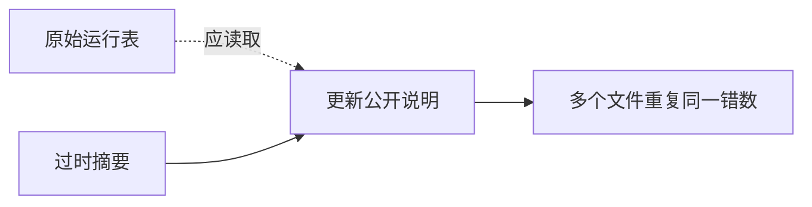

<div class="kicker">第五届机器学习会议培训班 · 2026 年 10 月 30 日</div>

# Using AI in Research:<br>Lessons from FUSION

## AI 如何进入研究工作：FUSION 的经验与教训

<div class="byline">金磊 · Jin Lei</div>
<div class="affiliation">同济大学<br>中国科学院近代物理研究所南方核科学理论研究中心</div>

<div class="source">FUSION: <a href="https://arxiv.org/abs/2609.04742">arXiv:2609.04742</a> · <a href="https://github.com/jinleiphys/FUSION">github.com/jinleiphys/FUSION</a></div>

<!--
Central message: 今天通过真实失败案例，学习怎样让 AI 交回能检查的研究工作。
图示说明：标题页，无定量图；FUSION 是本讲使用的核物理研究智能体项目。
讲述：我做核理论，日常工作包括读文献、操作老程序、检查数值和写论文。AI 已经进入这些工作。今天不介绍模型训练，也不要求大家懂核反应。我想把使用过程中真正踩过的坑讲清楚，最后给大家一份能带回自己项目的任务模板。请记住一个问题：它给了我一个结果，我凭什么接受？
Timing target: 0:00–1:00，1 分钟。
Transition: 先看一个结果，它没有崩溃，反而很像一个好结果。
-->

---

# 最贵的错误，可能长得很正常
<div class="subtitle">A plausible output can hide a wrong convention</div>

<div class="columns">
<div class="kami-card">
<h3>你看见的</h3>
<p>程序正常退出</p><p>输出完整、曲线光滑</p><p>截面数量级合理</p>
</div>
<div v-click class="kami-card">
<h3>输入里发生的</h3>
<p>半径定义用错了</p><p>同一参数对应不同物理尺寸</p><p>约定错误约放大半径 22%</p>
</div>
</div>

<div class="bottom-line">研究者需要检查输出背后的条件。</div>
<div class="source">实例：中子 + 锆-90，入射能量 50 MeV；MeV 为百万电子伏特。FUSION，arXiv:2609.04742。</div>

<!--
Central message: 约定错误可能产生完整而合理的输出，运行成功无法识别它。
图示说明：左栏是通常令人放心的信号，点击后右栏才揭示问题。22% 是这个系统的半径相对变化，不是截面的变化。
讲述：先请大家判断，左边三条能不能接受一个结果？停五秒。这个例子里程序没有报错，因为语法完全合法。输入参数的数值也没有抄错，但是参数对应的半径公式错了。不同程序可能把同一个 r0 解释成不同尺寸。AI 把文件写得很整齐，并不能替代这一层检查。后面我会把这份输入展开。
Timing target: 1:00–4:00，3 分钟。
Transition: 要理解这种风险，先把模型、工具和智能体分开。
-->

---
clicks: 4
class: scene-slide
---

# 模型、工具、智能体各做什么
<div class="subtitle">Model, tools, and agent</div>

<StepScene mode="agent" :step="$clicks" :height="334" />

<div class="bottom-line">工具把建议变成操作，操作需要结果检查。</div>

<!--
Central message: 智能体把模型生成的计划接到真实工具，并根据返回结果继续执行。
图示说明：五个点击状态依次显示模型、工具执行、输出检查、反馈循环和材料交付。蓝色标记表示当前操作位置。
讲述：这里用一个操作性定义，避免争论 agent 的哲学含义。模型说“运行这个命令”，工具执行命令，把退出状态和输出交回来，工作系统再决定继续还是修改。同一个语言模型可以放进不同系统，能做的工作也不同。当前有些网页应用也能调用工具，所以不能简单用网页和终端区分；要看它实际访问什么、执行什么、检查什么。
Timing target: 4:00–6:00，2 分钟。
Transition: 能动手以后，评价交付物的方式也要改变。
-->

---

# 三种“成功”，需要三种证据
<div class="subtitle">Execution, numerical verification, physical judgment</div>

| 问题 | 证据 | 仍然没有回答 |
|---|---|---|
| 程序跑完了吗？ | 退出状态、完整输出 | 算对了吗？ |
| 数值问题解对了吗？ | 收敛、解析解、同配置比较 | 模型合适吗？ |
| 结论有物理依据吗？ | 适用条件、数据、替代解释 | 能推广多远？ |

<div v-click class="bottom-line">每条结论，都要找到对应层级的证据。</div>

<!--
Central message: 执行、数值验证和物理判断回答不同的问题，证据不能越级使用。
图示说明：从上到下读表，一行的证据不自动覆盖下一行。
讲述：退出零说明程序认为自己完成了。加密网格后结果不变，说明这套数值设置稳定。两个独立程序一致，支持它们解了同一个配置的问题。即使这些都成立，我们还要问这个有效相互作用适不适合能量和体系，忽略的自由度会不会改变结论。今天很多故事，都是证据越过了它能支持的边界。
Timing target: 6:00–8:00，2 分钟。
Transition: 用这张表作导航，接下来走完整条工作链。
-->

---

# 今天带走两件事
<div class="subtitle">Two outcomes for this training session</div>

<div class="columns">
<div class="kami-card"><h3>一份任务模板</h3><p>明确问题、参考、验证与交付</p><p>明天就能用于自己的项目</p></div>
<div class="kami-card"><h3>一种验收习惯</h3><p>追溯每个数的来源与条件</p><p>主动给验证器制造反例</p></div>
</div>

<div class="small mt-8">
<p>10–25 分钟：组织程序经验　 ·　25–45 分钟：真实计算</p>
<p>45–65 分钟：验证器与文献　 ·　65–80 分钟：练习与模板</p>
<p>80–90 分钟：研究问题与问答</p>
</div>

<!--
Central message: 这次培训的交付是可使用的任务模板与可执行的验收方法。
图示说明：上面是两个学习目标，下面是时间表；含五分钟练习和最后五分钟问答。
讲述：我会保留核物理实例的关键细节，但每个细节都落到跨领域可用的习惯。做分子模拟、材料计算或实验数据分析的人，可以把核反应程序替换成自己的程序。练习不需要安装任何东西，大家只需判断一份交付是否足够。我们先看怎样把个人经验交给一个能够操作文件的 AI。
Timing target: 8:00–10:00，2 分钟。
Transition: 第一部分从 FUSION 到底提供什么开始。
-->

---
layout: section
---

<div class="kicker">01 · 从个人经验到可执行工作</div>

# FUSION 怎样组织程序经验
<div class="subtitle">Code-specific skills, verified inputs, explicit checks</div>

<p class="statement">把操作步骤、已知陷阱和验证方法<br>放到同一个工作包里。</p>
<p class="small">FUSION：面向核物理程序与文献工作的开源智能体项目。</p>

<!--
Central message: FUSION 将程序操作经验组织成智能体可以阅读和执行的技能。
图示说明：章节页，工作包指后面展示的说明、输入和脚本组合。
讲述：FUSION 是一个开源核物理研究智能体项目。它连接可公开获得的科学程序，也提供文献检索入口。论文发布时覆盖二十个程序。这个范围说明有共同的组织方法，但并不能证明它能替每个人处理任何研究问题。今天关注的是工作包的结构，以及其中可检查的约束。
Timing target: 10:00–11:00，1 分钟。
Transition: 先把它提供的三类帮助放在一张图里。
-->

---

# FUSION 把三类材料放到工作环境
<div class="subtitle">Programs, literature, and persistent records</div>

<div class="three">
<div class="kami-card"><h3>程序操作</h3><p>安装、修改输入、运行</p><p>附验证脚本与失败说明</p></div>
<div class="kami-card"><h3>文献入口</h3><p>本地搜索机器生成的摘要</p><p>通过标识返回论文原文</p></div>
<div class="kami-card"><h3>研究记录</h3><p>留下问题、结论与证据</p><p>个人记录独立保存</p></div>
</div>

<div class="bottom-line">复用的是操作经验，研究判断仍由研究者负责。</div>
<div class="source">论文发布版本：20 个程序，26 个技能；文献库约 6.1 万页。FUSION，arXiv:2609.04742。</div>

<!--
Central message: 程序操作、文献入口和研究记录相互支持，但不替代物理判断。
图示说明：三列是三种材料，不是三个新的语言模型。页底数字标明是论文发布版本。
讲述：一个工作环境里既能找到程序经验，也能查文献，还能记下为什么某个做法已经被否定。文献页是机器生成的入口，不是原文。私人记录应与公开仓库分开。二十个程序并不意味着二十种物理都被统一验证；每个技能的证据范围要分别阅读。后续仓库会变化，因此本讲不把页面数量当性能指标。
Timing target: 11:00–13:00，2 分钟。
Transition: 其中最小、最容易复制的单位就是一个技能。
-->

---

# 一个技能，要能回答六个问题
<div class="subtitle">A skill packages instructions, examples, and checks</div>

<div class="columns small">
<div class="kami-card"><h3>如何操作</h3><p>从哪里取得程序？</p><p>用哪个已验证输入？</p><p>怎样运行并解析结果？</p></div>
<div class="kami-card"><h3>如何验收</h3><p>有哪些已知失败方式？</p><p>与什么参考比较？</p><p>失败时怎样停止并报告？</p></div>
</div>

<div class="bottom-line">这里的 skill 是说明与脚本组合，不涉及训练模型权重。</div>

<!--
Central message: 技能要同时交代操作路径和验收条件。
图示说明：左列使任务可做，右列使交付可检查；六个问题少一个都可能留下静默错误。
讲述：很多人以为写 skill 就是写一段更长的提示词。说明确实很重要，但文字要求模型“仔细检查”没有给出检查方法。真正有用的是附上已经运行过的输入、可靠的解析方法和能拒绝错误的验证脚本。SKILL.md 是技能说明文件。它应该说明边界，不能只列成功案例。模型不必记住老程序的每一种输入格式，能找到可信样例就够了。
Timing target: 13:00–15:00，2 分钟。
Transition: 样例为什么要先验证？看两条输入生成路径。
-->

---

# 先找到有效输入，再修改它
<div class="subtitle">Edit a verified input before writing a new one</div>


<v-clicks>

- 保留输入文件与来源
- 记录哪些字段被修改
- 新任务仍需重新验证

</v-clicks>

<div class="bottom-line">样例减少格式错误，不能保证新配置正确。</div>

<!--
Central message: 从已验证输入修改，可以减少格式风险，修改后的配置仍需验证。
图示说明：箭头表示操作依赖；不能跳过差异检查，也不能把样例的通过结论搬到新配置。
讲述：老程序常有隐含顺序、结束标记、单位和默认值。从记忆写输入容易造出一种看起来像文档、却并不等于程序语法的格式。先找到真实输入，再做最小修改，错误空间会小得多。要检查差异，不只看修改后的文件。把中子改成质子，或者开启另一个耦合，并不是只换名字，验证条件也可能变化。
Timing target: 15:00–17:00，2 分钟。
Transition: 接着把安装、运行和验证串成依赖，而不是一串成功消息。
-->

---

# 每一步都要交出下一步能检查的材料
<div class="subtitle">A dependency chain with evidence at each step</div>


<div class="columns small">
<div class="kami-card"><h3>中途失败</h3><p>停止并保存退出状态</p><p>说明失败发生在哪一步</p></div>
<div class="kami-card"><h3>验证通过</h3><p>列出配置、参考和容差</p><p>保存完整输入与原始输出</p></div>
</div>

<!--
Central message: 步骤之间必须传递可检查的材料，任何缺失都不能变成成功。
图示说明：流程图表示证据的依赖，最后的保存证据使他人可以复核。
讲述：编译成功不是运行成功，运行成功不是解析成功。一个常见问题是最后一条打印命令成功，掩盖前面程序的非零退出状态。另一种是输出只有一半，解析器却拿到一个数就继续。请让每一步告诉下一步它实际产生了什么，而不是让每一步都打印 DONE。只有最终结果和它的来源一起交回来，才能审查整个链条。
Timing target: 17:00–19:00，2 分钟。
Transition: 对照参考时，还要问这个参考究竟检验哪一层。
-->

---

# 参考结果能证明什么
<div class="subtitle">Match the strength of the claim to the reference</div>

| 参考方式 | 支持什么 | 共同错误仍可能存在 |
|---|---|---|
| 同程序的作者输出 | 构建与回归复现 | 程序原有的物理错误 |
| 解析解、守恒关系 | 对应极限或约束正确 | 约束以外的错误 |
| 同配置的独立程序 | 数值实现相互支持 | 共同模型与输入错误 |
| 对照实验数据 | 模型受到数据检验 | 参数补偿、替代解释 |

<div class="bottom-line">预设容差是验收标准，物理意义需要另外说明。</div>

<!--
Central message: 参考的独立性和范围决定它能支持多强的结论。
图示说明：表中四行不是简单的高低排名，每行都有不同的盲点。
讲述：作者的参考输出很有用，能检查安装和编译是否复现原行为。但如果原程序漏掉了一项，参考也会漏掉。守恒关系更独立，却只检验那条关系。两个求解器采用不同算法，有助于发现实现错误，但如果两边拿了同一个错误势，仍会一致。拟合数据也可能由参数补偿实现。容差必须事先确定，不能看到差异后再扩大到刚好通过。
Timing target: 19:00–22:00，3 分钟。
Transition: 不需要先建一个大平台，可以从自己的最小工作包开始。
-->

---

# 从你最熟悉的一个程序开始
<div class="subtitle">Build one small, testable working package</div>

<div class="columns small">
<div class="kami-card"><h3>最小材料</h3><p>一份说明</p><p>一份已验证输入</p><p>一个可靠的运行与验证入口</p></div>
<div class="kami-card"><h3>第一次测试</h3><p>找不到依赖，能否说明？</p><p>运行失败，是否拒绝结果？</p><p>换一个干净目录，还能复现？</p></div>
</div>

<div class="bottom-line">冷启动：不依赖目标程序的既有安装、缓存或补丁，基础工具另列。</div>

<!--
Central message: 先围绕一个熟悉程序建立最小技能，再用冷启动检验隐含依赖。
图示说明：左栏是最小组成，右栏是交付前的三个真实问题。
讲述：开始时不需要组织几十个技能。选一个自己能判断结果的程序，找已有脚本，扩展它，而不是另写一套平行实现。冷启动要说明环境：有编译器，不代表有所有库。已经在作者机器跑过的脚本，可能一直借用作者的 PATH、软链接和旧输出。换一个空目录，是低成本发现这些问题的办法。后面的审计会给出真实的四类结果。
Timing target: 22:00–25:00，3 分钟。
Transition: 现在用一个具体散射计算，把所有抽象要求落到输入上。
-->

---
layout: section
---

<div class="kicker">02 · 从任务到可检查的计算</div>

# 走完一个真实计算
<div class="subtitle">A neutron scattering example, from input to verification</div>

<p class="statement">50 MeV 中子入射锆-90。<br>求总反应截面，检查它从哪里来。</p>
<p class="small">总反应截面：量化弹性散射以外过程的入射通量损失，单位为面积。
弹性：靶核内部状态不变。</p>

<!--
Central message: 一个具体计算能把任务、约定、收敛和比较逐层展开。
图示说明：中子是入射粒子，锆-90是靶核，50 MeV 是实验室入射能量。
讲述：这个例子只需要理解几个概念。入射中子可能保持靶核原状地散射，也可能进入其他过程。总反应截面量化离开弹性通道的通量，单位是面积。今天的目标是可靠地计算这个量，不提出新的核物理发现。案例是已经保存的真实输入和验证记录，本讲没有重新做科学计算。
Timing target: 25:00–26:00，1 分钟。
Transition: 用一句能验收的话写任务，比写“算一下散射”有效。
-->

---

# 先写一份能验收的任务
<div class="subtitle">Specify the calculation before the agent starts</div>

<div class="kami-card small">
<p>计算 n + 90Zr，实验室能量 50 MeV。</p>
<p>采用 KD02（Koning–Delaroche 核子光学势参数化）。</p>
<p>保留自旋轨道项：自旋与轨道运动的耦合。</p>
<p>求总反应截面 σ<sub>R</sub>，检查数值收敛。</p>
<p>用另一程序在相同参数与约定下比较。</p>
<p>交回输入、原始输出、版本与比较记录。</p>
</div>

<div class="bottom-line">光学势：描述散射与通量损失的有效相互作用。</div>

<!--
Central message: 验收从定义体系、模型、目标量、检查方法和材料开始。
图示说明：n+90Zr 是中子与锆-90；σR 是总反应截面，后面统一用“截面”。
讲述：KD02 指 Koning–Delaroche 的核子光学势参数化。大家不必记它的名字，但需要知道它是输入模型，有来源和范围。这里保留自旋轨道项，因为关掉它的基准不能自动验证开着它的配置。任务还必须先选定质量约定。后面专门比较整数质量与真实核质量，避免把两个不同问题的结果直接相减。
Timing target: 26:00–28:00，2 分钟。
Transition: 参数先从可信实现读取，再检查单位和定义。
-->

---

# 参数来源要能追溯到文件
<div class="subtitle">Read the implementation, record the source</div>


<v-clicks>

- KD02 参数从已有实现读取
- 保存生成参数的命令与版本
- 原始实现也要与定义核对

</v-clicks>

<div class="source">FUSION 公开实例：skills/fresco/examples/n90Zr-kd02-50MeV.in。</div>

<!--
Central message: 可追溯的参数来源比凭记忆重写公式更可靠，但来源本身仍需核对。
图示说明：流程从原始实现走到输入，最后单独检查物理约定。
讲述：一个模型可能熟悉 KD02 的形式，却记错系数、能量依赖或几何参数。FUSION 的实例从已有势实现读取参数。请记录来源版本，不只记“采用某某势”。原始代码也可能有精度约定，未经后缀限定的 Fortran 常数可能先按单精度解释。这里不展开语言细节，要带走的是：数据从哪个文件、哪条路径产生，必须能回答。
Timing target: 28:00–30:00，2 分钟。
Transition: 即使每个参数都正确，半径定义仍可能错。
-->

---
clicks: 3
class: scene-slide
---

# 同一个 r₀，在两个程序里可能不同
<div class="subtitle">A radius convention changes the physical input</div>

<div class="scene-formula">

$$R_{\rm sum}=r_0(A_p^{1/3}+A_t^{1/3}),\qquad R_{\rm target}=r_0 A_t^{1/3}$$

</div>

<div class="scene-definitions">Aₚ：入射粒子质量数；Aₜ：靶核质量数；r₀ 的单位为 fm（飞米，10⁻¹⁵ 米）。</div>

<StepScene mode="radius" :step="$clicks" :height="276" />

<!--
Central message: 约定不同会改变物理输入，程序不会把合法输入当错误。
图示说明：四个状态显示靶核项、添加入射粒子项、ap=0 恢复、两程序统一约定。外层线框是势的半径示意，不是硬球核边界。半径比例按公式计算，约为 1.223。
讲述：中子的质量数为一，靶核为九十，所以多出的比例是 1 除以九十的立方根，约百分之二十二。它是几何尺度变化，不是已测量的截面误差。KD02 的半径采用靶核项。若写入使用两项之和的程序而没有关闭入射粒子项，物理问题已经变了。核物理以外同样有这种错误，例如角度与弧度、体积归一化和不同的坐标定义。
Timing target: 30:00–33:00，3 分钟。
Transition: 这个物理要求，在实际文件里只落在一个很小的字段上。
-->

---

# 关键约定，落在一行真实输入里
<div class="subtitle">A small field carries a large physical assumption</div>

```text
! FRESCO potential input: target-only radius
&POT kp=1 type=0 ap=0.000 at=90.000 rc=1.200000 /
```

<div class="columns small">
<div class="kami-card"><h3>ap=0</h3><p>关闭入射粒子的半径项</p><p>是程序输入开关</p><p>不把动力学质量设为零</p></div>
<div class="kami-card"><h3>at=90</h3><p>靶核质量数</p><p>与后面的惯性质量分开</p></div>
</div>

<div class="source">FRESCO（散射求解程序）势输入：kp 为势编号，type=0 为几何与库仑设置，rc 为库仑半径系数，本例不修改。</div>

<!--
Central message: ap=0 是实现靶核半径约定的输入开关，不能靠结果看起来合理来猜。
图示说明：代码取自公开实例；kp 是势编号，type=0 是该程序的几何与库仑设置行，rc 是库仑半径系数。中子无电荷，本例不使用库仑势。
讲述：不要让大家背输入字段，重点是检查程序如何解释它。ap=0 是这份输入里关闭半径贡献的开关，不是在物理上把中子的惯性质量设成零。at=90 服务于半径定义；动力学的质量在另一个分区里指定。这两个概念若被混起来，后面跨程序比较会再次出错。可以现场打开附带的完整输入文件，指一下这行和 PARTITION 行的位置。
Timing target: 33:00–35:00，2 分钟。
Transition: 文件正确以后，运行记录要证明到底运行了哪个文件。
-->

---

# 运行记录要绑定这次输入
<div class="subtitle">Preserve the identity of a run</div>

<div class="three small">
<div class="kami-card"><h3>开始前</h3><p>程序版本与构建环境</p><p>输入文件与参数约定</p></div>
<div class="kami-card"><h3>运行中</h3><p>实际命令与工作目录</p><p>标准输出、错误与退出状态</p></div>
<div class="kami-card"><h3>结束后</h3><p>完整性与有限值检查</p><p>解析结果与原输出对应</p></div>
</div>

<div class="bottom-line">输出文件存在，不能证明它属于这一次运行。</div>

<!--
Central message: 运行身份必须绑定输入和输出，避免旧文件冒充新结果。
图示说明：三列按运行前、中、后分工；有限值指排除 NaN 和无穷大。
讲述：我们都见过程序失败后留下上一轮的输出。解析器只查“文件存在”，就把旧结果当这次结果。每次运行用独立输出目录，写清实际命令和退出状态，检查输出时间与完整性。文件摘要可以帮助定位版本，但同一可写目录里的摘要不是防篡改认证。这里要解决的是研究记录混乱和意外复用，不能把元数据检查夸成安全保证。
Timing target: 35:00–37:00，2 分钟。
Transition: 现在有了记录，再检查数值设置是否足够。
-->

---
class: compact-table
---

# 收敛：改变数值设置，结果变多少
<div class="subtitle">Convergence checks for the specified configuration</div>

| FRESCO 设置 | 总反应截面 / mb |
|---|---:|
| 径向步长 0.1 fm | 1299.18937 |
| 径向步长 0.025 fm | 1299.19061 |
| 径向步长 0.0125 fm | 1299.19061 |

<div class="small mt-5"><p>FRESCO：散射求解程序。fm：飞米，长度单位。</p><p>步长控制径向离散；匹配半径为接入远处边界条件的位置。</p><p>相同整数质量约定；匹配半径 40、60、80 fm 也稳定。
mb 为毫靶恩，1 mb = 10⁻³ barn。</p></div>

<div class="bottom-line">多位数字在这里描述数值稳定性。</div>
<div class="source">保存的验证记录：FUSION，skills/coloss/references/verification.md，Sec. 1b；本讲未重跑。</div>

<!--
Central message: 加密设置后的变化刻画数值稳定性，不能直接读成模型准确度。
图示说明：表中步长单位 fm 是飞米，1 fm 等于十的负十五次方米；匹配半径是数值积分外边界。mb 为面积单位。表中多位数字保留用于诊断。
讲述：先固定物理输入，只改一个数值设置。这里步长从 0.1 降到 0.025，再减半，结果在列出的位数稳定。还应检查外边界和角动量截断，不能只做步长。原始记录包含匹配半径扫描，COLOSS 的基函数数和外边界也做过检查。问大家：这能不能说明 KD02 在这个能量下预测实验到七位？答案不能，它只说明数值求解变化小。
Timing target: 37:00–39:00，2 分钟。
Transition: 两个程序比较前，先统一物理配置，尤其是质量。
-->

---
class: compact-table
---

# 先统一质量约定，再比较求解器
<div class="subtitle">Compare the same problem in both codes</div>

| 程序与质量约定 | 总反应截面 / mb |
|---|---:|
| FRESCO，真实核质量 | 1301.64017 |
| FRESCO，整数质量近似 | 1299.19061 |
| COLOSS，整数质量近似 | 1299.1905 |

<div class="small mt-5"><p>COLOSS：另一散射求解程序。u：原子质量单位。</p><p>真实质量：1.008665 与 89.904698 u；整数近似：1 与 90 u。</p><p>这里的质量进入动力学，与半径公式中的质量数分开。</p></div>

<div class="bottom-line">2.45 mb 的差别来自输入约定，远大于求解器差别。</div>
<div class="source">同体系、同能量、同 KD02 参数，含自旋轨道项；FUSION 验证记录 Sec. 1b。</div>

<!--
Central message: 不同质量约定计算的是不同配置，只有第二和第三行是匹配比较。
图示说明：u 是原子质量单位；真实质量相对整数近似的变化通过约化质量和波数进入动力学。
讲述：最上面与最下面相差约 2.45 mb，先别把它归给算法。换成同一个质量约定以后，FRESCO 的实轴积分与 COLOSS 的复标度求解在约 1299.2 mb 相符。原记录的两条精细数值相差约十的负四次方 mb，但我们只把它当数值比较。注意表中公开记录的小数位，不是物理可信位数。另一个能量、另一个势、另一个通道，都要重新匹配。
Timing target: 39:00–42:00，3 分钟。
Transition: 最后把这个计算到底证明了什么，说成一句范围明确的话。
-->

---

# 数值符合，结论也要有边界
<div class="subtitle">State the scope in the same sentence as the result</div>

<div class="kami-card">
<p>在 n + 90Zr、50 MeV、相同 KD02 参数与整数质量约定下，</p>
<p>两种求解方法给出约 1299.2 mb 的总反应截面。</p>
</div>

<div class="columns small">
<div class="kami-card"><h3>这条证据支持</h3><p>该配置的数值实现相互符合</p><p>所检验设置的结果已稳定</p></div>
<div class="kami-card"><h3>还需要别的证据</h3><p>模型对实验的准确度</p><p>其他体系与能量的适用性</p></div>
</div>

<!--
Central message: 结果句必须带着体系、配置和证据范围一起出现。
图示说明：上面是可以引用的结果句，下面分出仍待回答的物理问题。
讲述：准确度是接近真值的程度，精密度是重复测量或估计的离散程度，二者也不同于收敛。谈实验还要找相同靶核、能量、通道的数据；天然锆和锆-90、邻近能量不能不加说明地替换。这个实例的任务是验证工作链，不能包装成一个新物理发现。这也是今天第一个完整答案：AI 交回可检查材料以后，我们才知道它究竟完成了什么。
Timing target: 42:00–45:00，3 分钟。
Transition: 接下来更难的问题是，检查结果的脚本本身也可能错。
-->

---
layout: section
---

<div class="kicker">03 · 当验证器给出错误结论</div>

# 检查者，也需要被检查
<div class="subtitle">Test the verifier with counterexamples</div>

<p class="statement">“验证通过”是一条结论。<br>它也需要能被推翻的测试。</p>

<!--
Central message: 验证器也是程序，必须用反例检验它的拒绝能力。
图示说明：章节页，验证器指解析和判断输出是否满足验收条件的脚本。
讲述：前面假设检查脚本会正确判断，但这个假设最容易失守。一个验证器报告通过，可能因为真的符合，也可能因为该检查根本没有执行。它的通过记录不能拿来证明自己可靠。最有效的问题是：如果我删掉输出的一半，它还会不会通过？接下来从几种很小的反例开始。
Timing target: 45:00–46:00，1 分钟。
Transition: 先看四种应当拒绝的输入。
-->

---

# 给验证器制造四种失败
<div class="subtitle">Four counterexamples that should be rejected</div>

| 人为改变 | 必须发生的行为 |
|---|---|
| 删除输出或一条关键记录 | 拒绝，指出缺失内容 |
| 将一个数改成 NaN（非数值） | 拒绝非有限值 |
| 程序异常退出但留下输出 | 拒绝，保留退出状态 |
| 留下上一轮的正确输出 | 拒绝把旧结果当新结果 |

<div v-click class="bottom-line">误报通过（false pass）：错误结果仍被接受。</div>

<!--
Central message: 可靠验证器应拒绝预先构造的错误，而不只是接受一个好样例。
图示说明：四行是测试设计，不是新测量数据；NaN 表示不是一个有效数值。
讲述：测试应先明确预期，不能跑完以后再解释结果。删一条关键记录，不是随机破坏一大堆文件，否则不知道哪条检查起作用。异常退出的程序可能先打印了漂亮的结果，验证器也要拒绝。正常控制要保留，防止我们写了一个拒绝一切的验证器。对某些任务，不完整输出允许局部结果，但必须显式标成不完整，不能宣布整项任务通过。
Timing target: 46:00–48:00，2 分钟。
Transition: 这些并不是想象出来的边角风险，真实修复中出现过。
-->

---
class: compact-table
---

# SMASH：修复也会带来新错误
<div class="subtitle">Five review rounds of a transport-code wrapper</div>

| 审查轮次 | 当轮缺陷数 | 其中来自上一轮修复 |
|---|---:|---:|
| 1 | 19 | 0 |
| 2 | 2 | 2 |
| 3 | 6 | 4 |
| 4 | 2 | 2 |
| 5 | 1 | 0 |

<div class="bottom-line">第五轮未发现新的误报通过，但仍发现一次错误拒绝。</div>
<div class="source">SMASH：模拟粒子碰撞与演化的程序；此表审查外围运行和验证脚本。FUSION 验证记录。</div>

<!--
Central message: 多轮修复没有自动提高可靠性，修复本身反复引入同类缺陷。
图示说明：数字是这次包装脚本审查的发现数量，不能解释为语言模型总体错误率。
讲述：SMASH 用来模拟强子输运，本讲不讨论它的物理结果，只讨论如何驱动并检查它。五轮总计三十个发现。第二、第三、第四轮里，上一轮修复分别造成二、四、二个问题。第五轮唯一的问题是把合法输入误拒绝，未发现新的误报通过。这是一个有范围的停止条件，不是“软件已经没有错误”。记录显示发现来自实际运行和反例测试，单靠检查文字没有找出它们。
Timing target: 48:00–51:00，3 分钟。
Transition: 展开其中一个很普通的配置字段，就知道修复为什么会失效。
-->

---

# 读不懂字段，检查竟然被跳过
<div class="subtitle">An unreadable value must not disable verification</div>

```yaml
# A: independent configuration example
Nevents: 2
# B: independent configuration example
Nevents: 2  # two events requested
# C: independent configuration example
Nevents: "2"
```

<div class="columns small">
<div class="kami-card"><h3>曾经的错误路径</h3><p>读取失败</p><p>跳过事件数检查</p><p>仍报告成功</p></div>
<div v-click class="kami-card"><h3>修复后的要求</h3><p>字段存在却无法读取</p><p>停止并说明原因</p><p>同时测试合法写法</p></div>
</div>

<div class="source">三行展示三个独立配置写法，并非同一文件的重复键；Nevents 是请求的事件数。</div>

<!--
Central message: 无法解析配置时，必须报告无法验证，不能默默跳过检查。
图示说明：三个独立示例都是底层程序能读取的形式；包装脚本却曾读错注释或引号。
讲述：第二行的注释使包装脚本读到“2 # two events requested”，它判断这不是整数，便没有传递期望事件数。第三行的引号也造成同样问题。即使请求两件事而只输出一件，脚本仍通过。只补注释或去引号只能修这个样例。真正要修的类是：字段明明存在却不能理解时，应当停止。还要测试程序接受的合法边界，防止错误拒绝。
Timing target: 51:00–53:00，2 分钟。
Transition: 怎样证明新的检查真的触发了？把它暂时关掉。
-->

---
clicks: 4
class: scene-slide
---

# 关掉检查，测试应当翻转
<div class="subtitle">Prove that a test exercises the intended guard</div>

<StepScene mode="verifier" :step="$clicks" :height="334" />

<div class="bottom-line">不仅问“测试通过吗”，还要问“它检验了哪条规则”。</div>

<!--
Central message: 临时关闭目标检查后，测试应失效，从而证明它不是被其他检查挡住。
图示说明：五个状态依次显示完整与缺记录的输出、拦截反例、隔离副本关闭检查、断言失败、恢复检查并通过合法对照。纸张移动表达验证流程，不代表科学数据。
讲述：这一步的两个“通过”容易混。验证器正确拒绝坏输入，测试应通过；把检查拿掉，验证器误接受坏输入，测试应失败。有一个删事件的测试，实际上留下了不合法的孤立记录，被另一条检查拦住，根本没有检验事件数。还有一个手写控制例子自身不守恒。这样的测试看起来都很努力，却没有验证目标。隔离副本避免碰生产脚本。
Timing target: 53:00–56:00，3 分钟。
Transition: 检查可以逐条验证，修复也要逐轮审计。
-->

---

# 每次修复，都对照修复前的版本
<div class="subtitle">Audit the repair as a possible transmission path</div>

<div class="three small">
<div class="kami-card"><h3>原问题</h3><p>保留能复现它的输入</p><p>确认修复后会拒绝</p></div>
<div class="kami-card"><h3>新差异</h3><p>检查这次修改影响哪里</p><p>测试相邻合法配置</p></div>
<div class="kami-card"><h3>同类位置</h3><p>搜索共享的处理模式</p><p>检查是否也有同样缺陷</p></div>
</div>

<div class="bottom-line">“上一轮的问题已修好”与“这轮没有新问题”要分别检查。</div>

<!--
Central message: 修复应同时接受原反例、相邻合法输入和同类代码位置的审查。
图示说明：三列是独立的审查任务，不能只关闭原问题单。
讲述：把不受限的整数改成十八位限制，拦住了超大数，也误拒绝了合法的十九位 int64 最大值。这就是修复满足一个例子，却改变了合法域。要比较本轮与上轮的实际差异，追踪哪些行为变了。输入解析的相同模式如果在别处出现，也要搜出来。这样做比让另一个模型笼统“再检查一下全部代码”更有目标。
Timing target: 56:00–58:00，2 分钟。
Transition: 安装统计也要回到实际表格，不能从总结句继续转抄。
-->

---

# 冷启动审计，要保留四种结果
<div class="subtitle">Twenty paths exercised is not twenty unattended passes</div>

| 审计结果 | 程序数 |
|---|---:|
| 首次无人值守安装与验证通过 | 8 |
| 正确停止并报告缺依赖 | 4 |
| 修复移植问题后通过 | 5 |
| 受测试框架限制，需另外处理 | 3 |

<div class="bottom-line">20 条安装路径被执行过，不能写成 20 个都自动通过。</div>
<div class="source">原始表：2026-08 Linux 冷启动 results-round1.tsv、results.tsv；编译工具已存在，部分库缺失。</div>

<!--
Central message: 安装路径被测试与无人值守通过是不同指标，统计必须保留失败类别。
图示说明：四类互斥，八加四加五加三等于二十；正确停止不算安装完成。
讲述：首次路径中没有工具缺失的八个通过；四个分别缺 GSL、HDF5、Julia 或 MPI。五个暴露了路径、Makefile、临时文件和平台差异等移植问题。另三个是 FRESCO、CCFULL、TALYS，测试框架没有完成预期验证或调用方式不对。NLAT 还遭遇了超时，最终原始表记了六千五百秒。这说明测试框架也要审计。不要把人工后续处理后的成功，改写成最初自动通过。
Timing target: 58:00–61:00，3 分钟。
Transition: 这组数字还发生过一次传播错误，值得单独说。
-->

---

# 四个文件一致，仍然可能一起错
<div class="subtitle">Consistency does not establish correctness</div>



<div class="small mt-6"><p>一次清理过时数字的修改，从旧摘要取数。</p><p>文件更一致了，来源却更远了。</p></div>

<div class="bottom-line">更新结论时，从产生它的材料取值。</div>

<!--
Central message: 转抄一致性可能放大错误，准确更新必须回到产生结论的材料。
图示说明：虚线是本应采用的来源，实线是错误传播路径；不是说文件一致没有价值。
讲述：清理 README 过时说法时，更新者读了开发记录摘要，沿用“十三干净、四个缺依赖”并传播到多个文件。数字逐渐一致，却没有真实反映首轮结果。最后是加法发现不对，十三加四少了三个。如果那组错数恰好相加为二十，算术也救不了。规则是，从原始表取数；如果原始表找不到，写不可核验，而不是选择看起来最新的摘要。
Timing target: 61:00–63:00，2 分钟。
Transition: 同样的来源问题，也发生在文献检索入口。
-->

---

# 文献关系，也是需要验证的数据
<div class="subtitle">Search a summary, verify the paper and its relation</div>

<div class="columns small">
<div class="kami-card"><h3>引用链接可能错</h3><p>用作者与年份猜目标论文</p><p>该子集中，约 18.6% 指向正确论文</p></div>
<div class="kami-card"><h3>摘要关系可能错</h3><p>“比较”被标成“反驳”</p><p>返回引用上下文重新判断</p></div>
</div>

<div class="bottom-line">摘要用于找到线索，引用与论证回到论文原文。</div>
<div class="source">18.6% 只指 2026-09 作者年份猜测引用链接子集，不是整个文献库；该路径已移除。</div>

<!--
Central message: 文献的身份链接和关系判断分别会错，搜索结果必须返回原文核验。
图示说明：左列的比例仅针对错误风险高的作者年份猜测子集，右列是语义关系误分类。
讲述：引用图是论文之间的引用网络。某条链接的目标身份错了，后面再精细地分析“支持还是反驳”也无用。我们对作者年份猜测子集审计，正确率约百分之十八点六，之后移除该路径，使用 INSPIRE 文献元数据服务的参考列表。身份对了，仍要看上下文，机器曾把普通比较过度判成反驳。DOI 是文献持久标识，arXiv 是预印本库；标识帮助定位，原文才提供论证。
Timing target: 63:00–65:00，2 分钟。
Transition: 这些失败最后应当变成你可以直接写进任务里的要求。
-->

---
layout: section
---

<div class="kicker">04 · 把经验用于自己的研究</div>

# 给 AI 一份能验收的工作
<div class="subtitle">A practical task contract</div>

<p class="statement">把“帮我做”写成<br>“做什么，怎样检查，交回什么”。</p>

<!--
Central message: 清楚的任务契约把研究者的验收要求落实到 AI 的实际工作。
图示说明：章节页，契约是明确约束的任务说明，不涉及法律含义。
讲述：这不是提示词花活。你要告诉它什么问题值得解决，哪个材料可以作为参考，允许用多少资源，遇到什么情况应停止。然后让它交回能供你审查的材料。一个不懂结果的人，也许能写语法很好的要求；但验收条件必须来自对问题的理解。我们先看最常见的模糊任务怎么改。
Timing target: 65:00–66:00，1 分钟。
Transition: 把三种模糊请求改成可检查的工作。
-->

---

# 把模糊请求改成明确交付
<div class="subtitle">Define the evidence, not just the desired conclusion</div>

| 模糊请求 | 可检查的交付 |
|---|---|
| 帮我找支持这个想法的文献 | 找支持与反例，逐项给原文位置 |
| 让结果更接近实验 | 先查模型与约定，再拟合并报残差 |
| 帮我修好验证脚本 | 复现缺陷，修复，加入隔离反例 |

<div v-click class="bottom-line">不要让 AI 只搜集你希望得到的答案。</div>

<!--
Central message: 任务应要求证据与反例，而不只要求得到期望结论。
图示说明：三行是不同研究任务的改写，避免把输出形式当作验收标准。
讲述：如果你说“找支持”，系统就可能选择支持文本；换成查支持和反例，才给反驳留了入口。让拟合更好之前，要确认单位和模型，不能用参数吸收约定错误。拟合残差是模型与样本的差，不是“学习准确度”。修脚本要从可复现缺陷开始，附一个只触发目标规则的反例。每个要求都应该回答，研究者下一步如何判断这项工作完成了。
Timing target: 66:00–68:00，2 分钟。
Transition: 任务完成的方式，还要受资源与权限约束。
-->

---

# 资源预算与权限写在任务里
<div class="subtitle">Set boundaries before execution</div>

<div class="columns small">
<div class="kami-card"><h3>资源</h3><p>先查现有实现与输入</p><p>约定机器、时间与费用上限</p><p>超出预算，报告后再决定</p></div>
<div class="kami-card"><h3>操作范围</h3><p>在隔离目录做修改</p><p>记录外部数据与工具使用</p><p>删除、提交与发布单独授权</p></div>
</div>

<div class="bottom-line">项目规则文件 AGENTS.md：保存这些长期约定。</div>

<!--
Central message: 把计算资源和操作边界写清楚，能减少无效运行与意外修改。
图示说明：左列控制计算成本，右列控制影响范围；AGENTS.md 是可被智能体读取的项目规则文件。
讲述：科学计算最先要写明本次要知道什么。跑一下看看的小测试也要有问题，昂贵扫描更不能空跑。先查已有代码，十行改动能完成就不要另建一套。依赖环境放到项目外，避免同步目录装进几十万个可再生文件。公开材料可以用于演示，保密审稿材料应遵守适用的保密规定，不能直接作为云端工具输入。权限要求应具体到本次动作。
Timing target: 68:00–70:00，2 分钟。
Transition: 验收时，你要能找到一份完整的交付目录。
-->

---

# 交付目录，要能支持下一次复核
<div class="subtitle">Preserve inputs, outputs, checks, and unresolved issues</div>

```text
result/
  inputs/           实际使用的输入
  outputs/          原始输出与退出状态
  checks/           参考、容差与检查结果
  report.md         结论、范围、仍未解决的问题
```

<div class="small mt-6"><p>说明中记录版本、运行命令和材料来源。</p><p>记录失败尝试，防止下次重走已否定的路径。</p></div>

<div class="bottom-line">报告中的关键数，要能定位到原始输出。</div>

<!--
Central message: 一份研究交付应包含输入、原输出、验证证据和有边界的结论。
图示说明：这是教学用目录示例，可并入现有项目结构，不要求每个项目增加四个目录。
讲述：不要只收一张图或一段漂亮摘要。复核者需要找得到真实运行的输入、程序版本、命令、原始输出和解析规则。报告里有一个数，就给它对应的材料位置。失败尝试也要记录，特别是已经证伪的解释。可以把它们压到一份短报告，不要过度工程化。下一次对话换了模型，甚至换了人，这些记录仍能把工作接起来。
Timing target: 70:00–72:00，2 分钟。
Transition: 接下来大家用两分钟看一份交付，判断能否接受。
-->

---

# 练习：这份“通过”能接受吗
<div class="subtitle">Exercise, 2 minutes of individual review</div>

<div class="kami-card small">
<p>任务：在相同设置下，用两个程序比较一个结果。</p>
<p>交付：“A = 1301.6，B = 1299.2，差别小于 1%，通过。”</p>
<p>附件：一张曲线图、一个 PASS 文件。</p>
<p>说明：“A 本轮退出非零，但输出文件存在。”</p>
</div>

<div class="bottom-line">写下三个最先要问的问题，提出一个最小复核动作。</div>

<!--
Central message: 接受结论前要检查运行有效性、配置匹配和数字来源。
图示说明：本页是人为构造的教学交付，不是前面真实实例的原始日志；练习给出的 1% 未说明来源。
讲述：请每个人先独立写三个问题，邻座再讨论。不要只回答“不可信”，给一个具体动作，例如取两份实际输入比对质量约定，或要求在空输出目录重跑。两分钟内不要揭示答案。问两个听众各说一句，先收集他们选择的优先级。这里故意混合了数值接近、非零退出和旧文件三种诱导，目的不是找最长的清单，而是识别第一步该做什么。
Timing target: 72:00–74:00，2 分钟。
Transition: 对照一个有顺序的验收答案。
-->

---

# 先修复证据链，再讨论百分比
<div class="subtitle">Exercise answer and the limits of a second model</div>

<v-clicks>

1. 保存 A 的错误与输出，诊断后隔离重跑。
2. 比对实际输入，统一参数、单位与约定。
3. 回到原输出，核实数值、完整性与容差。

</v-clicks>

<div class="kami-card small mt-5"><p>第二个模型可帮助找反例。</p><p>若它只读第一份摘要，仍可能共享同一错误。</p></div>

<div class="bottom-line">独立性来自证据路径，不能只靠模型名字。</div>

<!--
Central message: 验收要先恢复有效运行和可追溯输入，另一个模型的同意不能替代这些材料。
图示说明：三步按优先顺序展开；第二个模型部分指出独立审查的条件。
讲述：1% 是否合理，任务没有给依据；但更早的问题是 A 这次没正常结束。可局部保留的输出也必须明确标为不完整，不能声称完成整项比较。换一个空目录有效重跑后，再查质量、单位、截断和版本。让第二个模型审查时，给原输入、原输出和任务，让它主动找反例。如果只给第一模型写的摘要，两个模型可能重复同一个遗漏。本次冷读检查也只检验可理解性，不是独立科学验证。
Timing target: 74:00–77:00，3 分钟。
Transition: 用一页模板把这些要求集中起来。
-->

---

# 一份可以直接复制的任务模板
<div class="subtitle">A reusable task template</div>

<div class="kami-card small">
<p><strong>问题：</strong>本次要回答什么，什么结果会改变判断？</p>
<p><strong>起点：</strong>先找现有代码与已验证输入，列出来源。</p>
<p><strong>范围：</strong>允许改哪些文件，使用什么资源，何时停止？</p>
<p><strong>验证：</strong>固定参考与容差，检查收敛和失败反例。</p>
<p><strong>交付：</strong>输入、版本、原输出、检查结果与剩余问题。</p>
</div>

<div class="bottom-line">把领域判断填进去，这份模板才有用。</div>

<!--
Central message: 模板必须填入具体研究问题和领域验收条件，不能只是通用措辞。
图示说明：五行对应问题、起点、边界、验证和交付；随讲稿提供可复制文本与实例。
讲述：例如这里的验证不是写“确保准确”，而是步长减半、外边界增大、另一求解器采用相同质量约定；脚本反例是缺行、非有限值和异常退出。模板不要膨胀成一页又一页规则，只保留会改变实际行为的内容。让它先给出已有输入的来源和最小修改，研究者审核高成本运行之前的物理设置。随后模型去执行并交回材料。
Timing target: 77:00–80:00，3 分钟。
Transition: 最后回到更上游：我们究竟要把执行能力用在哪个问题上？
-->

---
layout: section
---

<div class="kicker">05 · 从执行效率回到研究问题</div>

# 工具验证，需要已知结果或约束
<div class="subtitle">A validated tool still needs a scientific question</div>

<p class="statement">工具验证要复现已知结果，<br>或满足可检验的约束。<br>研究发现要回答仍未知的问题。</p>

<!--
Central message: 工具验证与研究发现的目的不同，复现成功不会自动产生新发现。
图示说明：章节页，两句分别说明验证和发现的必要条件。
讲述：这也是我自己研究里付出过代价的一点。一个高效工具容易让我们从工具出发，再挑一个容易验证的物理问题来展示。已知答案能检验工具，很适合写清楚边界的方法工作。但如果再把这个展示写成发现，就会超出证据。本讲的散射计算正是工具验证，给出的结果不应被包装成新的核结构认识。
Timing target: 80:00–81:00，1 分钟。
Transition: 启动研究前，写一句允许答案出乎意料的话。
-->

---

# 开始前，写出可能被推翻的问题
<div class="subtitle">A pre-launch scientific question</div>

<div class="kami-card">
<p>做完这项工作，我会知道关于研究对象的 X。</p>
<p>目前认为答案是 Y。</p>
<p>证据也可能使我接受另一种答案。</p>
</div>

<div class="bottom-line">写不出来，就把任务定位为有预算上限的工具工作。</div>

<!--
Central message: 研究任务需要可被证据改变的判断，工具任务则应诚实限定范围与预算。
图示说明：X 和 Y 是待填写的普通占位符，不是新定义的物理量。
讲述：请把对象写具体，例如某个反应机制是否主导某个观测量，或某项缺失相互作用是否改变数据解释。不要写“提高计算效率”，那是工具目标。也不要写成不管结果是什么都证实方法有用。工具工作本身有价值，但要限定投入，知道验收后就关闭。AI 可以加快搜证和计算，研究者必须决定哪个未知值得这些资源。
Timing target: 81:00–82:00，1 分钟。
Transition: 把今天的两条结论收束到最短。
-->

---

# 让 AI 交回工作，让证据支持结论
<div class="subtitle">Two conclusions to carry back to your project</div>

<div class="columns">
<div class="kami-card"><div class="big">01</div><h3 class="mt-4">每个结果附证据</h3><p>输入、版本、原输出</p><p>参考、条件与验证范围</p></div>
<div class="kami-card"><div class="big">02</div><h3 class="mt-4">每个验证附反例</h3><p>证明它会拒绝错误</p><p>修复之后再审查差异</p></div>
</div>

<div class="bottom-line">研究者决定问题与物理解释，AI 执行可检查的工作。</div>

<!--
Central message: 可信研究操作需要结果的证据链和验证器的反例测试。
图示说明：两张编号卡是全场两条最终结论。
讲述：如果大家只记两句话，记这两条。数值有出处，比较有条件，结论有范围；检查要能拒绝坏输入，并经得住修复后的再次审查。今天所有案例都回到这两件事。研究者的角色不是给每个操作点确认，而是把问题、模型、验收条件和解释管住，再让工具系统完成执行与记录。
Timing target: 82:00–83:00，1 分钟。
Transition: 资源和实践入口在下一页，讲稿中也给出可复制模板。
-->

---

# 从一个已验证任务开始
<div class="subtitle">Resources and the next practical step</div>

<div class="kami-card small">
<p>论文：<a href="https://arxiv.org/abs/2609.04742">arxiv.org/abs/2609.04742</a></p>
<p>代码：<a href="https://github.com/jinleiphys/FUSION">github.com/jinleiphys/FUSION</a></p>
<p>文档：<a href="https://vibeinscience.com">vibeinscience.com</a></p>
<p>联系：jinl@tongji.edu.cn</p>
</div>

<div class="bottom-line">选一个熟悉程序，复现一次，再制造一次应被拒绝的失败。</div>

<!--
Central message: 听众可从一个熟悉程序的基准与反例开始实践。
图示说明：链接为公开论文、代码和文档；本地讲稿另带离线文件。
讲述：上手时选自己能判断的程序。先复现，再删一条输出或者触发一次异常退出，看验证器是否拒绝。这一小步比一次接通所有工作流更有价值。FUSION 是作者日常使用并公开的基础设施，外部用户的使用反馈仍然重要，不把当前证据夸成大规模用户验证。会后可用仓库的单个技能，不必先部署整个平台。
Timing target: 83:00–85:00，2 分钟。
Transition: 最后五分钟留给问题，可以从你自己的工作流提问。
-->

---
layout: center
---

# 哪一步，最需要你来判断？
<div class="subtitle">Questions and discussion</div>

<p class="statement">问题选择　 ·　模型假设<br>验收证据　 ·　物理解释</p>

<p class="mt-10">谢谢。</p>

<!--
Central message: 听众应能辨认自己工作流中必须由研究者判断的环节。
图示说明：四个提示词提供问答入口。
讲述：邀请大家从自己的项目出发，例如用两个求解器比较、训练数据如何追溯、实验误差怎样进入模型。若无人提问，可以问：你们最常接受的交付，是图、数值还是原始记录？针对性地把问题落到证据路径。不要承诺未知程序必然能用一个技能解决。需要更多细节时可跳到备用页。
Timing target: 85:00–90:00，5 分钟问答。
Transition: 若问到随机程序、术语差别、版本维护或如何控制演示，请用备用页。
-->

---
layout: default
routeAlias: bk-random
---

# 备用：固定随机种子仍可能不同
<div class="subtitle">Monte Carlo checks need a stated statistical scope</div>

| 同一源代码、同一种子、同一配置 | macOS | Linux |
|---|---:|---:|
| SMASH，两事件的粒子记录数 | 990 | 978 |
| 净重子数，两事件合计 | 788 | 788 |
| 净电荷数，两事件合计 | 316 | 316 |

<div class="small mt-5"><p>表中为两事件合计；净重子数为重子（如质子、中子）减反重子数。</p><p>粒子记录数是输出条目数；两事件不足以判断粒子产额。</p><p>实际逐事件检查守恒，合计符合不能排除正负抵消。</p></div>
<div class="source">FUSION，SMASH verification.md；数值为已保存平台比较。</div>

<!--
Central message: 随机模拟的跨平台样本可能不同，检查需区分逐事件约束与统计观测量。
图示说明：同一种子不保证跨平台随机轨迹相同。守恒数是两个事件相加的展示，实际检查逐事件执行。
讲述：舍入差异可能改变后续随机分支，从而产生不同事件轨迹。不能拿两个事件的产额当稳健的物理参考，也不能因两平台不同就判程序坏了。这里重子数和电荷是严格记账锚点，但两事件相加会掩盖正负抵消，因此实际验证逐事件检查。若研究目标是产额，需足够事件、统计误差和分布比较。
Timing target: 按问题选用，约 2 分钟，不计入主讲时间。
Transition: 回到提问对应的主讲页。
-->

---
layout: default
routeAlias: bk-terms
---

# 备用：四个词分开使用
<div class="subtitle">Accuracy, precision, residuals, and convergence</div>

| 词 | 含义 | 常见混用 |
|---|---|---|
| 准确度 accuracy | 接近真值的程度 | 把训练残差当准确度 |
| 精密度 precision | 重复结果或估计的离散程度 | 用小散布代替正确模型 |
| 拟合残差 fit residual | 模型与样本的差 | 代替样本外性能与区间校准 |
| 数值收敛 convergence | 加密设置后结果稳定 | 代替模型的物理正确性 |

<div class="small mt-5"><p>区间校准：预测区间的标称覆盖率与实际覆盖率相符。</p></div>

<!--
Central message: 不同评价词对应不同证据，不能为了句子好看互换。
图示说明：表是术语定义与常见误用，无定量图。
讲述：训练集残差小，只说明训练样本拟合好。对一个概率预测，还要检查它报出的区间是否校准，例如标称覆盖率是否与实际覆盖率相符。确定性求解器的步长收敛，则检查离散化误差，不能当模型对实验的准确度。说清评价量，使读者知道你究竟测了什么。
Timing target: 按问题选用，约 2 分钟。
Transition: 回到证据分层页或听众问题。
-->

---
layout: default
routeAlias: bk-version
---

# 备用：讲稿版本也要能复核
<div class="subtitle">Maintain a talk as an evidence-bearing artifact</div>

<div class="columns small">
<div class="kami-card"><h3>保存的材料</h3><p>实际使用的输入与验证记录</p><p>冷启动审计原始表</p><p>公开论文与仓库版本</p></div>
<div class="kami-card"><h3>更新时检查</h3><p>数字从产生它的材料取值</p><p>对照前一轮讲稿的修改</p><p>确认网页与 PDF 都正确</p></div>
</div>

<div class="bottom-line">材料与结论一起保留，后续更新才能检查。</div>

<!--
Central message: 讲稿与说明也是结论传播路径，更新时需要保留证据和版本范围。
图示说明：两列分别说明归档材料与更新检查。
讲述：本讲引用公开论文来说明设计，数值细节则采用保存的输入与验证记录，冷启动分类从原始表重建。机器生成的语义关系不等于权威文献事实。后续扩大库规模不改变今天的核心结论，因此正文不堆新计数。讲稿更新也会传播错误，所以最后看渲染之外还要检查改动与来源。
Timing target: 按问题选用，约 1 分钟。
Transition: 回到主讲资源页。
-->

---
layout: default
routeAlias: bk-demo
---

# 备用：现场演示应当能离线讲完
<div class="subtitle">An offline demonstration with a live option</div>

<div class="three small">
<div class="kami-card"><h3>默认</h3><p>打开保存的输入</p><p>指认约定与数值设置</p><p>对照已保存验证记录</p></div>
<div class="kami-card"><h3>可选现场操作</h3><p>在隔离目录运行</p><p>使用会前已验证程序</p><p>保留输出与退出状态</p></div>
<div class="kami-card"><h3>出现故障</h3><p>显示实际错误</p><p>切回离线材料</p><p>不把旧输出说成新运行</p></div>
</div>

<!--
Central message: 离线真实材料保证教学完整，现场运行不能改变证据的身份。
图示说明：三列对应默认路径、现场可选路径和故障回退。
讲述：现场不装新依赖、不临时开放服务器权限，也不等待模型网络请求。若会前配置好远程程序，可选择运行这一份输入；未经会前验证则只演示文件。切回保存记录时明确说这是历史记录。真实错误也是课程材料，但不要让排障吞掉练习与问答时间。
Timing target: 按问题选用，约 1 分钟。
Transition: 回到问答页。
-->
